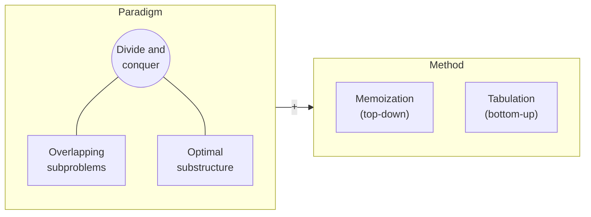

import RecursionDemo from '@components/RecursionDemo.astro';
import FibMemoDemo from '@components/FibMemoDemo.astro';
import DpTableDemo from '@components/DpTableDemo.astro';
import DpGridDemo from '@components/DpGridDemo.astro';
import PathDpDemo from '@components/PathDpDemo.astro';

> In Topic 01 we saw why recursive Fibonacci is slow. The culprit was not
> recursion but **computing the same value over and over**.  
> This topic keeps that promise. Just writing down each answer once turns
> exponential time into linear time.  
> We apply the idea to coin change, the longest increasing subsequence, grid
> paths, shortest paths, and the 0/1 knapsack in turn, and then walk the
> table backwards to recover the choices that built each answer.

## The problems dynamic programming solves \{#what}

[[dynamic-programming|Dynamic programming]] resembles
[[divide-and-conquer|divide and conquer]] in that it splits a problem into
smaller ones. The difference is that the smaller problems **overlap**.
Solving overlapping problems afresh every time repeats the same work
countless times, so instead we **store each answer once and reuse it.**



- **Overlapping subproblems**: the same small problem shows up many times.
  Fibonacci's $$F(3)$$ is one.
- **Optimal substructure**: the optimal solution to a large problem is made of
  optimal solutions to smaller ones. That is what lets us combine small
  answers into a large one.
- There are two ways to store answers:
  [[memoization|memoization]], which keeps the recursion and writes answers
  down, and [[tabulation|tabulation]], which fills a table upward from the
  smallest problems.

The "dynamic" in the name does not mean something changes at run time.
Richard Bellman recalled choosing the name in the 1950s so that it would
smell less of mathematics to the people reviewing his funding. Read it as
**"solving by filling answers into a table."**

## Fibonacci, again \{#fibonacci}

We bring back Topic 01's recursive Fibonacci. The code is the definition
transcribed directly.

```plaintext
ALGORITHM FibRecursive(n)
    if n <= 1 then
        return n
    return FibRecursive(n-1) + FibRecursive(n-2)
```

Let us follow the calls for $$F(5)$$ one step at a time. A node that
recomputes a value already computed turns red.

<RecursionDemo n={5} />

Computing $$F(5)$$ alone took **15** calls. Only 6 of them are distinct values,
$$F(0)$$ through $$F(5)$$. Counting how often each term is computed gives this.

| Term | Calls | of which $$F(3)$$ | of which $$F(2)$$ |
| --- | --- | --- | --- |
| $$F(0)$$, $$F(1)$$ | 1 | | |
| $$F(2)$$ | 3 | | 1 |
| $$F(3)$$ | 5 | 1 | 1 |
| $$F(4)$$ | 9 | 1 | 2 |
| $$F(5)$$ | 15 | 2 | 3 |

The call count grows as $$C(n) = C(n-1) + C(n-2) + 1$$. As we saw in Topic 01,
$$C(n) = 2F(n+1) - 1$$, which grows by about 1.6 times each time $$n$$ goes up
by one. The call tree is not a complete binary tree, but the
[[time-complexity|time complexity]] still grows like $$O(2^n)$$.

The loop in Topic 01, by contrast, carries just the two previous terms
forward and computes each term once: time $$O(n)$$, space $$O(1)$$. Can we get
that while keeping the shape of the recursion?

### Memoization: write the answer down \{#memoization}

**Memoization** is just what the name says: **take a memo**. We keep the
recursion as it is, and the function writes its answer into a table right
before returning it. The next time the same value is requested, it comes out
of the table instead of branching again.

1. If $$n \le 1$$, return the value itself, as Fibonacci's definition says.
2. If the memo holds a value other than -1, that is, a value already written
   down, return it.
3. Otherwise recurse, passing the memo along.
4. Write the result into the memo and return it.

Let us run the memoized recursion over the same tree. Yellow marks a call
answered from the memo, and dashed lines mark branches that are **never called
at all** thanks to it. Watch the moments when a value is written into the table
on the left and when it is read back.

<FibMemoDemo n={5} />

Calling $$F(5)$$ goes down the left branch to $$F(4)$$, $$F(3)$$, and $$F(2)$$. Up
to this point the memo is empty, so it is exactly the plain recursion. What
changes is the way back up.

- $$F(2) = 1$$ is computed and written into `memo[2]`.
- $$F(3)$$ adds its right child $$F(1)$$, becomes 2, and is written into `memo[3]`.
- When $$F(4)$$ calls its right child $$F(2)$$, `memo[2]` already holds 1.
  It returns at once **without branching again**.
- $$F(5)$$'s right child $$F(3)$$ also comes out of `memo[3]`. The four calls the
  plain recursion would have made below $$F(3)$$ disappear.

In the end there are **9** calls. Each term is computed the first time it is
met and only read the second time, so for $$n \ge 1$$ there are $$2n - 1$$
calls.

- Pseudocode

```plaintext
ALGORITHM FibMemo(n, memo)
    if n <= 1 then
        return n
    if memo[n] != -1 then             // already computed
        return memo[n]                // return at once, no branching
    memo[n] <- FibMemo(n-1, memo) + FibMemo(n-2, memo)
    return memo[n]                    // write it down before returning
```

- C implementation

```c
long long fibMemo(int n) {
    calls++;
    if (n <= 1) {
        return n;
    }
    if (memo[n] != -1) {
        return memo[n]; /* already computed: no more branching */
    }
    memo[n] = fibMemo(n - 1) + fibMemo(n - 2);
    return memo[n];
}
```

`n <= 1` returns before looking at the memo, so `memo[0]` and `memo[1]` stay
-1 to the end. The demo's table shows the same.

- **Time** $$O(n)$$: each value is computed only once.
- **Space** $$O(n)$$: the memo array, plus a recursion stack up to $$n$$ frames deep.

### Tabulation: fill from the smallest \{#tabulation}

**Tabulation** reverses the direction. Instead of descending from the big
problem, it **fills the table completely, upward from the smallest problems.**
One loop and one array are enough. The earlier cells being referenced are blue,
and the cell being filled is orange.

<DpTableDemo problem="fib" n={5} />

```plaintext
ALGORITHM FibTabulation(n)
    if n <= 1 then
        return n
    dp[0] <- 0
    dp[1] <- 1
    for i <- 2 to n do
        dp[i] <- dp[i-1] + dp[i-2]    // the two cells before are already filled
    return dp[n]
```

- **Time** $$O(n)$$: each cell is filled once.
- **Space** $$O(n)$$: one table. With no recursion, the stack cannot overflow.

`dp[i]` looks only at the two cells right before it. Then there is no need to
hold the whole array; two variables suffice. That is Topic 01's iterative
version. **Iteration is tabulation with the space trimmed down.**

### The three side by side \{#fib-run}

- Run

```sh
cd src/topic-14-dynamic-programming/01_fibonacci
make -f /work/Makefile fibonacci.out && ./fibonacci.out
```

- Output

```console
F(5)
  recursive  = 5, calls = 15
  memo       = 5, calls = 9
  memo       = [-1, -1, 1, 2, 3, 5]
  tabulation = 5
  dp         = [0, 1, 1, 2, 3, 5]

 n  recursive calls  memo calls                 F(n)
 10              177          19                   55
 20            21891          39                 6765
 30          2692537          59               832040
 90                -         179  2880067194370816120
```

The recursive call counts 177, 21891, and 2692537 are the same numbers as in
Topic 01's table. With a memo, the same recursion drops to 19, 39, and 59
calls. Each time $$n$$ grows by 10, the plain recursion grows about 100 times,
while the memo adds just 20 calls.

At $$n = 90$$ the plain recursion would never finish, so it is skipped. The memo
answers in 179 calls. The only change was two lines of `if`.

## Memoization and tabulation \{#memo-vs-tab}

The two compute the same recurrence in opposite directions.

| | Memoization | Tabulation |
| --- | --- | --- |
| Computation | **lazy**: only what is needed | **eager**: everything |
| Starting point | top down, big problem → small problems | bottom up, small problems → big problem |
| Implementation | recursion + cache | loop + table |
| Intuitiveness | transcribe the recurrence as is | the fill order must be worked out |
| Robustness | deep recursion risks stack overflow | uses no stack |
| Space optimization | hard | easy (keep only a few earlier cells) |
| Also called | top-down | bottom-up |

- **Memoization** stores results as it recurses and so avoids recomputation.
  It descends from the big problem, like $$F(4)$$, $$F(3)$$, and computes **only
  the subproblems it needs**. The price is the overhead of recursive calls.
- **Tabulation** fills the table in order from the small problems. It solves
  **every subproblem** from the smallest up, like $$F(2)$$, $$F(3)$$, and since it
  uses only a loop, it is efficient.

Neither is simply better. When the recurrence comes to mind first, transcribe
it as a memo; when the fill order of the table is clear, write a tabulation.
The next section on lazy and eager gives a basis for choosing.

## Lazy and eager \{#lazy}

Memoization's "only what is needed" is called **lazy** in programming. It does
not mean idle. It is **the smartness of working only when needed**. The
opposite, doing everything in advance, is **eager**.

### Lazy in everyday life \{#lazy-life}

| Example | Eager | Lazy |
| --- | --- | --- |
| Video streaming | download the whole movie, then play (30-minute wait) | buffer only the part about to play |
| Images on a web page | load all 100 images on the page | load only the visible images, more as you scroll |
| Database query | a user's 1,000 posts, 500 friends, and 2,000 photos all at once | basic information first, the rest when opened |

Netflix and YouTube starting playback before the whole movie arrives, and a
long shopping page filling in images as you scroll, are both lazy.

### Lazy in programming \{#lazy-code}

A Python generator is a **lazy list**. A list builds every value and keeps it
in memory, while a generator produces one value each time the next one is
requested.

```python
def squares_eager(n):          # keep every value in memory
    result = []
    for i in range(n):
        result.append(i * i)
    return result

def squares_lazy(n):           # compute one at a time, only when needed
    for i in range(n):
        yield i * i

numbers = squares_eager(1000000)   # a list of a million elements is created
numbers = squares_lazy(1000000)    # nothing has been computed yet
```

Functional languages such as Haskell do this at the language level. You define
an infinite list and take only as much as you need. Imitating the same idea in
Python looks like this.

```python
def fibonacci_infinite():      # "define" infinitely many Fibonacci numbers
    a, b = 0, 1
    while True:
        yield a
        a, b = b, a + b

fib = fibonacci_infinite()
first_10 = [next(fib) for _ in range(10)]   # only 10 are actually computed
```

### Which one when \{#lazy-when}

**When lazy (memoization) is better**

- When only part of the result is needed: you just need $$F(50)$$
- Conditional computation: some work is needed only under certain conditions
- Saving memory: not every intermediate result needs to be stored
- Quick prototyping: you need working code first

**When eager (tabulation) is better**

- When the whole result is needed: you need every value from $$F(1)$$ to $$F(50)$$
- When robustness matters: you want to avoid the risk of stack overflow
- When tuning performance: you want to remove the overhead of recursive calls
- When tuning space: you want fine control over memory use

The next example (coin change) shows this difference in numbers. The memo never
computes 5 won at all, while the table fills in everything through 5 won.

## Example 1. Coin change \{#coin-change}

- **Problem**: the minimum number of coins that make a given amount
- **Input**: coins `{2, 3, 5}`, amount 6 won (any coin may be used any number of times)
- **Answer**: 2 coins (3 + 3)

Topic 06's greedy was "largest coin first." Here greedy pays 5 won first and
gets stuck, because the remaining 1 won cannot be made. Dynamic programming
reasons from **the last coin paid**. If the last coin is $$c$$, the remaining
$$a - c$$ won is the same problem again.

$$
C(a) = \begin{cases}
0 & a = 0 \\
\min\limits_{c \,\in\, \text{coins},\ c \le a} \bigl( C(a - c) + 1 \bigr) & a > 0
\end{cases}
$$

An amount that cannot be made is $$\infty$$ (`INF` in the code).

### Memoization \{#coin-memo}

Transcribe the recurrence as a recursion and add a memo. The steps are the same
as for Fibonacci.

```plaintext
ALGORITHM CoinChangeMemo(amount, coins, m, memo)
    if amount = 0 then return 0          // 1. base: 0 won takes 0 coins
    if amount < 0 then return INF        //    a negative amount cannot be made
    if memo[amount] != -1 then           // 2. already computed: return at once
        return memo[amount]
    best <- INF                          // 3. try each coin, recurse on the rest
    for i <- 0 to m-1 do
        r <- CoinChangeMemo(amount - coins[i], coins, m, memo)
        if r != INF and r + 1 < best then
            best <- r + 1
    memo[amount] <- best                 // 4. write it down and return
    return best
```

Following how `coinChangeMemo(6)` actually descends gives this.

```plaintext
solve 6
├─ coin 2: 6-2 = 4 → solve 4
│  ├─ coin 2: 4-2 = 2 → solve 2
│  │  ├─ coin 2: 2-2 = 0 → 0 coins
│  │  ├─ coins 3, 5: negative → impossible
│  │  └─ result: 1 coin (2)
│  ├─ coin 3: 4-3 = 1 → solve 1
│  │  └─ result: impossible (INF)
│  ├─ coin 5: negative → impossible
│  └─ result: 2 coins (2 + 2)
├─ coin 3: 6-3 = 3 → solve 3
│  ├─ coin 2: 3-2 = 1 → memo[1] = INF, read back
│  ├─ coin 3: 3-3 = 0 → 0 coins
│  └─ result: 1 coin (3)
├─ coin 5: 6-5 = 1 → memo[1] = INF, read back
└─ final: min(2+1, 1+1) = 2 coins (3 + 3)
```

`memo[1]` was computed once and read back twice. The `memo` array in the output
records exactly this process.

```console
coins = {2, 3, 5}, amount = 6
  solve 6
  solve 4
  solve 2
  solve 1
  solve 3
memo -> 2 coins, solved 5 amounts
  memo = [-1, INF, 1, 1, 2, -1, 2]
```

`memo[5]` stayed at -1, because making 6 won never needed the answer for 5 won.
That is **lazy**. `memo[0]` is -1 because 0 won is returned directly by the
base case.

### Tabulation \{#coin-tab}

Fill the same recurrence starting from 1 won. Filling one cell looks at the
$$a - c$$ cell for each coin. The blue arrows above the table are those
references, and the darkest arrow is the cell that gave the minimum. Once the
table is full, **path restoration** arrows run backwards below it.

<DpTableDemo problem="coin" coins={[2, 3, 5]} amount={6} />

```plaintext
ALGORITHM CoinChangeTab(amount, coins, m)
    dp[0] <- 0                           // 1. initialize
    for a <- 1 to amount do dp[a] <- INF
    for a <- 1 to amount do              // 2. every amount, smallest first
        for i <- 0 to m-1 do
            c <- coins[i]
            if c <= a and dp[a - c] != INF and dp[a - c] + 1 < dp[a] then
                dp[a] <- dp[a - c] + 1
                choice[a] <- c           //    the last coin paid at this amount
    if dp[amount] = INF then return INF  // 3. return
    a <- amount                          // 4. restore: follow choice back
    while a > 0 do
        print choice[a]
        a <- a - choice[a]
    return dp[amount]
```

Here is the moment the 6-won cell is filled.

| Last coin | Cell referenced | Candidate |
| --- | --- | --- |
| 2 | `dp[4]` = 2 | 3 |
| 3 | `dp[3]` = 1 | **2** (minimum) |
| 5 | `dp[1]` = INF | impossible |

**The count alone does not tell you which coins were paid.** So whenever the
minimum changes, we write that coin into `choice[a]`. Once the table is full,
`choice[6] = 3` takes us to the 3-won cell, and `choice[3] = 3` to the 0-won
cell. The coins paid are 3 + 3. **Walking the table backwards to recover the
choices that built the answer** is called path restoration. Every remaining
example in this topic uses the same technique.

```console
tab  -> 2 coins: 3 + 3, filled 6 amounts
  dp   = [0, INF, 1, 1, 2, 1, 2]
```

The table filled in `dp[5] = 1` too but never used it for the answer. That is
**eager**. For amount $$A$$ and $$m$$ coins, time is $$O(Am)$$ and space is $$O(A)$$.

### Topic 06's 80 won \{#coin-revisit}

In Topic 06, making change for 80 won with the coins `{50, 40, 10}`, greedy
grabbed 50 won first and paid **4 coins** (50 + 10 + 10 + 10). Let us fill the
same table. All the coins are multiples of 10, so only the 10-won cells are
shown. The amounts in between cannot be made and are never referenced.

<DpTableDemo problem="coin" coins={[50, 40, 10]} amount={80} unit={10} />

In the 80-won cell, paying 50 won last gives `dp[30] + 1 = 4`, and paying 40 won
last gives `dp[40] + 1 = 2`. The table **compares both**, so it picks 2. Greedy
never looked at the 40-won option again once it picked 50.

- Run

```sh
cd src/topic-14-dynamic-programming/02_coin_change
make -f /work/Makefile coinChange.out && ./coinChange.out
```

- Output

```console
coins = {2, 3, 5}, amount = 6
  solve 6
  solve 4
  solve 2
  solve 1
  solve 3
memo -> 2 coins, solved 5 amounts
  memo = [-1, INF, 1, 1, 2, -1, 2]
tab  -> 2 coins: 3 + 3, filled 6 amounts
  dp   = [0, INF, 1, 1, 2, 1, 2]

coins = {50, 40, 10}, amount = 80
memo -> 2 coins, solved 8 amounts
tab  -> 2 coins: 40 + 40, filled 80 amounts
```

For 80 won, the memo solved only **8** amounts, all multiples of 10, while the
table filled all **80** cells from 1 won up. Both answer 2 coins, 40 + 40.

## Example 2. Longest increasing subsequence \{#lis}

- **Problem**: the length of the longest strictly increasing sequence obtained
  by picking some elements of an array while keeping their order
- **Input**: `[10, 9, 2, 5, 3, 7, 101, 18]`
- **Answer**: 4

The longest increasing subsequence (LIS) need not be unique. This array has
four of length 4.

```plaintext
[10, 9, 2, 5, 3, 7, 101, 18]   →  2  5  7  101
                                   2  5  7  18
                                   2  3  7  101
                                   2  3  7  18
```

### Memoization: take it or leave it \{#lis-memo}

Go through the elements from the front and decide **whether to take each one**.
To take it, it must be larger than the last element taken. So the remaining
work is determined by two things: "the element `i` to look at now" and "the
last element taken, `prev`."

```plaintext
ALGORITHM LisHelper(arr, n, i, prev)
    if i = n then return 0                       // 1. base: no elements left
    if memo[i][prev+1] != -1 then                // 2. (i, prev) already solved
        return memo[i][prev+1]
    exclude <- LisHelper(arr, n, i+1, prev)      // 3. leave arr[i]
    include <- 0
    if prev = -1 or arr[i] > arr[prev] then      //    if arr[i] can be taken
        include <- 1 + LisHelper(arr, n, i+1, i) //    take it
    memo[i][prev+1] <- max(include, exclude)     // 4. write down the larger
    return memo[i][prev+1]
```

`prev` = -1 means nothing has been taken yet. The table's column is `prev + 1`
so that this -1 lands in column 0.

Each element splits two ways, so without a memo this is $$O(2^n)$$. Yet
different branches can end up with **the same remaining work**. Here are the
four branches after the first two elements of `[2, 10, 5, 7, 3]`.

| 2 | 10 | Taken so far | Remaining work |
| --- | --- | --- | --- |
| take | take | `[2, 10]` | `i = 2, prev = 10` |
| take | leave | `[2]` | `i = 2, prev = 2` |
| leave | take | `[10]` | `i = 2, prev = 10` (same subproblem as the first row) |
| leave | leave | `[]` | `i = 2`, nothing taken |

The first and third rows have taken different sequences, but how far they can
still extend depends only on `(i = 2, prev = 10)`. So it needs solving only
once. There are at most $$n(n+1)$$ subproblems, so time and space are both
$$O(n^2)$$.

### How often is the table really used \{#lis-memo-hits}

Print one line each time a value comes out of the memo.

```console
arr = [10, 9, 2, 5, 3, 7, 101, 18]

plain recursion = 4, calls = 108
memo hits (i, prev + 1)
  hit memo[7][7] = 0
  hit memo[7][7] = 0
  hit memo[6][6] = 1
  hit memo[7][7] = 0
  hit memo[6][6] = 1
  hit memo[7][7] = 0
  hit memo[6][6] = 1
  hit memo[5][5] = 2
  hit memo[4][4] = 2
  hit memo[7][7] = 0
  hit memo[7][7] = 0
memo = 4, calls = 62, hits = 11, filled 36 of 72
```

Surprisingly, only **11** times. Only 36 of the 72 cells were filled, and the
calls dropped from 108 to 62. `hit memo[7][7] = 0` is the situation where
element 7 (18) is next and the last one taken was element 6 (101). 18 cannot
follow 101, so the answer is 0.

With 8 elements, the same `(i, prev)` repeats less than you might expect. As
the array grows, the plain recursion grows like $$2^n$$ and the memo like
$$n^2$$, so the gap widens quickly.

### Tabulation: the longest that ends here \{#lis-tab}

Tabulation changes the question. Let `dp[i]` be the length of the longest
increasing subsequence **that ends at `arr[i]`**. Then `arr[i]` attaches after
one of the earlier elements smaller than itself.

$$
dp[i] = 1 + \max \{\, dp[j] : j < i,\ arr[j] < arr[i] \,\}
$$

If there is no such $$j$$, `dp[i] = 1`, since a single element is already
length 1. Filling one cell looks at **several** earlier cells. The blue arrows
are the smaller elements, and the dark arrow is the element that gave the
longest sequence.

<DpTableDemo problem="lis" arr={[10, 9, 2, 5, 3, 7, 101, 18]} />

```plaintext
ALGORITHM LisTab(arr, n)
    for i <- 0 to n-1 do                         // 1. initialize
        dp[i] <- 1                               //    length 1 on its own
        prev[i] <- -1
    for i <- 1 to n-1 do                         // 2. scan earlier elements
        for j <- 0 to i-1 do
            if arr[j] < arr[i] and dp[j] + 1 > dp[i] then
                dp[i] <- dp[j] + 1               //    put arr[i] after arr[j]
                prev[i] <- j
    // 3. find the maximum: the first index with the largest dp
    end <- argmax(dp)
    // 4. path restoration: follow prev back from end, collecting in reverse
    return dp[end]
```

The answer is not `dp[n-1]` but **the maximum of `dp`**, because nothing
guarantees the longest sequence ends at the last element. Each cell looks at
all earlier cells, so time is $$O(n^2)$$ and space is $$O(n)$$.

- Run

```sh
cd src/topic-14-dynamic-programming/03_lis
make -f /work/Makefile lis.out && ./lis.out
```

- Output (last part)

```console
tab  = 4
  dp   = [1, 1, 1, 2, 2, 3, 4, 4]
  prev = [-1, -1, -1, 2, 2, 3, 5, 5]
  one LIS: 2 5 7 101
```

`prev` is what restoration uses. The maximum 4 first appears at element 6
(101). Following `prev` from there gives element 5 (7), element 3 (5), and
element 2 (2); reversed, that is `2 5 7 101`. Choosing the 18 of equal length
instead gives `2 5 7 18`. When several answers exist, which one comes out is
decided by how ties are handled.

## Example 3. Grid paths \{#grid-paths}

- **Problem**: the number of paths on a grid from `(0, 0)` to `(5, 5)`, moving
  only `x+1` or `y+1` at each step
- **Condition**: the obstacles `(2, 2)`, `(3, 3)`, `(4, 4)` cannot be passed.
- **Answer**: 48

A path into a cell can come only **from the cell above** or **from the cell to
the left**. So a cell's value is the value above plus the value to the left.
An obstacle cell is 0.

<DpGridDemo problem="grid" />

In Python it looks like this. Memoization counts "from
here to the end," tabulation counts "from the start to here."

```python
obstacles = [(2, 2), (3, 3), (4, 4)]  # obstacle positions

def paths_memo(x, y, tx, ty, memo):
    if x == tx and y == ty:                      # reached the target
        return 1
    if x > tx or y > ty or (x, y) in obstacles:  # out of bounds or an obstacle
        return 0
    if (x, y) in memo:
        return memo[(x, y)]
    memo[(x, y)] = paths_memo(x + 1, y, tx, ty, memo) + \
                   paths_memo(x, y + 1, tx, ty, memo)
    return memo[(x, y)]

def paths_tab(tx, ty):
    dp = [[0] * (ty + 1) for _ in range(tx + 1)]
    for i in range(tx + 1):
        for j in range(ty + 1):
            if (i, j) in obstacles:
                dp[i][j] = 0
            elif i == 0 and j == 0:
                dp[i][j] = 1
            else:
                up = dp[i - 1][j] if i > 0 else 0
                left = dp[i][j - 1] if j > 0 else 0
                dp[i][j] = up + left
    return dp[tx][ty]
```

- Run

```sh
cd src/topic-14-dynamic-programming/04_grid_paths
make -f /work/Makefile gridPaths.out && ./gridPaths.out
```

- Output

```console
grid 6 x 6, (0, 0) -> (5, 5), obstacles (2, 2) (3, 3) (4, 4)

plain recursion = 48, calls = 439
memo            = 48, calls = 65, solved 32 cells
tab             = 48

  x\y    0    1    2    3    4    5
   0     1    1    1    1    1    1
   1     1    2    3    4    5    6
   2     1    3    #    4    9   15
   3     1    4    4    #    9   24
   4     1    5    9    9    #   24
   5     1    6   15   24   24   48
```

Without obstacles the count is the number of ways to choose which 5 of the 10
steps go down, $$\binom{10}{5} = 252$$. The three diagonal obstacles block 204 of
them, leaving 48. The plain recursion made 439 calls, the memo 65. For a table
of size $$X \times Y$$, time and space are both $$O(XY)$$.

With the target at `(5, 5)`, the answer is the same even on a 10 × 10 grid.
Since moves go only right and down, cells beyond the target are never used.

## Example 4. Path finding: shortest path with k edges \{#shortest-path}

Now a [[graph|graph]]. In a directed graph with a cost on each edge, we look
for the cheapest way from vertex 0 to vertex 3 using **exactly 3 edges**. The
picture on the left of the demo below is that graph. It has 9 edges.

```plaintext
0→1 (1)   0→2 (2)   1→3 (6)   2→1 (2)   2→3 (4)
2→4 (3)   3→5 (3)   4→3 (1)   4→5 (5)
```

There are only two paths with 3 edges.

- Path 1: 0 → 2 → 4 → 3, cost 2 + 3 + 1 = **6**
- Path 2: 0 → 2 → 1 → 3, cost 2 + 2 + 6 = 10

### How to split the problem \{#shortest-path-split}

Instead of counting "0 to 3 with 3 edges" directly, split it by **the first
step**.

1. From 0 there are two choices, 1 and 2.
   - Choosing 1 leaves **1 → 3 with 2 edges**
   - Choosing 2 leaves **2 → 3 with 2 edges**
2. From 1 there is one choice, 3. That leaves 3 → 3 with 1 edge. No such edge
   exists, so this branch is **impossible**.
3. From 2 the choices are 1, 3, and 4.
   - 1 → 3 with 1 edge: 6, so 2 → 1 → 3 is 2 + 6 = 8
   - 3 → 3 with 1 edge: impossible
   - 4 → 3 with 1 edge: 1, so 2 → 4 → 3 is 3 + 1 = 4
   - So **the minimum for 2 → 3 with 2 edges is 4**
4. 0 → 2 → 4 → 3 = 2 + (3 + 1) = **6**

As a recurrence: $$S(u, v, k)$$ is the minimum cost from $$u$$ to $$v$$ using
$$k$$ edges.

$$
S(u, v, k) = \begin{cases}
0 & k = 0,\ u = v \\
\infty & k = 0,\ u \ne v \\
\min\limits_{u \to x} \bigl( w(u, x) + S(x, v, k-1) \bigr) & k > 0
\end{cases}
$$

### From recursion to memoization \{#shortest-path-memo}

Writing the recurrence directly as a recursion is **implementation 1**; adding
a `memo[k][u][v]` table to it is **implementation 2**. Along with each value,
the table records **the cheapest first step** (`next`). The destination is
fixed at 3, so the demo's table has rows $$k$$ and columns for the start vertex
$$u$$. The dashed blue edges are the ones being tried, and the solid dark blue
edge is the one that gave the minimum. At the end, the path is restored along
`next` with pink arrows.

<PathDpDemo />

```plaintext
ALGORITHM ShortestMemo(u, v, k, memo, next)
    // 1. base: all edges used up
    if k = 0 then
        if u = v then return 0 else return INF
    // 2. (k, u, v) already solved: return at once
    if memo[k][u][v] != -1 then
        return memo[k][u][v]
    // 3. try each first edge u -> x
    best <- INF
    for each edge u -> x do
        r <- ShortestMemo(x, v, k-1, memo, next)
        if r != INF and w(u, x) + r < best then
            best <- w(u, x) + r
            next[k][u][v] <- x        // record the cheapest first step
    // 4. write it down and return
    memo[k][u][v] <- best
    return best

ALGORITHM RestorePath(u, v, k, next)  // 5. path restoration
    path <- [u]
    while k > 0 do
        u <- next[k][u][v]            // follow the recorded first step
        append u to path
        k <- k - 1
    return path
```

- Run

```sh
cd src/topic-14-dynamic-programming/05_shortest_path
make -f /work/Makefile shortestPath.out && ./shortestPath.out
```

- Output

```console
edges: 0->1 (1), 0->2 (2), 1->3 (6), 2->1 (2), 2->3 (4), 2->4 (3), 3->5 (3), 4->3 (1), 4->5 (5)
0 -> 3 with exactly 3 edges

plain recursion = 6, calls = 12
  hit memo[1][3][3] = INF
memo            = 6, calls = 11
  k=1: 1->3 = 6, 3->3 = INF, 4->3 = 1
  k=2: 1->3 = INF, 2->3 = 4
  k=3: 0->3 = 6
path: 0 -> 2 -> 4 -> 3 (2 + 3 + 1 = 6)
```

The cells written into the memo match the steps we split by hand above, one for
one.

| $$k$$ | Cells written | Meaning |
| --- | --- | --- |
| 1 | 1→3 = 6, 3→3 = INF, 4→3 = 1 | cost to reach 3 with one edge |
| 2 | 1→3 = INF, 2→3 = 4 | cost to reach 3 with two edges |
| 3 | 0→3 = 6 | the answer we wanted |

Of the table's 18 cells (`k` = 1\~3, 6 vertices), **only 6** were computed.
Memoization fills only the cells it needs. This graph is small, so the call
counts, 12 and 11, are almost the same. `3→3` (1 edge) was needed twice, and
the second time it came from the table. As the graph grows, meeting the same
`(k, u)` again becomes exponentially more common. Without a memo, every edge
choice branches, so with $$d$$ outgoing edges it is $$O(d^k)$$; with a memo,
each of the $$kV$$ cells is solved once, for $$O(kVd)$$.

### Path restoration \{#path-restore}

`memo` holds only costs. Knowing the cost is 6 does not tell you which path it
is. So the moment `best` changes, we also write that first step into
`next[k][u][v]`. After the answer is in, start from the source and follow the
recorded first step $$k$$ times.

```plaintext
next[3][0][3] = 2    0 → 2   (cost 2)
next[2][2][3] = 4    2 → 4   (cost 3)
next[1][4][3] = 3    4 → 3   (cost 1)
```

Coin change's `choice`, LIS's `prev`, and `next` here all do the same job.
**When you settle a value, record what you chose, and at the end follow it
back.** Whenever dynamic programming is asked not for "the minimum" but for
"how to achieve the minimum," this one extra line comes along.

This problem differs from the [[shortest-path|shortest path]] of Topic 12.
Dijkstra finds the cheapest path with no limit on the number of edges. Here
the condition "exactly $$k$$ edges" rules out 0 → 2 → 3 (6), which uses only 2
edges.

## Example 5. 0/1 knapsack \{#knapsack}

This is the problem Topic 06 deferred.

- **Problem**: pack a knapsack of capacity 50 to maximize the total value.
- **Condition**: items **cannot be split.** Each is either taken or not.
- **Items**: (weight 10, value 60), (weight 20, value 100), (weight 30, value 120)

Greedy by value per unit weight took items 1 and 2, then item 3 did not fit in
the remaining 20, so it stopped at **160**. Taking items 2 and 3 gives **220**.

Dynamic programming adds items one at a time and compares **"take this item /
leave it" at every capacity**. Let `dp[i][c]` be the maximum value that fits in
capacity $$c$$ using only items 1 through $$i$$.

$$
dp[i][c] = \begin{cases}
dp[i-1][c] & w_i > c \\
\max\bigl(dp[i-1][c],\ dp[i-1][c - w_i] + v_i\bigr) & w_i \le c
\end{cases}
$$

- The cell above, `dp[i-1][c]`: leave item $$i$$
- The cell $$w_i$$ to the left in the row above, plus $$v_i$$: take item $$i$$

All weights are multiples of 10, so the demo shows only every tenth column.
Once the table is full, it climbs back up from the bottom right and restores the
items taken.

<DpGridDemo problem="knapsack" />

```plaintext
ALGORITHM Knapsack(w, v, n, W)
    // 1. with no items, value 0
    for c <- 0 to W do dp[0][c] <- 0
    // 2. add items one at a time
    for i <- 1 to n do
        for c <- 0 to W do
            dp[i][c] <- dp[i-1][c]                      // leave it (cell above)
            if w[i] <= c and dp[i-1][c - w[i]] + v[i] > dp[i][c] then
                dp[i][c] <- dp[i-1][c - w[i]] + v[i]    // take it
    // 3. restore bottom up: differs from the cell above -> item i was taken
    c <- W
    for i <- n downto 1 do
        if dp[i][c] != dp[i-1][c] then
            take item i
            c <- c - w[i]
    return dp[n][W]
```

- Run

```sh
cd src/topic-14-dynamic-programming/06_knapsack
make -f /work/Makefile knapsack.out && ./knapsack.out
```

- Output

```console
capacity = 50
items: (w=10, v=60) (w=20, v=100) (w=30, v=120)

dp (columns every 10)
  i\c    0   10   20   30   40   50
  0      0    0    0    0    0    0
  1      0   60   60   60   60   60
  2      0   60  100  160  160  160
  3      0   60  100  160  180  220

best = 220
  take item 3 (w=30, v=120)
  take item 2 (w=20, v=100)
```

The 220 at the bottom right is the result of comparing 160 in the cell above
(item 3 left) with `dp[2][20] + 120 = 220` (item 3 taken). The case greedy
missed, "drop item 1 and take 2 and 3," was already inside the cell
`dp[2][20] = 100`.

Restoration goes from the bottom up. `dp[3][50] = 220` differs from the cell
above, so item 3 was taken, and we move to capacity 20. `dp[2][20] = 100` also
differs from the 60 above it, so item 2 was taken. `dp[1][0] = 0` equals the
cell above, so item 1 was not taken.

The table is $$(n+1) \times (W+1)$$, so time and space are both $$O(nW)$$. Note
that $$W$$ is a **value** in the input. With a capacity of a billion, the table
has a billion cells. That is why this algorithm, though it looks polynomial, is
strictly called pseudo-polynomial.

## Dynamic programming in summary \{#summary}

### When it applies \{#when}

- **When a problem is made of smaller (repeated) instances**, it is solved from
  the solutions to those subproblems.
- **Like divide and conquer**, it splits the problem into smaller instances.
  - But unlike divide and conquer, it is used **when the subproblems overlap**.
  - It solves the small instances first, stores the results (memoization,
    tabulation), and later uses them to solve larger instances.
- **Like greedy**, it is mostly used for **optimization problems**.
  - There are many candidate solutions, and we want one with the optimal (best)
    value.
  - Greedy follows a single candidate; dynamic programming compares **all** of
    them. That is why the answers differed for 80 won and the 0/1 knapsack.
- It applies **only when there is optimal substructure**. This is called the
  **principle of optimality**.
  - An optimal solution to an instance of the problem always contains optimal
    solutions to its subinstances.
  - Example: in shortest paths, if $$v_k$$ lies on an optimal path from $$v_i$$
    to $$v_j$$, then the subpaths from $$v_i$$ to $$v_k$$ and from $$v_k$$ to $$v_j$$
    are each optimal too.
  - Counterexample: the **longest simple path** lacks this property. Making
    each subpath as long as possible can reuse vertices and break simplicity.

### How it differs from divide and conquer \{#vs-divide}

| | Divide and conquer | Dynamic programming |
| --- | --- | --- |
| Direction | top-down: split the problem going down | bottom-up by default (memoization does the same top-down) |
| Subproblems | do not overlap | overlap |
| Efficiency | efficient when subproblems are independent | stores overlapping answers, eliminating recomputation |
| When they overlap | solves the same thing again, inefficient | solves it only once |
| Examples | merge sort, quicksort, recursive Fibonacci | iterative Fibonacci, coin change, LIS, knapsack |

Recursive Fibonacci has the shape of divide and conquer, but its subproblems
overlap, so it is inefficient. Seen as dynamic programming, the same problem
takes a single loop.

### Order of design \{#design}

1. **Define the subproblem.** You should be able to say in one sentence what a
   cell of the table means, as in "`dp[a]` is the minimum number of coins that
   make `a` won."
2. **Set up the recursive property (the recurrence).** Express a large cell in
   terms of smaller ones. Usually you split on one "last choice": the last
   coin, the last element, the first edge, the last item.
3. **Fix the base cases.** Give values to the cells that cannot be split
   further.
4. **Choose the direction of computation.** For memoization, attach a table to
   the recursion; for tabulation, order the fill so that referenced cells come
   first.
5. **If needed, record the choices and restore them.** `choice`, `prev`, `next`

### Famous problems dynamic programming solves \{#problems}

| Problem | What one cell means |
| --- | --- |
| Fibonacci numbers | $$F(n)$$ |
| Binomial coefficients | $$\binom{n}{k} = \binom{n-1}{k-1} + \binom{n-1}{k}$$ |
| Coin change | minimum coins that make amount $$a$$ |
| All-pairs shortest paths (Floyd's algorithm) | shortest distance from $$i$$ to $$j$$ through vertices $$1..k$$ only |
| Chained matrix multiplication | minimum multiplications for $$A_i \cdots A_j$$ |
| Knapsack | maximum value with items $$1..i$$ and capacity $$c$$ |
| Traveling salesperson | minimum cost for visited set $$S$$ ending at vertex $$j$$ |
| Edit distance | distance between the first $$i$$ and $$j$$ characters of two strings |
| Sequence alignment (Smith-Waterman, Needleman-Wunsch) | best alignment score of the prefixes of two DNA sequences |

## What to keep from this topic \{#takeaway}

- **Dynamic programming**: compute each overlapping subproblem's answer once,
  store it, and reuse it. Optimal substructure is what lets small answers build
  a large one.
- **Memoization** (top-down, lazy): keep the recursion and write the answers
  down. It fills only the cells it needs. Recursive Fibonacci's 15 calls become
  9, and $$O(2^n)$$ becomes $$O(n)$$.
- **Tabulation** (bottom-up, eager): fill the table completely from the
  smallest problems. It uses no stack and is easy to trim in space. Topic 01's
  loop is tabulation with the space trimmed down.
- Coin change with `{50, 40, 10}` for 80 won takes **2 coins** (40 + 40), and
  the 0/1 knapsack reaches **220**. Greedy followed one candidate and missed
  them; dynamic programming compared them all and found them.
- **Path restoration**: when settling a value, record the choice (`choice`,
  `prev`, `next`) and follow it back at the end.
- Design starts with **defining what one cell of the table is**. The
  recurrence, base cases, and fill order follow from that definition.

## Practice code \{#code}

It lives in the
[lec-algorithm/algorithm-code](https://github.com/lec-algorithm/algorithm-code/tree/main)
repository under `src/topic-14-dynamic-programming/`. Each example pairs one
pseudocode file with a C and a Python implementation.

```plaintext
src/topic-14-dynamic-programming/
├── 01_fibonacci/       # recursion 15 calls, memo 9, tabulation; up to n = 90
├── 02_coin_change/     # 6 won = 3 + 3; Topic 06's 80 won = 40 + 40
├── 03_lis/             # LIS 4, 11 memo hits, restores 2 5 7 101
├── 04_grid_paths/      # 48 paths to (5, 5) around three obstacles
├── 05_shortest_path/   # 3 edges: 0 → 2 → 4 → 3, cost 6
└── 06_knapsack/        # 0/1 knapsack 220, items 2 and 3
```

Open a file and press the **▶ button** at the top right of the editor
to run it. See
[Setting up the practice environment](/article/setup-guide/) for how to
run things.

**Try it yourself**

- Delete the two `if` lines in `fibMemo` that check the memo. The call count
  becomes identical to the plain recursion. Those two lines are the whole
  speedup.
- Find more amounts where greedy and dynamic programming disagree with
  `{50, 40, 10}`. Run it side by side with Topic 06's greedy code to compare.
- Grow the LIS array to about 20 elements and compare the call counts of
  `plain recursion` and `memo`.
- Empty the grid's `obstacles` and check that you get 252.
- Change the shortest path's destination to 5 and `k` to 4. You get
  `0 -> 2 -> 4 -> 3 -> 5` (9).
- Change the knapsack capacity to 40. You get 180 (items 1 and 3).

## History \{#changelog}

The slides and this note are versioned together. The current version is
**v1**, shown at the bottom left of the slides.

| Version | Date | Changes |
| --- | --- | --- |
| v1 | 2026-10-26 | First release |
