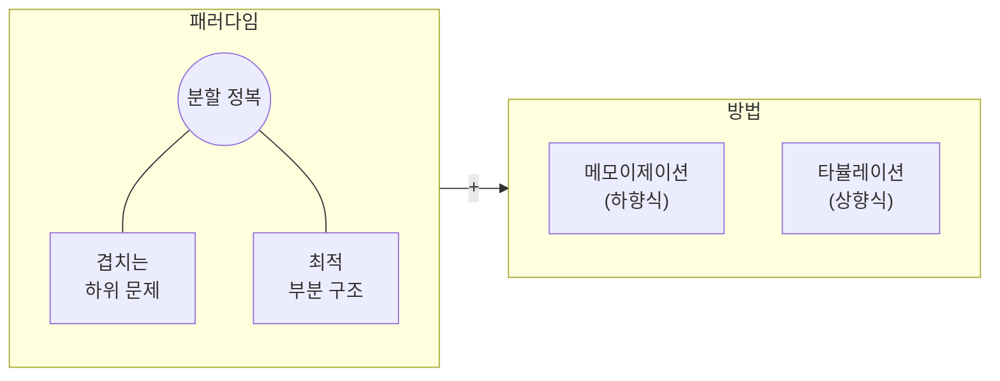

import RecursionDemo from '@components/RecursionDemo.astro';
import FibMemoDemo from '@components/FibMemoDemo.astro';
import DpTableDemo from '@components/DpTableDemo.astro';
import DpGridDemo from '@components/DpGridDemo.astro';
import PathDpDemo from '@components/PathDpDemo.astro';

> 주제 01에서 피보나치 재귀가 왜 느린지 보았습니다. 원인은 재귀가 아니라
> **같은 값을 몇 번이고 다시 구하는 것**이었습니다.  
> 이번 주제는 그 약속을 회수합니다. 한 번 구한 답을 적어 두기만 하면 지수
> 시간이 선형 시간이 됩니다.  
> 그 생각을 거스름돈, 최장 증가 부분수열, 격자 경로, 최단 경로, 0/1 배낭에
> 차례로 적용하고, 표를 거꾸로 따라가 답을 만든 선택까지 되살립니다.

## 동적 계획법이 푸는 문제 \{#what}

[[dynamic-programming|동적 계획법]]은 영어로 dynamic programming입니다. 문제를
작은 문제로 나눈다는 점에서 [[divide-and-conquer|분할 정복]]과 닮았습니다. 다른 점은 작은
문제들이 **서로 겹친다**는 것입니다. 겹치는 문제를 매번 새로 풀면 같은 일을
수없이 반복하게 되므로, **한 번 푼 답을 저장해 두고 다시 꺼내 씁니다.**



- **겹치는 하위 문제**(overlapping subproblems): 같은 작은 문제가 여러 번
  나옵니다. 피보나치의 $$F(3)$$가 그렇습니다.
- **최적 부분 구조**(optimal substructure): 큰 문제의 최적해가 작은 문제의
  최적해로 이루어집니다. 그래야 작은 답을 조합해 큰 답을 만들 수 있습니다.
- 저장하는 방법은 둘입니다. 재귀를 그대로 두고 답을 적어 두는
  [[memoization|메모이제이션]]과, 작은 문제부터 표를 채워 올라가는
  [[tabulation|타뷸레이션]]입니다.

이름의 "dynamic"은 실행 중에 무언가가 바뀐다는 뜻이 아닙니다. 1950년대에
리처드 벨먼(Richard Bellman)이 연구비 심사에서 수학 냄새가 덜 나도록 붙인
이름이라고 스스로 회고했습니다. **"답을 표에 채워 가며 푸는 방법"** 정도로
읽으면 됩니다.

## 피보나치, 다시 \{#fibonacci}

주제 01의 피보나치 재귀를 다시 꺼냅니다. 정의를 그대로 옮긴 코드입니다.

```plaintext
ALGORITHM FibRecursive(n)
    if n <= 1 then
        return n
    return FibRecursive(n-1) + FibRecursive(n-2)
```

$$F(5)$$를 구하는 호출을 한 걸음씩 따라가 봅니다. 같은 값을 다시 구하는
노드가 빨강으로 칠해집니다.

<RecursionDemo n={5} />

$$F(5)$$ 하나를 구하려고 함수를 **15번** 불렀습니다. 그중 서로 다른 값은
$$F(0)$$부터 $$F(5)$$까지 6개뿐입니다. 항마다 몇 번 계산되는지 세면 이렇습니다.

| 구하려는 항 | 호출 수 | 그중 $$F(3)$$ | 그중 $$F(2)$$ |
| --- | --- | --- | --- |
| $$F(0)$$, $$F(1)$$ | 1 | | |
| $$F(2)$$ | 3 | | 1 |
| $$F(3)$$ | 5 | 1 | 1 |
| $$F(4)$$ | 9 | 1 | 2 |
| $$F(5)$$ | 15 | 2 | 3 |

호출 수는 $$C(n) = C(n-1) + C(n-2) + 1$$로 늘어납니다. 주제 01에서 본 것처럼
$$C(n) = 2F(n+1) - 1$$이고, $$n$$이 하나 늘 때마다 약 1.6배가 됩니다.
완전 이진 트리는 아니지만 [[time-complexity|시간 복잡도]]는 $$O(2^n)$$ 꼴로
자랍니다.

반대로 주제 01의 반복은 앞의 두 항만 들고 나아가므로 각 항을 한 번씩만
구합니다. 시간 $$O(n)$$, 공간 $$O(1)$$입니다. 재귀의 모양을 유지하면서 이렇게
만들 수는 없을까요.

### 메모이제이션: 답을 적어 둔다 \{#memoization}

**메모이제이션**(memoization)은 이름 그대로 **메모를 해 두자**는 방식입니다.
재귀는 그대로 두고, 함수가 답을 돌려주기 직전에 표에 적어 둡니다. 다음에 같은
값을 구하라고 하면 다시 갈라지지 않고 표에서 꺼냅니다.

1. $$n \le 1$$이면 피보나치의 기본 정의대로 원래 값을 돌려줍니다.
2. 메모에 -1이 아닌 값이 있으면, 즉 이미 적어 둔 값이 있으면 그 값을 돌려줍니다.
3. 없으면 메모와 함께 재귀로 호출합니다.
4. 결과를 메모에 적고 돌려줍니다.

같은 트리 위에서 메모를 붙인 재귀를 돌려 봅니다. 노랑은 메모에서 꺼낸
호출이고, 점선은 그 덕분에 **아예 불리지 않은** 가지입니다. 왼쪽 표에 값이
적히는 순간과 읽히는 순간을 보세요.

<FibMemoDemo n={5} />

$$F(5)$$를 부르면 왼쪽 가지를 따라 $$F(4)$$, $$F(3)$$, $$F(2)$$까지 내려갑니다.
여기까지는 메모가 비어 있으므로 재귀와 똑같습니다. 달라지는 것은 돌아오는
길입니다.

- $$F(2) = 1$$을 구해 `memo[2]`에 적습니다.
- $$F(3)$$은 오른쪽 자식 $$F(1)$$을 더해 2가 되고 `memo[3]`에 적힙니다.
- $$F(4)$$가 오른쪽 자식 $$F(2)$$를 부르면, 이번에는 `memo[2]`에 1이 있습니다.
  **다시 갈라지지 않고** 바로 돌려줍니다.
- $$F(5)$$의 오른쪽 자식 $$F(3)$$도 `memo[3]`에서 꺼냅니다. 재귀였다면
  $$F(3)$$ 아래로 네 번 더 불렀을 호출이 사라집니다.

결과적으로 호출은 **9번**입니다. 각 항을 처음 만날 때 한 번 계산하고, 두 번째
만날 때는 꺼내기만 하므로 $$n \ge 1$$이면 $$2n - 1$$번입니다.

- 의사코드

```plaintext
ALGORITHM FibMemo(n, memo)
    if n <= 1 then
        return n
    if memo[n] != -1 then             // 이미 구한 값이면
        return memo[n]                // 다시 갈라지지 않고 바로 돌려준다
    memo[n] <- FibMemo(n-1, memo) + FibMemo(n-2, memo)
    return memo[n]                    // 돌려주기 전에 적어 둔다
```

- C 구현

```c
long long fibMemo(int n) {
    calls++;
    if (n <= 1) {
        return n;
    }
    if (memo[n] != -1) {
        return memo[n]; /* 이미 구한 값: 다시 갈라지지 않는다 */
    }
    memo[n] = fibMemo(n - 1) + fibMemo(n - 2);
    return memo[n];
}
```

`n <= 1`은 메모를 보기 전에 돌려주므로 `memo[0]`과 `memo[1]`은 끝까지 -1로
남습니다. 데모의 표도 그렇습니다.

- **시간** $$O(n)$$: 각 값을 한 번씩만 계산합니다.
- **공간** $$O(n)$$: 메모 배열에 더해 재귀 호출 스택이 $$n$$칸까지 쌓입니다.

### 타뷸레이션: 작은 것부터 채운다 \{#tabulation}

**타뷸레이션**(tabulation)은 방향을 뒤집습니다. 큰 문제에서 내려가지 않고,
작은 문제부터 **표를 빠짐없이 채워 올라갑니다.** 반복문 하나와 배열 하나면
됩니다. 칸을 채울 때 참조하는 앞 칸이 파랑, 지금 채우는 칸이 주황입니다.

<DpTableDemo problem="fib" n={5} />

```plaintext
ALGORITHM FibTabulation(n)
    if n <= 1 then
        return n
    dp[0] <- 0
    dp[1] <- 1
    for i <- 2 to n do
        dp[i] <- dp[i-1] + dp[i-2]    // 앞의 두 칸은 이미 채워져 있다
    return dp[n]
```

- **시간** $$O(n)$$: 칸마다 한 번씩 채웁니다.
- **공간** $$O(n)$$: 표 하나. 재귀가 없으니 스택이 넘칠 일도 없습니다.

`dp[i]`는 바로 앞 두 칸만 봅니다. 그렇다면 배열 전체를 들고 있을 필요가 없고
변수 두 개로 충분합니다. 그것이 주제 01의 반복 구현입니다. **반복은 공간을
줄인 타뷸레이션입니다.**

### 세 방식을 나란히 \{#fib-run}

- 실행

```sh
cd src/topic-14-dynamic-programming/01_fibonacci
make -f /work/Makefile fibonacci.out && ./fibonacci.out
```

- 결과

```console
F(5)
  recursive  = 5, calls = 15
  memo       = 5, calls = 9
  memo       = [-1, -1, 1, 2, 3, 5]
  tabulation = 5
  dp         = [0, 1, 1, 2, 3, 5]

 n  recursive calls  memo calls                 F(n)
 10              177          19                   55
 20            21891          39                 6765
 30          2692537          59               832040
 90                -         179  2880067194370816120
```

재귀 호출 수 177, 21891, 2692537은 주제 01의 표와 같은 숫자입니다. 메모를
붙이자 같은 재귀가 19, 39, 59번으로 줄었습니다. $$n$$이 10 늘 때마다 재귀는
약 100배가 되고, 메모는 20번 늘 뿐입니다.

$$n = 90$$이면 재귀는 끝나지 않으므로 건너뜁니다. 메모는 179번 만에 답을
냅니다. 바뀐 것은 `if` 두 줄뿐입니다.

## 메모이제이션과 타뷸레이션 \{#memo-vs-tab}

두 방식은 같은 점화식을 다른 방향으로 계산합니다.

| | 메모이제이션 | 타뷸레이션 |
| --- | --- | --- |
| 계산 방식 | **lazy**: 필요한 것만 | **eager**: 전부 |
| 시작점 | 위에서 아래로, 큰 문제 → 작은 문제 | 아래에서 위로, 작은 문제 → 큰 문제 |
| 구현 | 재귀 + 캐시 | 반복문 + 표 |
| 직관성 | 점화식을 그대로 옮기면 된다 | 채우는 순서를 따로 정해야 한다 |
| 안정성 | 깊으면 스택 오버플로 위험 | 스택을 쓰지 않는다 |
| 공간 최적화 | 어렵다 | 쉽다 (앞 칸 몇 개만 남기면 된다) |
| 다른 이름 | 하향식(top-down) | 상향식(bottom-up) |

- **메모이제이션**은 재귀적으로 호출하면서 계산된 결과를 저장해 중복 계산을
  피합니다. $$F(4)$$, $$F(3)$$처럼 큰 문제에서 내려가며 **필요한 하위 문제만**
  계산합니다. 대신 재귀 호출의 부담이 붙습니다.
- **타뷸레이션**은 작은 문제부터 순차적으로 표를 채웁니다. $$F(2)$$, $$F(3)$$처럼
  작은 것부터 **모든 하위 문제**를 풀고, 반복문만 쓰므로 효율적입니다.

어느 쪽이 낫다고 잘라 말할 수는 없습니다. 점화식이 먼저 떠오르면 메모로 바로
옮기고, 표의 채우는 순서가 분명하면 타뷸레이션으로 씁니다. 다음 절의 lazy와
eager가 그 선택의 기준을 줍니다.

## lazy와 eager \{#lazy}

메모이제이션의 "필요한 것만"을 프로그래밍에서는 **lazy**(지연)라고 부릅니다.
게으르다는 뜻이 아닙니다. **필요할 때만 일하는 똑똑함**입니다. 반대로 미리
전부 해 두는 것이 **eager**(즉시)입니다.

### 생활 속 lazy \{#lazy-life}

| 예 | eager | lazy |
| --- | --- | --- |
| 동영상 스트리밍 | 영화 전체를 내려받은 뒤 재생 (30분 대기) | 지금 볼 부분만 버퍼링하며 재생 |
| 웹 페이지 이미지 | 페이지의 이미지 100개를 모두 불러옴 | 화면에 보이는 이미지만 불러오고, 스크롤하면 더 |
| 데이터베이스 조회 | 사용자의 글 1000개, 친구 500명, 사진 2000장을 한꺼번에 | 기본 정보만 먼저, 나머지는 열어 볼 때 |

넷플릭스와 유튜브가 영화 전체를 받기 전에 재생을 시작하는 것, 긴 쇼핑몰
페이지가 스크롤할 때마다 이미지를 채우는 것이 모두 lazy입니다.

### 프로그래밍 속 lazy \{#lazy-code}

Python의 제너레이터(generator)는 **lazy한 리스트**입니다. 리스트는 값을 전부
만들어 메모리에 두지만, 제너레이터는 다음 값을 달라고 할 때 하나씩 만듭니다.

```python
def squares_eager(n):          # 모든 값을 메모리에 저장
    result = []
    for i in range(n):
        result.append(i * i)
    return result

def squares_lazy(n):           # 필요할 때만 하나씩 계산
    for i in range(n):
        yield i * i

numbers = squares_eager(1000000)   # 원소 100만 개짜리 리스트가 생긴다
numbers = squares_lazy(1000000)    # 아직 아무것도 계산하지 않았다
```

함수형 언어(Haskell 등)는 이것을 언어 차원에서 합니다. 무한한 리스트를
정의해 두고 필요한 만큼만 꺼내 씁니다. 같은 생각을 Python으로 흉내 내면
이렇습니다.

```python
def fibonacci_infinite():      # 무한히 많은 피보나치 수를 "정의"한다
    a, b = 0, 1
    while True:
        yield a
        a, b = b, a + b

fib = fibonacci_infinite()
first_10 = [next(fib) for _ in range(10)]   # 실제로는 10개만 계산된다
```

### 언제 어느 쪽인가 \{#lazy-when}

**lazy(메모이제이션)가 나을 때**

- 부분 결과만 필요할 때: $$F(50)$$ 하나만 알면 될 때
- 조건부 계산: 특정 조건에서만 일부 계산이 필요할 때
- 메모리를 아낄 때: 모든 중간 결과를 저장할 필요가 없을 때
- 빠른 프로토타이핑: 일단 돌아가는 코드가 먼저 필요할 때

**eager(타뷸레이션)가 나을 때**

- 전체 결과가 필요할 때: $$F(1)$$부터 $$F(50)$$까지 모두 필요할 때
- 안정성이 중요할 때: 스택 오버플로 위험을 피하고 싶을 때
- 성능을 다듬을 때: 재귀 호출의 부담을 없애고 싶을 때
- 공간을 다듬을 때: 메모리 사용량을 세밀하게 제어하고 싶을 때

다음 예제(거스름돈)에서 이 차이가 숫자로 드러납니다. 메모는 5원을 끝내 구하지
않고, 표는 5원까지 빠짐없이 채웁니다.

## 예제 1. 거스름돈 \{#coin-change}

- **문제**: 특정 금액을 만드는 동전 개수의 최솟값
- **입력**: 동전 `{2, 3, 5}`, 금액 6원 (같은 동전을 몇 번이든 쓸 수 있다)
- **답**: 2개 (3 + 3)

주제 06의 그리디는 "가장 큰 동전부터"였습니다. 여기서 그리디는 5원을 먼저
내고, 남은 1원을 만들 수 없어 막힙니다. 동적 계획법은 **마지막에 낸 동전**을
기준으로 생각합니다. 마지막 동전이 $$c$$라면 나머지 $$a - c$$원은 다시 같은
문제입니다.

$$
C(a) = \begin{cases}
0 & a = 0 \\
\min\limits_{c \,\in\, \text{coins},\ c \le a} \bigl( C(a - c) + 1 \bigr) & a > 0
\end{cases}
$$

만들 수 없는 금액은 $$\infty$$(코드에서는 `INF`)로 둡니다.

### 메모이제이션 \{#coin-memo}

점화식을 재귀로 그대로 옮기고 메모를 붙입니다. 순서는 피보나치와 같습니다.

```plaintext
ALGORITHM CoinChangeMemo(amount, coins, m, memo)
    if amount = 0 then return 0          // 1. 기저: 0원은 동전 0개
    if amount < 0 then return INF        //    음수 금액은 만들 수 없다
    if memo[amount] != -1 then           // 2. 이미 구한 금액이면 바로 돌려준다
        return memo[amount]
    best <- INF                          // 3. 동전마다 하나씩 내 보고 나머지를 재귀로
    for i <- 0 to m-1 do
        r <- CoinChangeMemo(amount - coins[i], coins, m, memo)
        if r != INF and r + 1 < best then
            best <- r + 1
    memo[amount] <- best                 // 4. 적어 두고 돌려준다
    return best
```

`coinChangeMemo(6)`이 실제로 어떻게 내려가는지 따라가면 이렇습니다.

```plaintext
solve 6
├─ 동전 2: 6-2 = 4 → solve 4
│  ├─ 동전 2: 4-2 = 2 → solve 2
│  │  ├─ 동전 2: 2-2 = 0 → 0개
│  │  ├─ 동전 3, 5: 음수 → 불가
│  │  └─ 결과: 1개 (2)
│  ├─ 동전 3: 4-3 = 1 → solve 1
│  │  └─ 결과: 불가 (INF)
│  ├─ 동전 5: 음수 → 불가
│  └─ 결과: 2개 (2 + 2)
├─ 동전 3: 6-3 = 3 → solve 3
│  ├─ 동전 2: 3-2 = 1 → memo[1] = INF 꺼냄
│  ├─ 동전 3: 3-3 = 0 → 0개
│  └─ 결과: 1개 (3)
├─ 동전 5: 6-5 = 1 → memo[1] = INF 꺼냄
└─ 최종: min(2+1, 1+1) = 2개 (3 + 3)
```

`memo[1]`은 한 번 구한 뒤 두 번 꺼내 썼습니다. 실행 결과의 `memo` 배열이 이
과정을 그대로 남깁니다.

```console
coins = {2, 3, 5}, amount = 6
  solve 6
  solve 4
  solve 2
  solve 1
  solve 3
memo -> 2 coins, solved 5 amounts
  memo = [-1, INF, 1, 1, 2, -1, 2]
```

`memo[5]`가 -1로 남았습니다. 6원을 만드는 데 5원짜리 답은 필요하지 않았기
때문입니다. 이것이 **lazy**입니다. `memo[0]`이 -1인 것은 0원을 기저에서 바로
돌려주기 때문입니다.

### 타뷸레이션 \{#coin-tab}

같은 점화식을 1원부터 채웁니다. 칸 하나를 채울 때 동전마다 $$a - c$$원 칸을
봅니다. 표 위의 파랑 화살표가 그 참조이고, 가장 진한 화살표가 최솟값을 준
칸입니다. 다 채우면 표 아래로 **경로 복원** 화살표가 거꾸로 이어집니다.

<DpTableDemo problem="coin" coins={[2, 3, 5]} amount={6} />

```plaintext
ALGORITHM CoinChangeTab(amount, coins, m)
    dp[0] <- 0                           // 1. 초기화
    for a <- 1 to amount do dp[a] <- INF
    for a <- 1 to amount do              // 2. 작은 금액부터 빠짐없이
        for i <- 0 to m-1 do
            c <- coins[i]
            if c <= a and dp[a - c] != INF and dp[a - c] + 1 < dp[a] then
                dp[a] <- dp[a - c] + 1
                choice[a] <- c           //    이 금액에서 마지막에 낸 동전
    if dp[amount] = INF then return INF  // 3. 반환
    a <- amount                          // 4. 경로 복원: choice를 거꾸로 따라간다
    while a > 0 do
        choice[a]를 출력
        a <- a - choice[a]
    return dp[amount]
```

6원 칸을 채우는 순간을 보면 이렇습니다.

| 마지막 동전 | 참조하는 칸 | 후보 |
| --- | --- | --- |
| 2 | `dp[4]` = 2 | 3 |
| 3 | `dp[3]` = 1 | **2** (최소) |
| 5 | `dp[1]` = INF | 불가 |

**답의 개수만으로는 무엇을 냈는지 모릅니다.** 그래서 최솟값이 바뀔
때마다 `choice[a]`에 그 동전을 적어 둡니다. 다 채운 뒤 `choice[6] = 3`이니 3원 칸으로,
`choice[3] = 3`이니 0원 칸으로 갑니다. 낸 동전은 3 + 3입니다. 표를 **거꾸로
따라가 답을 만든 선택을 되살리는 것**을 경로 복원이라고 합니다. 이 주제의
나머지 예제도 모두 같은 방법을 씁니다.

```console
tab  -> 2 coins: 3 + 3, filled 6 amounts
  dp   = [0, INF, 1, 1, 2, 1, 2]
```

표는 `dp[5] = 1`까지 채웠지만 답에는 쓰지 않았습니다. 이것이 **eager**입니다.
금액 $$A$$, 동전 $$m$$개라면 시간 $$O(Am)$$, 공간 $$O(A)$$입니다.

### 주제 06의 80원 \{#coin-revisit}

주제 06에서 동전 `{50, 40, 10}`으로 80원을 거슬러 줄 때 그리디는 50원을 먼저
집어 **4개**(50 + 10 + 10 + 10)를 냈습니다. 같은 표를 채워 봅니다. 동전이 모두
10의 배수라 10원 단위 칸만 보입니다. 사이 금액은 만들 수 없고 참조되지도
않습니다.

<DpTableDemo problem="coin" coins={[50, 40, 10]} amount={80} unit={10} />

80원 칸에서 50원을 마지막으로 내면 `dp[30] + 1 = 4`, 40원을 내면
`dp[40] + 1 = 2`입니다. 표는 둘을 **모두 견주므로** 2를 고릅니다. 그리디는 50원을
고른 순간 40원 쪽을 다시 보지 않았습니다.

- 실행

```sh
cd src/topic-14-dynamic-programming/02_coin_change
make -f /work/Makefile coinChange.out && ./coinChange.out
```

- 결과

```console
coins = {2, 3, 5}, amount = 6
  solve 6
  solve 4
  solve 2
  solve 1
  solve 3
memo -> 2 coins, solved 5 amounts
  memo = [-1, INF, 1, 1, 2, -1, 2]
tab  -> 2 coins: 3 + 3, filled 6 amounts
  dp   = [0, INF, 1, 1, 2, 1, 2]

coins = {50, 40, 10}, amount = 80
memo -> 2 coins, solved 8 amounts
tab  -> 2 coins: 40 + 40, filled 80 amounts
```

80원에서 메모는 10원 단위 금액 **8개**만 풀었고, 표는 1원부터 **80칸**을 전부
채웠습니다. 답은 둘 다 2개, 40 + 40입니다.

## 예제 2. 최장 증가 부분수열 \{#lis}

- **문제**: 배열에서 순서를 지킨 채 몇 개를 골라 만든, 순증가하는 가장 긴
  수열의 길이
- **입력**: `[10, 9, 2, 5, 3, 7, 101, 18]`
- **답**: 4

최장 증가 부분수열(longest increasing subsequence, LIS)은 하나가 아닐 수
있습니다. 이 배열에는 길이 4짜리가 네 개 있습니다.

```plaintext
[10, 9, 2, 5, 3, 7, 101, 18]   →  2  5  7  101
                                   2  5  7  18
                                   2  3  7  101
                                   2  3  7  18
```

### 메모이제이션: 고른다, 안 고른다 \{#lis-memo}

원소를 앞에서부터 보며 **고를지 말지**를 정합니다. 고르려면 마지막으로 고른
원소보다 커야 합니다. 그러니 남은 일은 "지금 볼 원소 `i`"와 "마지막으로 고른
원소 `prev`" 두 가지로 정해집니다.

```plaintext
ALGORITHM LisHelper(arr, n, i, prev)
    if i = n then return 0                       // 1. 기저: 더 볼 원소가 없다
    if memo[i][prev+1] != -1 then                // 2. 이미 구한 (i, prev)면 바로
        return memo[i][prev+1]
    exclude <- LisHelper(arr, n, i+1, prev)      // 3. arr[i]를 고르지 않는 경우
    include <- 0
    if prev = -1 or arr[i] > arr[prev] then      //    arr[i]를 고를 수 있으면
        include <- 1 + LisHelper(arr, n, i+1, i) //    고르는 경우
    memo[i][prev+1] <- max(include, exclude)     // 4. 둘 중 큰 것을 적어 둔다
    return memo[i][prev+1]
```

`prev`가 -1이면 아직 고른 것이 없다는 뜻입니다. 표의 열을 `prev + 1`로 두는
것은 그 -1을 0번 열에 담기 위해서입니다.

원소마다 두 갈래로 갈라지므로 메모 없이는 $$O(2^n)$$입니다. 그런데 갈래가
달라도 **남은 일이 같아지는** 경우가 생깁니다. `[2, 10, 5, 7, 3]`의 앞 두
원소에서 갈라진 네 갈래를 보면 이렇습니다.

| 2 | 10 | 고른 수열 | 남은 일 |
| --- | --- | --- | --- |
| 고름 | 고름 | `[2, 10]` | `i = 2, prev = 10` |
| 고름 | 안 고름 | `[2]` | `i = 2, prev = 2` |
| 안 고름 | 고름 | `[10]` | `i = 2, prev = 10` (첫 줄과 같은 부분 문제) |
| 안 고름 | 안 고름 | `[]` | `i = 2`, 고른 것 없음 |

첫 줄과 셋째 줄은 고른 수열이 다르지만, 앞으로 이을 수 있는 길이는
`(i = 2, prev = 10)`만으로 정해집니다. 그래서 한 번만 풀면 됩니다. 부분 문제는
많아야 $$n(n+1)$$개이므로 시간과 공간 모두 $$O(n^2)$$입니다.

### 표가 실제로 몇 번 쓰이나 \{#lis-memo-hits}

메모에서 꺼낼 때마다 한 줄씩 찍어 봅니다.

```console
arr = [10, 9, 2, 5, 3, 7, 101, 18]

plain recursion = 4, calls = 108
memo hits (i, prev + 1)
  hit memo[7][7] = 0
  hit memo[7][7] = 0
  hit memo[6][6] = 1
  hit memo[7][7] = 0
  hit memo[6][6] = 1
  hit memo[7][7] = 0
  hit memo[6][6] = 1
  hit memo[5][5] = 2
  hit memo[4][4] = 2
  hit memo[7][7] = 0
  hit memo[7][7] = 0
memo = 4, calls = 62, hits = 11, filled 36 of 72
```

의외로 **11번**뿐입니다. 72칸 중 36칸만 채웠고, 호출은 108번에서 62번으로
줄었습니다. `hit memo[7][7] = 0`은 7번 원소(18)를 볼 차례이고 마지막으로 고른
것이 6번(101)인 상황입니다. 18은 101 뒤에 올 수 없으니 0입니다.

원소 8개에서는 같은 `(i, prev)`가 생각보다 덜 겹칩니다. 배열이 길어질수록
메모 없는 재귀는 $$2^n$$으로, 메모는 $$n^2$$으로 자라므로 차이가 급격히
벌어집니다.

### 타뷸레이션: 여기서 끝나는 가장 긴 길이 \{#lis-tab}

타뷸레이션은 질문을 바꿉니다. `dp[i]`를 **`arr[i]`로 끝나는** 가장 긴 증가
부분수열의 길이로 둡니다. 그러면 `arr[i]`는 앞에 있는 자기보다 작은 원소 중
하나의 뒤에 붙습니다.

$$
dp[i] = 1 + \max \{\, dp[j] : j < i,\ arr[j] < arr[i] \,\}
$$

그런 $$j$$가 없으면 `dp[i] = 1`입니다. 원소 하나만으로도 길이 1이기 때문입니다.
칸 하나를 채울 때 앞의 칸을 **여러 개** 봅니다. 파랑 화살표가 자기보다 작은
원소들이고, 진한 화살표가 가장 긴 수열을 준 원소입니다.

<DpTableDemo problem="lis" arr={[10, 9, 2, 5, 3, 7, 101, 18]} />

```plaintext
ALGORITHM LisTab(arr, n)
    for i <- 0 to n-1 do                         // 1. 초기화
        dp[i] <- 1                               //    원소 하나만으로는 길이 1
        prev[i] <- -1
    for i <- 1 to n-1 do                         // 2. 앞의 원소를 모두 훑는다
        for j <- 0 to i-1 do
            if arr[j] < arr[i] and dp[j] + 1 > dp[i] then
                dp[i] <- dp[j] + 1               //    arr[j] 뒤에 arr[i]를 잇는다
                prev[i] <- j
    // 3. 최댓값 찾기: dp가 가장 큰 첫 인덱스
    end <- argmax(dp)
    // 4. 경로 복원: end부터 prev를 따라가며 거꾸로 모은다
    return dp[end]
```

답은 `dp[n-1]`이 아니라 **`dp`의 최댓값**입니다. 가장 긴 수열이 마지막 원소로
끝난다는 보장이 없기 때문입니다. 칸마다 앞의 칸을 전부 보므로 시간
$$O(n^2)$$, 공간 $$O(n)$$입니다.

- 실행

```sh
cd src/topic-14-dynamic-programming/03_lis
make -f /work/Makefile lis.out && ./lis.out
```

- 결과 (뒷부분)

```console
tab  = 4
  dp   = [1, 1, 1, 2, 2, 3, 4, 4]
  prev = [-1, -1, -1, 2, 2, 3, 5, 5]
  one LIS: 2 5 7 101
```

`prev`가 경로 복원에 쓰입니다. 최댓값 4는 6번(101)에서 처음 나옵니다. 거기서
`prev`를 따라가면 5번(7), 3번(5), 2번(2)이고, 뒤집으면 `2 5 7 101`입니다.
길이가 같은 18 쪽을 고르면 `2 5 7 18`이 됩니다. 답이 여럿일 때 어느 것이
나오는지는 동점을 어떻게 처리하느냐가 정합니다.

## 예제 3. 격자 경로 \{#grid-paths}

- **문제**: 격자의 `(0, 0)`에서 `(5, 5)`까지, 한 번에 `x+1` 또는 `y+1`로만
  움직여 가는 경로의 수
- **조건**: 장애물 `(2, 2)`, `(3, 3)`, `(4, 4)`는 지나갈 수 없다.
- **답**: 48

어떤 칸에 오는 길은 **위 칸에서 오는 길**과 **왼쪽 칸에서 오는 길**뿐입니다.
그러니 칸의 값은 위 칸 값 + 왼쪽 칸 값입니다. 장애물 칸은 0입니다.

<DpGridDemo problem="grid" />

Python으로 쓰면 이렇습니다. 메모이제이션은 "여기서 끝까지",
타뷸레이션은 "처음부터 여기까지"를 셉니다.

```python
obstacles = [(2, 2), (3, 3), (4, 4)]  # 장애물 위치

def paths_memo(x, y, tx, ty, memo):
    if x == tx and y == ty:                      # 목표 지점 도달
        return 1
    if x > tx or y > ty or (x, y) in obstacles:  # 경계를 벗어나거나 장애물
        return 0
    if (x, y) in memo:
        return memo[(x, y)]
    memo[(x, y)] = paths_memo(x + 1, y, tx, ty, memo) + \
                   paths_memo(x, y + 1, tx, ty, memo)
    return memo[(x, y)]

def paths_tab(tx, ty):
    dp = [[0] * (ty + 1) for _ in range(tx + 1)]
    for i in range(tx + 1):
        for j in range(ty + 1):
            if (i, j) in obstacles:
                dp[i][j] = 0
            elif i == 0 and j == 0:
                dp[i][j] = 1
            else:
                up = dp[i - 1][j] if i > 0 else 0
                left = dp[i][j - 1] if j > 0 else 0
                dp[i][j] = up + left
    return dp[tx][ty]
```

- 실행

```sh
cd src/topic-14-dynamic-programming/04_grid_paths
make -f /work/Makefile gridPaths.out && ./gridPaths.out
```

- 결과

```console
grid 6 x 6, (0, 0) -> (5, 5), obstacles (2, 2) (3, 3) (4, 4)

plain recursion = 48, calls = 439
memo            = 48, calls = 65, solved 32 cells
tab             = 48

  x\y    0    1    2    3    4    5
   0     1    1    1    1    1    1
   1     1    2    3    4    5    6
   2     1    3    #    4    9   15
   3     1    4    4    #    9   24
   4     1    5    9    9    #   24
   5     1    6   15   24   24   48
```

장애물이 없으면 10걸음 중 아래로 갈 5걸음을 고르는 수 $$\binom{10}{5} = 252$$입니다.
대각선 장애물 셋이 그중 204개를 막아 48개가 남았습니다. 메모 없는 재귀는
439번, 메모는 65번 불렸습니다. 표의 크기가 $$X \times Y$$이면 시간과 공간 모두
$$O(XY)$$입니다.

목표가 `(5, 5)`이면 격자가 10 × 10이어도 답은 같습니다. 오른쪽과 아래로만
움직이므로 목표를 넘어간 칸은 쓰이지 않습니다.

## 예제 4. 길찾기: 간선 k개로 가는 최단 경로 \{#shortest-path}

이번에는 [[graph|그래프]]입니다. 간선마다 비용이 붙은 방향 그래프에서 0번
정점을 떠나 3번 정점에 **간선을 정확히 3개** 써서 가는 가장 싼 길을 찾습니다.
아래 데모의 왼쪽 그림이 그 그래프입니다. 간선은 9개입니다.

```plaintext
0→1 (1)   0→2 (2)   1→3 (6)   2→1 (2)   2→3 (4)
2→4 (3)   3→5 (3)   4→3 (1)   4→5 (5)
```

간선 3개짜리 길은 둘뿐입니다.

- 길 1: 0 → 2 → 4 → 3, 비용 2 + 3 + 1 = **6**
- 길 2: 0 → 2 → 1 → 3, 비용 2 + 2 + 6 = 10

### 문제를 쪼개는 방법 \{#shortest-path-split}

"0에서 3으로 간선 3개"를 직접 세지 않고 **첫 걸음**으로 쪼갭니다.

1. 0에서의 선택지는 1과 2, 두 개입니다.
   - 1을 고르면 남은 일은 **1 → 3을 간선 2개로**
   - 2를 고르면 남은 일은 **2 → 3을 간선 2개로**
2. 1에서의 선택지는 3 하나입니다. 남은 일은 3 → 3을 간선 1개로. 그런 간선은
   없으므로 이 갈래는 **불가**입니다.
3. 2에서의 선택지는 1, 3, 4입니다.
   - 1 → 3을 간선 1개로: 6이므로 2 → 1 → 3은 2 + 6 = 8
   - 3 → 3을 간선 1개로: 불가
   - 4 → 3을 간선 1개로: 1이므로 2 → 4 → 3은 3 + 1 = 4
   - 그래서 **2 → 3을 간선 2개로 가는 최솟값은 4**
4. 0 → 2 → 4 → 3 = 2 + (3 + 1) = **6**

이것을 점화식으로 쓰면 이렇습니다. $$S(u, v, k)$$는 $$u$$에서 $$v$$로 간선
$$k$$개를 써서 가는 최소 비용입니다.

$$
S(u, v, k) = \begin{cases}
0 & k = 0,\ u = v \\
\infty & k = 0,\ u \ne v \\
\min\limits_{u \to x} \bigl( w(u, x) + S(x, v, k-1) \bigr) & k > 0
\end{cases}
$$

### 재귀에서 메모이제이션으로 \{#shortest-path-memo}

점화식을 그대로 재귀로 쓰면 **구현 1**, 거기에 `memo[k][u][v]` 표를 붙이면
**구현 2**입니다. 표에는 값과 함께 **가장 싼 첫 걸음**(`next`)을 적어 둡니다.
도착점이 3으로 고정이므로 데모의 표는 행이 $$k$$, 열이 출발 정점 $$u$$입니다.
파랑 점선이 지금 시도하는 간선, 진한 파랑이 최솟값을 준 간선입니다. 끝에서는
`next`를 따라 분홍 화살표로 길을 복원합니다.

<PathDpDemo />

```plaintext
ALGORITHM ShortestMemo(u, v, k, memo, next)
    // 1. 기저: 간선을 다 썼다
    if k = 0 then
        if u = v then return 0 else return INF
    // 2. 이미 구한 (k, u, v)면 바로 돌려준다
    if memo[k][u][v] != -1 then
        return memo[k][u][v]
    // 3. 첫 간선 u -> x를 하나씩 골라 본다
    best <- INF
    for each edge u -> x do
        r <- ShortestMemo(x, v, k-1, memo, next)
        if r != INF and w(u, x) + r < best then
            best <- w(u, x) + r
            next[k][u][v] <- x        // 가장 싼 첫 걸음을 적어 둔다
    // 4. 적어 두고 돌려준다
    memo[k][u][v] <- best
    return best

ALGORITHM RestorePath(u, v, k, next)  // 5. 경로 복원
    path <- [u]
    while k > 0 do
        u <- next[k][u][v]            // 적어 둔 첫 걸음을 따라간다
        append u to path
        k <- k - 1
    return path
```

- 실행

```sh
cd src/topic-14-dynamic-programming/05_shortest_path
make -f /work/Makefile shortestPath.out && ./shortestPath.out
```

- 결과

```console
edges: 0->1 (1), 0->2 (2), 1->3 (6), 2->1 (2), 2->3 (4), 2->4 (3), 3->5 (3), 4->3 (1), 4->5 (5)
0 -> 3 with exactly 3 edges

plain recursion = 6, calls = 12
  hit memo[1][3][3] = INF
memo            = 6, calls = 11
  k=1: 1->3 = 6, 3->3 = INF, 4->3 = 1
  k=2: 1->3 = INF, 2->3 = 4
  k=3: 0->3 = 6
path: 0 -> 2 -> 4 -> 3 (2 + 3 + 1 = 6)
```

메모 표에 적힌 칸이 위에서 손으로 쪼갠 단계와 하나씩 맞습니다.

| $$k$$ | 적힌 칸 | 뜻 |
| --- | --- | --- |
| 1 | 1→3 = 6, 3→3 = INF, 4→3 = 1 | 간선 하나로 3에 가는 비용 |
| 2 | 1→3 = INF, 2→3 = 4 | 간선 둘로 3에 가는 비용 |
| 3 | 0→3 = 6 | 구하려던 답 |

표 18칸(`k` = 1\~3, 정점 6개) 중 **6칸만** 구했습니다. 메모이제이션은 필요한
칸만 채웁니다. 이 그래프는 작아서 호출 수는 12번과 11번으로 거의 같습니다.
`3→3`(간선 1개)은 두 번 필요했고 두 번째는 표에서 꺼냈습니다. 그래프가 커지면
같은 `(k, u)`를 만나는 일이 기하급수적으로 늘어납니다. 메모 없이는 간선을
고를 때마다 갈라지므로 나가는 간선이 $$d$$개일 때 $$O(d^k)$$이고, 메모를
붙이면 칸 $$kV$$개를 한 번씩 풀어 $$O(kVd)$$입니다.

### 경로 복원 \{#path-restore}

`memo`에는 비용만 있습니다. 비용 6을 알아도 어느 길인지는 모릅니다. 그래서
`best`가 바뀌는 순간 `next[k][u][v]`에 그 첫 걸음을 함께 적습니다. 답을 낸
뒤에는 출발점에서 시작해 적힌 첫 걸음을 $$k$$번 따라가면 됩니다.

```plaintext
next[3][0][3] = 2    0 → 2   (비용 2)
next[2][2][3] = 4    2 → 4   (비용 3)
next[1][4][3] = 3    4 → 3   (비용 1)
```

거스름돈의 `choice`, LIS의 `prev`, 여기의 `next`는 모두 같은 일을 합니다.
**값을 정할 때 고른 것을 함께 적어 두고, 끝에서 거꾸로 따라간다.** 동적
계획법에서 "최솟값"이 아니라 "최소가 되는 방법"을 물으면 언제나 이 한 줄이
붙습니다.

이 문제는 주제 12의 [[shortest-path|최단 경로]]와 다릅니다. 다익스트라는
간선 수에 제한이 없는 가장 싼 길을 찾습니다. 여기서는 "간선 정확히 $$k$$개"라는
조건이 있어서, 간선 2개로 가는 0 → 2 → 3(6)은 답이 될 수 없습니다.

## 예제 5. 0/1 배낭 \{#knapsack}

주제 06에서 미뤄 둔 문제입니다.

- **문제**: 용량 50인 배낭에 가치의 합이 가장 크도록 물건을 담는다.
- **조건**: 물건은 **쪼갤 수 없다.** 담거나 담지 않거나 둘 중 하나다.
- **물건**: (무게 10, 가치 60), (무게 20, 가치 100), (무게 30, 가치 120)

단위 무게당 가치 순으로 담는 그리디는 물건 1과 2를 담고 남은 20에 물건 3이
들어가지 않아 **160**에서 멈췄습니다. 물건 2와 3을 담으면 **220**입니다.

동적 계획법은 물건을 하나씩 늘려 가며 **"이 물건을 담는다 / 안 담는다"를 모든
용량에서** 견줍니다. `dp[i][c]`를 물건 1부터 $$i$$까지만 써서 용량 $$c$$에 담을
수 있는 최대 가치로 둡니다.

$$
dp[i][c] = \begin{cases}
dp[i-1][c] & w_i > c \\
\max\bigl(dp[i-1][c],\ dp[i-1][c - w_i] + v_i\bigr) & w_i \le c
\end{cases}
$$

- 위 칸 `dp[i-1][c]`: 물건 $$i$$를 담지 않는 경우
- 위 줄에서 $$w_i$$만큼 왼쪽 칸 + $$v_i$$: 물건 $$i$$를 담는 경우

무게가 모두 10의 배수라 데모는 10 단위 열만 보입니다. 다 채우면 오른쪽 아래에서
위로 거슬러 올라가며 담은 물건을 복원합니다.

<DpGridDemo problem="knapsack" />

```plaintext
ALGORITHM Knapsack(w, v, n, W)
    // 1. 물건이 없으면 가치 0
    for c <- 0 to W do dp[0][c] <- 0
    // 2. 물건을 하나씩 늘려 가며
    for i <- 1 to n do
        for c <- 0 to W do
            dp[i][c] <- dp[i-1][c]                      // 안 담는 경우 (위 칸)
            if w[i] <= c and dp[i-1][c - w[i]] + v[i] > dp[i][c] then
                dp[i][c] <- dp[i-1][c - w[i]] + v[i]    // 담는 경우
    // 3. 경로 복원: 아래에서 위로, 위 칸과 다르면 물건 i를 담은 것
    c <- W
    for i <- n downto 1 do
        if dp[i][c] != dp[i-1][c] then
            take item i
            c <- c - w[i]
    return dp[n][W]
```

- 실행

```sh
cd src/topic-14-dynamic-programming/06_knapsack
make -f /work/Makefile knapsack.out && ./knapsack.out
```

- 결과

```console
capacity = 50
items: (w=10, v=60) (w=20, v=100) (w=30, v=120)

dp (columns every 10)
  i\c    0   10   20   30   40   50
  0      0    0    0    0    0    0
  1      0   60   60   60   60   60
  2      0   60  100  160  160  160
  3      0   60  100  160  180  220

best = 220
  take item 3 (w=30, v=120)
  take item 2 (w=20, v=100)
```

맨 아래 오른쪽 220은 위 칸 160(물건 3을 안 담음)과 `dp[2][20] + 120 = 220`(물건
3을 담음)을 견준 결과입니다. 그리디가 놓친 "물건 1을 버리고 2, 3을 담는" 경우가
`dp[2][20] = 100`이라는 칸 안에 이미 들어 있었습니다.

복원은 아래에서 위로 갑니다. `dp[3][50] = 220`이 위 칸과 다르므로 물건 3을
담았고, 용량 20으로 옮깁니다. `dp[2][20] = 100`도 위 칸 60과 다르므로 물건 2를
담았습니다. `dp[1][0] = 0`은 위 칸과 같으니 물건 1은 담지 않았습니다.

표가 $$(n+1) \times (W+1)$$이므로 시간과 공간 모두 $$O(nW)$$입니다. $$W$$가
입력의 **값**이라는 점에 주의하세요. 용량이 10억이면 표도 10억 칸입니다.
그래서 이 알고리즘은 다항 시간처럼 보이지만 엄밀히는 의사 다항 시간
(pseudo-polynomial)이라 부릅니다.

## 동적 계획법 정리 \{#summary}

### 언제 쓸 수 있나 \{#when}

- **문제가 작은(반복되는) 인스턴스로 이루어질 때** 하위 문제의 해결책을 바탕으로
  문제를 풉니다.
- **분할 정복처럼** 문제를 더 작은 인스턴스로 나눕니다.
  - 다만 분할 정복과 달리 **하위 문제들이 서로 겹칠 때** 씁니다.
  - 작은 인스턴스를 먼저 풀고, 결과를 저장한 다음(메모이제이션, 타뷸레이션),
    나중에 그 결과로 더 큰 인스턴스를 풉니다.
- **그리디처럼 최적화 문제**를 푸는 데 주로 씁니다.
  - 후보 해가 여러 개이고, 그중 최적(가장 좋은) 값을 가진 해를 찾습니다.
  - 그리디는 후보 하나만 따라가고, 동적 계획법은 후보를 **모두** 견줍니다.
    80원과 0/1 배낭에서 답이 갈린 이유입니다.
- **최적 부분 구조가 있을 때만** 씁니다. 이것을 **최적성의 원리**(principle of
  optimality)라고 합니다.
  - 문제의 한 인스턴스에 대한 최적해는 언제나 그 하위 인스턴스들에 대한 최적해를
    포함합니다.
  - 예: 최단 경로에서 $$v_k$$가 $$v_i$$에서 $$v_j$$로 가는 최적 경로 위에
    있다면, $$v_i$$에서 $$v_k$$, $$v_k$$에서 $$v_j$$로 가는 부분 경로도 각각
    최적입니다.
  - 반례: **가장 긴 단순 경로**에는 이 성질이 없습니다. 부분 경로를 각각 가장 길게
    늘리면 정점이 겹쳐 단순 경로가 깨질 수 있습니다.

### 분할 정복과 무엇이 다른가 \{#vs-divide}

| | 분할 정복 | 동적 계획법 |
| --- | --- | --- |
| 방향 | 하향식: 문제를 쪼개 내려간다 | 상향식이 기본 (메모이제이션은 하향식으로 같은 일을 한다) |
| 하위 문제 | 서로 겹치지 않는다 | 서로 겹친다 |
| 효율 | 하위 문제가 독립이면 효율적 | 겹치는 답을 저장해 재계산을 없앤다 |
| 겹칠 때 | 같은 것을 다시 풀어 비효율적 | 한 번만 푼다 |
| 예 | 머지 정렬, 퀵 정렬, 피보나치 재귀 | 피보나치 반복, 거스름돈, LIS, 배낭 |

피보나치 재귀는 분할 정복의 모양이지만 하위 문제가 겹치므로 비효율적입니다.
같은 문제를 동적 계획법으로 보면 반복 하나로 끝납니다.

### 설계하는 순서 \{#design}

1. **부분 문제를 정한다.** 표의 한 칸이 무엇을 뜻하는지 한 문장으로 쓸 수
   있어야 합니다. "`dp[a]`는 `a`원을 만드는 최소 동전 수"처럼.
2. **재귀 속성(점화식)을 세운다.** 큰 칸을 작은 칸으로 표현합니다. 대개 "마지막
   선택" 하나로 쪼갭니다. 마지막 동전, 마지막 원소, 첫 간선, 마지막 물건이
   그 예입니다.
3. **기저를 정한다.** 더 쪼갤 수 없는 칸의 값을 정합니다.
4. **계산 방향을 정한다.** 메모이제이션이면 재귀에 표를 붙이고, 타뷸레이션이면
   참조하는 칸이 먼저 채워지도록 순서를 잡습니다.
5. **필요하면 선택을 기록해 복원한다.** `choice`, `prev`, `next`

### 동적 계획법이 푸는 유명한 문제 \{#problems}

| 문제 | 한 칸의 뜻 |
| --- | --- |
| 피보나치 수열 | $$F(n)$$ |
| 이항 계수 | $$\binom{n}{k} = \binom{n-1}{k-1} + \binom{n-1}{k}$$ |
| 거스름돈 | 금액 $$a$$를 만드는 최소 동전 수 |
| 모든 쌍 최단 경로 (플로이드 알고리즘) | 정점 $$1..k$$만 거쳐 $$i$$에서 $$j$$로 가는 최단 거리 |
| 연쇄 행렬 곱셈 | $$A_i \cdots A_j$$를 곱하는 최소 곱셈 수 |
| 배낭 | 물건 $$1..i$$, 용량 $$c$$의 최대 가치 |
| 외판원 문제 | 방문한 정점 집합 $$S$$, 마지막 정점 $$j$$의 최소 비용 |
| 편집 거리 | 문자열 앞부분 $$i$$글자와 $$j$$글자 사이의 거리 |
| 서열 정렬 (Smith-Waterman, Needleman-Wunsch) | 두 DNA 서열 앞부분의 최적 정렬 점수 |

## 이 주제에서 남길 것 \{#takeaway}

- **동적 계획법**: 겹치는 부분 문제의 답을 한 번만 계산하고 저장해 다시 쓴다.
  최적 부분 구조가 있어야 작은 답으로 큰 답을 만들 수 있다.
- **메모이제이션**(하향식, lazy): 재귀는 그대로 두고 답을 적어 둔다. 필요한 칸만
  채운다. 피보나치 재귀의 호출 15번이 9번이 되고, $$O(2^n)$$이 $$O(n)$$이 된다.
- **타뷸레이션**(상향식, eager): 작은 문제부터 표를 빠짐없이 채운다. 스택을 쓰지
  않고 공간을 줄이기 쉽다. 주제 01의 반복은 공간을 줄인 타뷸레이션이다.
- 거스름돈 `{50, 40, 10}`, 80원은 **2개**(40 + 40), 0/1 배낭은 **220**이다.
  그리디는 후보 하나만 따라가서 놓쳤고, 동적 계획법은 모두 견주어 찾았다.
- **경로 복원**: 값을 정할 때 고른 것(`choice`, `prev`, `next`)을 함께 적어 두고
  끝에서 거꾸로 따라간다.
- 설계는 **표의 한 칸이 무엇인지 정하는 것**에서 시작한다. 점화식, 기저, 채우는
  순서는 그 정의에서 따라 나온다.

## 실습 코드 \{#code}

[lec-algorithm/algorithm-code](https://github.com/lec-algorithm/algorithm-code/tree/main) 저장소의 `src/topic-14-dynamic-programming/`
폴더에 들어 있습니다. 예제마다 의사코드 하나에 C와 Python 구현이 붙습니다.

```plaintext
src/topic-14-dynamic-programming/
├── 01_fibonacci/       # 재귀 15회, 메모 9회, 타뷸레이션. n = 90까지
├── 02_coin_change/     # 6원 = 3 + 3, 주제 06의 80원 = 40 + 40
├── 03_lis/             # LIS 4, 메모 적중 11회, 2 5 7 101 복원
├── 04_grid_paths/      # 장애물 셋을 피해 (5, 5)까지 48가지
├── 05_shortest_path/   # 간선 3개로 0 → 2 → 4 → 3, 비용 6
└── 06_knapsack/        # 0/1 배낭 220, 물건 2와 3
```

파일을 열고 편집기 오른쪽 위 **▶ 버튼**을 누르면 실행됩니다. 실행 방법은
[실습 환경 준비](/article/setup-guide/)를 참고하세요.

**직접 해 볼 것**

- `fibMemo`에서 메모를 확인하는 `if` 두 줄을 지워 보세요. 호출 수가 재귀와
  똑같아집니다. 빨라진 이유는 그 두 줄뿐입니다.
- 거스름돈에서 `{50, 40, 10}`으로 그리디와 답이 갈리는 금액을 더 찾아보세요.
  주제 06의 그리디 코드와 나란히 돌리면 바로 비교됩니다.
- LIS 배열을 20개쯤으로 늘리고 `plain recursion`과 `memo`의 호출 수를 견주어
  보세요.
- 격자 경로의 `obstacles`를 비워 252가 나오는지 확인해 보세요.
- 최단 경로의 도착점을 5로, `k`를 4로 바꿔 보세요. `0 -> 2 -> 4 -> 3 -> 5`(9)가
  나옵니다.
- 배낭의 용량을 40으로 바꿔 보세요. 180(물건 1, 3)이 나옵니다.

## 자료 이력 \{#changelog}

슬라이드와 이 자료는 함께 버전을 올립니다. 현재 **v1**이고, 슬라이드
왼쪽 아래에서 같은 버전을 확인할 수 있습니다.

| 버전 | 날짜 | 내용 |
| --- | --- | --- |
| v1 | 2026-10-26 | 최초 공개 |
