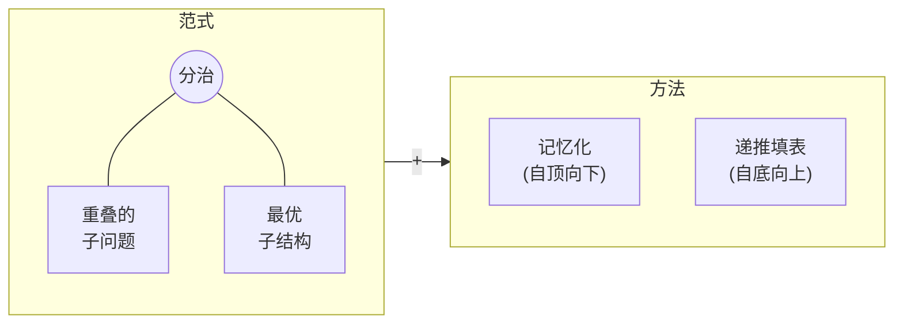

import RecursionDemo from '@components/RecursionDemo.astro';
import FibMemoDemo from '@components/FibMemoDemo.astro';
import DpTableDemo from '@components/DpTableDemo.astro';
import DpGridDemo from '@components/DpGridDemo.astro';
import PathDpDemo from '@components/PathDpDemo.astro';
import FibCountDemo from '@components/FibCountDemo.astro';
import CoinMemoDemo from '@components/CoinMemoDemo.astro';
import CoinCompareDemo from '@components/CoinCompareDemo.astro';

> 在主题 01 里我们看到了斐波那契递归为什么慢。原因不在递归，而在于
> **把同一个值一遍又一遍地重新计算**。  
> 本主题来兑现当时的承诺。只要把算过的答案记下来，指数时间就变成线性时间。  
> 我们把这个想法依次用到找零钱、最长递增子序列、网格路径、最短路径、0/1 背包上，
> 再沿着表格倒着走，把得出答案的那些选择也还原出来。

## 动态规划解决什么问题 \{#what}

[[dynamic-programming|动态规划]]的英文是 dynamic programming。它和
[[divide-and-conquer|分治法]]一样，把问题拆成小问题。不同的是这些小问题
**彼此重叠**。重叠的问题如果每次都重新解，就会把同样的事做无数遍，
所以**把解过的答案存起来，需要时再取出来用**。



- **重叠子问题**（overlapping subproblems）：同一个小问题出现多次。斐波那契的
  $$F(3)$$ 就是这样。
- **最优子结构**（optimal substructure）：大问题的最优解由小问题的最优解构成。
  这样才能把小答案组合成大答案。
- 存答案的方法有两种。一种是保留递归、把答案记下来的
  [[memoization|记忆化]]；另一种是从小问题开始往上填表的
  [[tabulation|递推填表]]。

名字里的"dynamic"并不是指运行时有什么东西在变。20 世纪 50 年代，理查德·贝尔曼
（Richard Bellman）回忆说，这是为了在经费评审时让它听起来少一点数学味而起的
名字。把它理解为“**一边填表一边求解的方法**”就可以了。

## 再看斐波那契 \{#fibonacci}

把主题 01 的斐波那契递归再拿出来。这是照着定义直接写出的代码。

```plaintext
ALGORITHM FibRecursive(n)
    if n <= 1 then
        return n
    return FibRecursive(n-1) + FibRecursive(n-2)
```

一步一步跟着求 $$F(5)$$ 的调用走一遍。重新计算同一个值的节点会被涂成红色。

<RecursionDemo n={5} />

为了求一个 $$F(5)$$，函数被调用了 **15 次**。其中不同的值只有 $$F(0)$$ 到
$$F(5)$$ 这 6 个。数一数每一项被计算了几次：

| 要求的项 | 调用次数 | 其中 $$F(3)$$ | 其中 $$F(2)$$ |
| --- | --- | --- | --- |
| $$F(0)$$, $$F(1)$$ | 1 | | |
| $$F(2)$$ | 3 | | 1 |
| $$F(3)$$ | 5 | 1 | 1 |
| $$F(4)$$ | 9 | 1 | 2 |
| $$F(5)$$ | 15 | 2 | 3 |

调用次数按 $$C(n) = C(n-1) + C(n-2) + 1$$ 增长。正如主题 01 所见，
$$C(n) = 2F(n+1) - 1$$，$$n$$ 每加 1 大约变成 1.6 倍。虽然不是完全二叉树，
[[time-complexity|时间复杂度]]仍按 $$O(2^n)$$ 的形状增长。

反过来，主题 01 的迭代只带着前两项往前走，每一项只算一次。时间 $$O(n)$$，
空间 $$O(1)$$。能不能在保留递归形状的同时做到这一点呢？

### 记忆化：把答案记下来 \{#memoization}

**记忆化**（memoization）顾名思义，就是**做个笔记**。递归保持不变，函数在
返回答案之前先把它写进表里。下次再要同一个值时，不再分叉，直接从表里取。

1. 若 $$n \le 1$$，按斐波那契的基本定义返回原值。
2. 若 memo 里有不是 -1 的值，也就是已经记下了，就返回该值。
3. 否则带着 memo 递归调用。
4. 把结果写进 memo 再返回。

在同一棵树上运行带记忆的递归。黄色是从 memo 里取出的调用，虚线是因此
**根本没有被调用**的分支。注意看左边表格里值被写入和被读取的时刻。

<FibMemoDemo n={5} />

调用 $$F(5)$$ 后，沿着左分支一路下到 $$F(4)$$、$$F(3)$$、$$F(2)$$。到这里为止
memo 是空的，所以和递归完全一样。不同的是返回的路上。

- 求出 $$F(2) = 1$$，写进 `memo[2]`。
- $$F(3)$$ 加上右孩子 $$F(1)$$ 得到 2，写进 `memo[3]`。
- $$F(4)$$ 调用右孩子 $$F(2)$$ 时，这次 `memo[2]` 里已经有 1 了。
  它**不再分叉**，直接返回。
- $$F(5)$$ 的右孩子 $$F(3)$$ 也从 `memo[3]` 取出。递归时 $$F(3)$$ 下面还要再调用
  的 4 次就此消失。

结果调用了 **9 次**。每一项在第一次遇到时计算一次，第二次遇到时只是取出，
所以 $$n \ge 1$$ 时是 $$2n - 1$$ 次。

- 伪代码

```plaintext
ALGORITHM FibMemo(n, memo)
    if n <= 1 then
        return n
    if memo[n] != -1 then             // 如果已经求过
        return memo[n]                // 不再分叉，直接返回
    memo[n] <- FibMemo(n-1, memo) + FibMemo(n-2, memo)
    return memo[n]                    // 返回之前先记下
```

- C 实现

```c
long long fibMemo(int n) {
    calls++;
    if (n <= 1) {
        return n;
    }
    if (memo[n] != -1) {
        return memo[n]; /* 已经求过的值：不再分叉 */
    }
    memo[n] = fibMemo(n - 1) + fibMemo(n - 2);
    return memo[n];
}
```

`n <= 1` 在看 memo 之前就返回了，所以 `memo[0]` 和 `memo[1]` 一直保持 -1。
演示里的表格也是如此。

- **时间** $$O(n)$$：每个值只算一次。
- **空间** $$O(n)$$：除了 memo 数组，递归调用栈最多叠到 $$n$$ 层。

### 递推填表：从小到大填 \{#tabulation}

**递推填表**（tabulation）把方向反过来。不从大问题往下走，而是从小问题开始
**把表一格不漏地往上填**。一个循环加一个数组就够了。填一格时引用的前面格子
是蓝色，正在填的格子是橙色。

<DpTableDemo problem="fib" n={5} />

```plaintext
ALGORITHM FibTabulation(n)
    if n <= 1 then
        return n
    dp[0] <- 0
    dp[1] <- 1
    for i <- 2 to n do
        dp[i] <- dp[i-1] + dp[i-2]    // 前两格已经填好
    return dp[n]
```

- **时间** $$O(n)$$：每格填一次。
- **空间** $$O(n)$$：一张表。没有递归，栈也不会溢出。

`dp[i]` 只看紧挨着的前两格。那就不必留着整个数组，两个变量就够了。这正是
主题 01 的迭代实现。**迭代就是压缩了空间的递推填表。**

### 三种方式并排比较 \{#fib-run}

拖动 $$n$$，亲手数一数三种方式各做了多少事。柱子以当前 $$n$$ 的纯递归调用次数
为全长。下面一行是纯递归调用每个 $$F(k)$$ 的次数，点击柱子就能看到该项的递归与
记忆化调用次数。

<FibCountDemo n={5} />

$$n$$ 超过 20 以后，记忆化和填表的柱子几乎看不见。纯递归调用 $$F(k)$$ 的次数本身
就是斐波那契数，$$F(1)$$ 被调用 $$F(n)$$ 次。

- 运行

```sh
cd src/topic-14-dynamic-programming/01_fibonacci
make -f /work/Makefile fibonacci.out && ./fibonacci.out
```

- 结果

```console
F(5)
  recursive  = 5, calls = 15
  memo       = 5, calls = 9
  memo       = [-1, -1, 1, 2, 3, 5]
  tabulation = 5
  dp         = [0, 1, 1, 2, 3, 5]

 n  recursive calls  memo calls                 F(n)
 10              177          19                   55
 20            21891          39                 6765
 30          2692537          59               832040
 90                -         179  2880067194370816120
```

递归调用次数 177、21891、2692537 与主题 01 表格里的数字相同。加上记忆后，
同样的递归降到 19、39、59 次。$$n$$ 每加 10，递归大约变成 100 倍，记忆化
只多 20 次。

$$n = 90$$ 时递归跑不完，所以跳过。记忆化 179 次就给出答案。改动的只有
两行 `if`。

## 记忆化与递推填表 \{#memo-vs-tab}

两种方式用不同的方向计算同一个递推式。

| | 记忆化 | 递推填表 |
| --- | --- | --- |
| 计算方式 | **lazy**：只算需要的 | **eager**：全部算 |
| 起点 | 从上到下，大问题 → 小问题 | 从下到上，小问题 → 大问题 |
| 实现 | 递归 + 缓存 | 循环 + 表 |
| 直观性 | 照搬递推式即可 | 要另外确定填表顺序 |
| 稳定性 | 太深有栈溢出风险 | 不用栈 |
| 空间优化 | 困难 | 容易（只留前面几格即可） |
| 别名 | 自顶向下（top-down） | 自底向上（bottom-up） |

- **记忆化**在递归调用的过程中保存算好的结果，避免重复计算。像 $$F(4)$$、
  $$F(3)$$ 这样从大问题往下走，**只算需要的子问题**。代价是递归调用的开销。
- **递推填表**从小问题开始按顺序填表。像 $$F(2)$$、$$F(3)$$ 这样从小的开始
  解**所有子问题**，只用循环，所以效率高。

很难断言哪一个更好。先想到递推式时，直接写成记忆化；填表顺序清楚时，
写成递推填表。下一节的 lazy 与 eager 给出选择的依据。

## lazy 与 eager \{#lazy}

记忆化的"只算需要的"，在编程里叫 **lazy**（惰性）。它不是偷懒的意思，
而是**只在需要时才干活的聪明**。反过来，事先全部做好叫 **eager**（急切）。

### 生活中的 lazy \{#lazy-life}

| 例子 | eager | lazy |
| --- | --- | --- |
| 视频流媒体 | 下载完整部电影再播放（等 30 分钟） | 只缓冲马上要看的部分，边下边播 |
| 网页图片 | 把页面上的 100 张图片全部加载 | 只加载屏幕上看得见的，滚动时再加载 |
| 数据库查询 | 一次取出用户的 1000 篇帖子、500 个好友、2000 张照片 | 先取基本信息，其余等打开时再取 |

Netflix 和 YouTube 不等整部电影下载完就开始播放，很长的购物页面每次滚动
才补上图片，这些都是 lazy。

### 编程中的 lazy \{#lazy-code}

Python 的生成器（generator）是 **lazy 的列表**。列表把值全部做好放在内存里，
生成器则在你要下一个值时才做一个。

```python
def squares_eager(n):          # 把所有值存进内存
    result = []
    for i in range(n):
        result.append(i * i)
    return result

def squares_lazy(n):           # 需要时才算一个
    for i in range(n):
        yield i * i

numbers = squares_eager(1000000)   # 生成一个 100 万个元素的列表
numbers = squares_lazy(1000000)    # 还什么都没算
```

函数式语言（Haskell 等）在语言层面就这样做。先定义一个无限列表，再按需
取用。用 Python 模仿同样的想法是这样的：

```python
def fibonacci_infinite():      # "定义"无限多个斐波那契数
    a, b = 0, 1
    while True:
        yield a
        a, b = b, a + b

fib = fibonacci_infinite()
first_10 = [next(fib) for _ in range(10)]   # 实际只算了 10 个
```

### 什么时候用哪一个 \{#lazy-when}

**lazy（记忆化）更好的时候**

- 只需要部分结果时：只要知道 $$F(50)$$ 一个值
- 条件计算：只有在特定条件下才需要部分计算
- 节省内存时：不必保存所有中间结果
- 快速原型：先要一份能跑的代码

**eager（递推填表）更好的时候**

- 需要全部结果时：$$F(1)$$ 到 $$F(50)$$ 都要
- 重视稳定性时：想避开栈溢出的风险
- 打磨性能时：想去掉递归调用的开销
- 打磨空间时：想精细地控制内存用量

在下一个例子（找零钱）里，这个差别会以数字的形式显现。记忆化始终没有去求
5 韩元，而表格把 5 韩元也一格不漏地填上了。

## 例 1. 找零钱 \{#coin-change}

- **问题**：凑出某个金额所需硬币数的最小值
- **输入**：硬币 `{2, 3, 5}`，金额 6 韩元（同一种硬币可以用任意多次）
- **答案**：2 枚（3 + 3）

主题 06 的贪心是"从最大的硬币开始"。在这里贪心先付 5 韩元，剩下的 1 韩元
凑不出来，就卡住了。动态规划以**最后付出的那枚硬币**为基准来思考。如果
最后一枚是 $$c$$，剩下的 $$a - c$$ 韩元又是同一个问题。

$$
C(a) = \begin{cases}
0 & a = 0 \\
\min\limits_{c \,\in\, \text{coins},\ c \le a} \bigl( C(a - c) + 1 \bigr) & a > 0
\end{cases}
$$

凑不出的金额记为 $$\infty$$（代码里是 `INF`）。

### 记忆化 \{#coin-memo}

把递推式原样写成递归，再加上 memo。步骤和斐波那契一样。
单步跟着 `coinChangeMemo(6)` 实际往下走一遍。节点上面的数是金额，下面的数是该金额
的答案（最少硬币数）。黄色是从 memo 取出的调用，虚线是负数金额，粗边是给出最小值的
硬币。

<CoinMemoDemo coins={[2, 3, 5]} amount={6} />

把这个过程写成伪代码是这样：

```plaintext
ALGORITHM CoinChangeMemo(amount, coins, m, memo)
    if amount = 0 then return 0          // 1. 基本情况：0 元需要 0 枚
    if amount < 0 then return INF        //    负数金额凑不出
    if memo[amount] != -1 then           // 2. 已经求过的金额直接返回
        return memo[amount]
    best <- INF                          // 3. 每种硬币各付一枚，剩下的递归
    for i <- 0 to m-1 do
        r <- CoinChangeMemo(amount - coins[i], coins, m, memo)
        if r != INF and r + 1 < best then
            best <- r + 1
    memo[amount] <- best                 // 4. 记下再返回
    return best
```

`memo[1]` 求过一次后又被取出用了两次。运行结果里的 `memo` 数组原样留下了
这个过程。

```console
coins = {2, 3, 5}, amount = 6
  solve 6
  solve 4
  solve 2
  solve 1
  solve 3
memo -> 2 coins, solved 5 amounts
  memo = [-1, INF, 1, 1, 2, -1, 2]
```

`memo[5]` 保持 -1。因为凑 6 韩元时用不到 5 韩元的答案。这就是 **lazy**。
`memo[0]` 是 -1，是因为 0 韩元在基本情况里就直接返回了。

### 递推填表 \{#coin-tab}

用同一个递推式，从 1 韩元开始填。填一格时，对每种硬币看 $$a - c$$ 韩元那一格。
表上方的蓝色箭头就是这些引用，最深的箭头是给出最小值的那一格。填完后，表的
下方会有**路径还原**箭头倒着连起来。

<DpTableDemo problem="coin" coins={[2, 3, 5]} amount={6} />

```plaintext
ALGORITHM CoinChangeTab(amount, coins, m)
    dp[0] <- 0                           // 1. 初始化
    for a <- 1 to amount do dp[a] <- INF
    for a <- 1 to amount do              // 2. 从小金额开始一个不漏
        for i <- 0 to m-1 do
            c <- coins[i]
            if c <= a and dp[a - c] != INF and dp[a - c] + 1 < dp[a] then
                dp[a] <- dp[a - c] + 1
                choice[a] <- c           //    这个金额最后付的硬币
    if dp[amount] = INF then return INF  // 3. 返回
    a <- amount                          // 4. 路径还原：沿 choice 倒着走
    while a > 0 do
        output choice[a]
        a <- a - choice[a]
    return dp[amount]
```

看看填 6 韩元这一格的那一刻：

| 最后一枚硬币 | 引用的格子 | 候选 |
| --- | --- | --- |
| 2 | `dp[4]` = 2 | 3 |
| 3 | `dp[3]` = 1 | **2**（最小） |
| 5 | `dp[1]` = INF | 不行 |

**只有答案的枚数，并不知道付了哪些硬币**。所以每当最小值更新时，就把那枚
硬币记进 `choice[a]`。填完后，`choice[6] = 3`，于是走到 3 韩元那一格；
`choice[3] = 3`，于是走到 0 韩元那一格。付出的硬币是 3 + 3。**沿着表倒着走、
把得出答案的选择还原出来**，这就叫路径还原。本主题其余的例子都用同样的方法。

```console
tab  -> 2 coins: 3 + 3, filled 6 amounts
  dp   = [0, INF, 1, 1, 2, 1, 2]
```

表格把 `dp[5] = 1` 也填上了，但答案里没有用到。这就是 **eager**。
金额为 $$A$$、硬币 $$m$$ 种时，时间 $$O(Am)$$，空间 $$O(A)$$。

### 主题 06 的 80 韩元 \{#coin-revisit}

在主题 06 里，用硬币 `{50, 40, 10}` 找 80 韩元时，贪心先拿了 50 韩元，付了
**4 枚**（50 + 10 + 10 + 10）。来填同样的表。硬币都是 10 的倍数，所以只显示
10 韩元为单位的格子。中间的金额凑不出，也不会被引用。

<DpTableDemo problem="coin" coins={[50, 40, 10]} amount={80} unit={10} />

在 80 韩元那一格，最后付 50 韩元是 `dp[30] + 1 = 4`，付 40 韩元是
`dp[40] + 1 = 2`。表格把两者**都比较了**，所以选 2。贪心在拿起 50 韩元的那一刻，
就再也没有回头看 40 韩元那条路。

- 运行

```sh
cd src/topic-14-dynamic-programming/02_coin_change
make -f /work/Makefile coinChange.out && ./coinChange.out
```

- 结果

```console
coins = {2, 3, 5}, amount = 6
  solve 6
  solve 4
  solve 2
  solve 1
  solve 3
memo -> 2 coins, solved 5 amounts
  memo = [-1, INF, 1, 1, 2, -1, 2]
tab  -> 2 coins: 3 + 3, filled 6 amounts
  dp   = [0, INF, 1, 1, 2, 1, 2]

coins = {50, 40, 10}, amount = 80
memo -> 2 coins, solved 8 amounts
tab  -> 2 coins: 40 + 40, filled 80 amounts
```

在 80 韩元里，记忆化只解了 10 韩元为单位的 **8 个**金额，表格则从 1 韩元起
把 **80 格**全部填满。两者的答案都是 2 枚，40 + 40。

贪心与动态规划答案不同的金额不只 80 韩元。选一组硬币或自己输入，再点击金额格子，
比较两种方法付出的硬币。有的组合像 `{100, 50, 10}` 那样贪心总是对的，也有像
`{2, 3, 5}` 那样会让贪心卡住的组合。

<CoinCompareDemo coins={[50, 40, 10]} amount={80} />

## 例 2. 最长递增子序列 \{#lis}

- **问题**：在数组中保持顺序挑出若干个，组成严格递增的最长序列，求其长度
- **输入**：`[10, 9, 2, 5, 3, 7, 101, 18]`
- **答案**：4

最长递增子序列（longest increasing subsequence，LIS）可能不止一个。这个数组
里长度为 4 的有四个。

```plaintext
[10, 9, 2, 5, 3, 7, 101, 18]   →  2  5  7  101
                                   2  5  7  18
                                   2  3  7  101
                                   2  3  7  18
```

### 记忆化：选，还是不选 \{#lis-memo}

从前往后看元素，决定**选不选**。要选，就得比最后选的元素大。所以剩下的事由
"现在要看的元素 `i`"和"最后选的元素 `prev`"两样决定。

```plaintext
ALGORITHM LisHelper(arr, n, i, prev)
    if i = n then return 0                       // 1. 基本情况：没有元素可看了
    if memo[i][prev+1] != -1 then                // 2. 已求过的 (i, prev) 直接返回
        return memo[i][prev+1]
    exclude <- LisHelper(arr, n, i+1, prev)      // 3. 不选 arr[i] 的情况
    include <- 0
    if prev = -1 or arr[i] > arr[prev] then      //    如果可以选 arr[i]
        include <- 1 + LisHelper(arr, n, i+1, i) //    选的情况
    memo[i][prev+1] <- max(include, exclude)     // 4. 记下两者中较大的
    return memo[i][prev+1]
```

`prev` 为 -1 表示还什么都没选。表的列用 `prev + 1`，是为了把这个 -1 放进第 0 列。

每个元素分成两条路，所以不加记忆是 $$O(2^n)$$。可是路不同，**剩下的事却可能
相同**。看 `[2, 10, 5, 7, 3]` 的前两个元素分出的四条路：

| 2 | 10 | 已选序列 | 剩下的事 |
| --- | --- | --- | --- |
| 选 | 选 | `[2, 10]` | `i = 2, prev = 10` |
| 选 | 不选 | `[2]` | `i = 2, prev = 2` |
| 不选 | 选 | `[10]` | `i = 2, prev = 10`（与第一行是同一个子问题） |
| 不选 | 不选 | `[]` | `i = 2`，还没选 |

第一行和第三行选出的序列不同，但往后还能接多长，只由 `(i = 2, prev = 10)`
决定。所以只需解一次。子问题至多 $$n(n+1)$$ 个，时间和空间都是 $$O(n^2)$$。

### 表格实际被用了几次 \{#lis-memo-hits}

每从 memo 里取一次，就打印一行。

```console
arr = [10, 9, 2, 5, 3, 7, 101, 18]

plain recursion = 4, calls = 108
memo hits (i, prev + 1)
  hit memo[7][7] = 0
  hit memo[7][7] = 0
  hit memo[6][6] = 1
  hit memo[7][7] = 0
  hit memo[6][6] = 1
  hit memo[7][7] = 0
  hit memo[6][6] = 1
  hit memo[5][5] = 2
  hit memo[4][4] = 2
  hit memo[7][7] = 0
  hit memo[7][7] = 0
memo = 4, calls = 62, hits = 11, filled 36 of 72
```

出乎意料，只有 **11 次**。72 格只填了 36 格，调用从 108 次降到 62 次。
`hit memo[7][7] = 0` 是轮到看第 7 个元素（18）、而最后选的是第 6 个（101）的
情形。18 不能接在 101 后面，所以是 0。

只有 8 个元素时，相同的 `(i, prev)` 重叠得没有想象中多。数组越长，不加记忆的
递归按 $$2^n$$ 增长，记忆化按 $$n^2$$ 增长，差距会急剧拉大。

### 递推填表：以这里结尾的最长长度 \{#lis-tab}

递推填表换了个问法。把 `dp[i]` 定义为**以 `arr[i]` 结尾**的最长递增子序列的
长度。这样 `arr[i]` 就接在它前面某个比它小的元素后面。

$$
dp[i] = 1 + \max \{\, dp[j] : j < i,\ arr[j] < arr[i] \,\}
$$

没有这样的 $$j$$ 时 `dp[i] = 1`。因为单个元素本身长度就是 1。填一格时要看前面
**好几格**。蓝色箭头是比自己小的元素，深色箭头是给出最长序列的那个元素。

<DpTableDemo problem="lis" arr={[10, 9, 2, 5, 3, 7, 101, 18]} />

```plaintext
ALGORITHM LisTab(arr, n)
    for i <- 0 to n-1 do                         // 1. 初始化
        dp[i] <- 1                               //    单个元素长度为 1
        prev[i] <- -1
    for i <- 1 to n-1 do                         // 2. 扫过前面所有元素
        for j <- 0 to i-1 do
            if arr[j] < arr[i] and dp[j] + 1 > dp[i] then
                dp[i] <- dp[j] + 1               //    把 arr[i] 接在 arr[j] 后
                prev[i] <- j
    // 3. 找最大值：dp 最大的第一个下标
    end <- argmax(dp)
    // 4. 路径还原：从 end 沿 prev 倒着收集
    return dp[end]
```

答案不是 `dp[n-1]`，而是 **`dp` 的最大值**。因为不能保证最长的序列以最后一个
元素结尾。每格都要看前面所有格子，所以时间 $$O(n^2)$$，空间 $$O(n)$$。

- 运行

```sh
cd src/topic-14-dynamic-programming/03_lis
make -f /work/Makefile lis.out && ./lis.out
```

- 结果（后半部分）

```console
tab  = 4
  dp   = [1, 1, 1, 2, 2, 3, 4, 4]
  prev = [-1, -1, -1, 2, 2, 3, 5, 5]
  one LIS: 2 5 7 101
```

`prev` 用来还原路径。最大值 4 第一次出现在第 6 个（101）。从那里沿 `prev` 走，
是第 5 个（7）、第 3 个（5）、第 2 个（2），反过来就是 `2 5 7 101`。如果选
长度相同的 18 那一边，就是 `2 5 7 18`。答案有多个时出哪一个，由平局怎么处理
决定。

## 例 3. 网格路径 \{#grid-paths}

- **问题**：从网格的 `(0, 0)` 到 `(5, 5)`，每次只能 `x+1` 或 `y+1`，求路径数
- **条件**：障碍 `(2, 2)`、`(3, 3)`、`(4, 4)` 不能通过。
- **答案**：48

走到某一格的路只有**从上面一格来的**和**从左边一格来的**。所以一格的值是
上面一格的值 + 左边一格的值。障碍格为 0。

<DpGridDemo problem="grid" />

用 Python 写出来是这样的。记忆化数"从这里到终点"，递推填表
数"从起点到这里"。

```python
obstacles = [(2, 2), (3, 3), (4, 4)]  # 障碍位置

def paths_memo(x, y, tx, ty, memo):
    if x == tx and y == ty:                      # 到达终点
        return 1
    if x > tx or y > ty or (x, y) in obstacles:  # 越界或障碍
        return 0
    if (x, y) in memo:
        return memo[(x, y)]
    memo[(x, y)] = paths_memo(x + 1, y, tx, ty, memo) + \
                   paths_memo(x, y + 1, tx, ty, memo)
    return memo[(x, y)]

def paths_tab(tx, ty):
    dp = [[0] * (ty + 1) for _ in range(tx + 1)]
    for i in range(tx + 1):
        for j in range(ty + 1):
            if (i, j) in obstacles:
                dp[i][j] = 0
            elif i == 0 and j == 0:
                dp[i][j] = 1
            else:
                up = dp[i - 1][j] if i > 0 else 0
                left = dp[i][j - 1] if j > 0 else 0
                dp[i][j] = up + left
    return dp[tx][ty]
```

- 运行

```sh
cd src/topic-14-dynamic-programming/04_grid_paths
make -f /work/Makefile gridPaths.out && ./gridPaths.out
```

- 结果

```console
grid 6 x 6, (0, 0) -> (5, 5), obstacles (2, 2) (3, 3) (4, 4)

plain recursion = 48, calls = 439
memo            = 48, calls = 65, solved 32 cells
tab             = 48

  x\y    0    1    2    3    4    5
   0     1    1    1    1    1    1
   1     1    2    3    4    5    6
   2     1    3    #    4    9   15
   3     1    4    4    #    9   24
   4     1    5    9    9    #   24
   5     1    6   15   24   24   48
```

没有障碍时，是从 10 步里挑出向下走的 5 步的方法数 $$\binom{10}{5} = 252$$。
对角线上的三个障碍挡住了其中 204 条，剩下 48 条。不加记忆的递归调用了 439 次，
记忆化 65 次。表的大小为 $$X \times Y$$ 时，时间和空间都是 $$O(XY)$$。

终点是 `(5, 5)` 时，即使网格是 10 × 10，答案也一样。因为只能向右、向下走，
越过终点的格子用不上。

亲手挪动障碍。点击格子会放置或移除障碍，表格从头重新填写。三个障碍全部移除后
答案变成 252。只挡住一格，经过那一格的路径也会一下子全部消失。

<DpGridDemo problem="grid" editable />

## 例 4. 寻路：恰好 k 条边的最短路径 \{#shortest-path}

这次是[[graph|图]]。在每条边带代价的有向图中，从顶点 0 出发，**恰好用 3 条边**
到达顶点 3，求最便宜的路。下面演示左边的图就是这个图。一共 9 条边。

```plaintext
0→1 (1)   0→2 (2)   1→3 (6)   2→1 (2)   2→3 (4)
2→4 (3)   3→5 (3)   4→3 (1)   4→5 (5)
```

用 3 条边的路只有两条。

- 路 1：0 → 2 → 4 → 3，代价 2 + 3 + 1 = **6**
- 路 2：0 → 2 → 1 → 3，代价 2 + 2 + 6 = 10

### 拆分问题的方法 \{#shortest-path-split}

不直接数"从 0 到 3 用 3 条边"，而是按**第一步**拆开。

1. 0 的选择有 1 和 2 两个。
   - 选 1，剩下的是**用 2 条边从 1 到 3**
   - 选 2，剩下的是**用 2 条边从 2 到 3**
2. 1 的选择只有 3 一个。剩下的是用 1 条边从 3 到 3。没有这样的边，所以这条路
   **不行**。
3. 2 的选择有 1、3、4。
   - 用 1 条边从 1 到 3：6，所以 2 → 1 → 3 是 2 + 6 = 8
   - 用 1 条边从 3 到 3：不行
   - 用 1 条边从 4 到 3：1，所以 2 → 4 → 3 是 3 + 1 = 4
   - 所以**用 2 条边从 2 到 3 的最小值是 4**
4. 0 → 2 → 4 → 3 = 2 + (3 + 1) = **6**

写成递推式是这样的。$$S(u, v, k)$$ 是从 $$u$$ 用 $$k$$ 条边到 $$v$$ 的最小代价。

$$
S(u, v, k) = \begin{cases}
0 & k = 0,\ u = v \\
\infty & k = 0,\ u \ne v \\
\min\limits_{u \to x} \bigl( w(u, x) + S(x, v, k-1) \bigr) & k > 0
\end{cases}
$$

### 从递归到记忆化 \{#shortest-path-memo}

把递推式原样写成递归是**实现 1**，再加上 `memo[k][u][v]` 表就是**实现 2**。
表里除了值，还记下**最便宜的第一步**（`next`）。终点固定为 3，所以演示里的表
行是 $$k$$、列是出发顶点 $$u$$。蓝色虚线是正在尝试的边，深蓝是给出最小值的边。
最后沿着 `next` 用粉色箭头把路还原出来。

<PathDpDemo />

```plaintext
ALGORITHM ShortestMemo(u, v, k, memo, next)
    // 1. 基本情况：边用完了
    if k = 0 then
        if u = v then return 0 else return INF
    // 2. 已求过的 (k, u, v) 直接返回
    if memo[k][u][v] != -1 then
        return memo[k][u][v]
    // 3. 逐一尝试第一条边 u -> x
    best <- INF
    for each edge u -> x do
        r <- ShortestMemo(x, v, k-1, memo, next)
        if r != INF and w(u, x) + r < best then
            best <- w(u, x) + r
            next[k][u][v] <- x        // 记下最便宜的第一步
    // 4. 记下再返回
    memo[k][u][v] <- best
    return best

ALGORITHM RestorePath(u, v, k, next)  // 5. 路径还原
    path <- [u]
    while k > 0 do
        u <- next[k][u][v]            // 沿记下的第一步走
        append u to path
        k <- k - 1
    return path
```

- 运行

```sh
cd src/topic-14-dynamic-programming/05_shortest_path
make -f /work/Makefile shortestPath.out && ./shortestPath.out
```

- 结果

```console
edges: 0->1 (1), 0->2 (2), 1->3 (6), 2->1 (2), 2->3 (4), 2->4 (3), 3->5 (3), 4->3 (1), 4->5 (5)
0 -> 3 with exactly 3 edges

plain recursion = 6, calls = 12
  hit memo[1][3][3] = INF
memo            = 6, calls = 11
  k=1: 1->3 = 6, 3->3 = INF, 4->3 = 1
  k=2: 1->3 = INF, 2->3 = 4
  k=3: 0->3 = 6
path: 0 -> 2 -> 4 -> 3 (2 + 3 + 1 = 6)
```

memo 表里写下的格子与上面手工拆分的步骤一一对应。

| $$k$$ | 写下的格子 | 含义 |
| --- | --- | --- |
| 1 | 1→3 = 6, 3→3 = INF, 4→3 = 1 | 用 1 条边到 3 的代价 |
| 2 | 1→3 = INF, 2→3 = 4 | 用 2 条边到 3 的代价 |
| 3 | 0→3 = 6 | 要求的答案 |

表的 18 格（`k` = 1\~3，6 个顶点）中**只求了 6 格**。记忆化只填需要的格子。
这个图很小，调用次数是 12 次和 11 次，几乎一样。`3→3`（1 条边）被需要了两次，
第二次是从表里取的。图一变大，遇到相同 `(k, u)` 的次数会成指数增长。不加记忆
时每选一条边就分叉，出边为 $$d$$ 条时是 $$O(d^k)$$；加上记忆后，$$kV$$ 个格子
各解一次，是 $$O(kVd)$$。

### 路径还原 \{#path-restore}

`memo` 里只有代价。知道代价是 6，也不知道是哪条路。所以在 `best` 更新的那一刻，
把第一步一起记进 `next[k][u][v]`。求出答案后，从起点出发沿着记下的第一步走
$$k$$ 次就行了。

```plaintext
next[3][0][3] = 2    0 → 2   (代价 2)
next[2][2][3] = 4    2 → 4   (代价 3)
next[1][4][3] = 3    4 → 3   (代价 1)
```

找零钱的 `choice`、LIS 的 `prev`、这里的 `next` 做的都是同一件事。
**决定值的时候把所选的一起记下，最后倒着走回去**。在动态规划里，只要问的不是
"最小值"而是"怎样才能最小"，总会多出这一行。

这个问题和主题 12 的[[shortest-path|最短路径]]不同。Dijkstra 求的是边数不限的
最便宜的路。这里有"恰好 $$k$$ 条边"的条件，所以用 2 条边的 0 → 2 → 3（6）不能
作为答案。

## 例 5. 0/1 背包 \{#knapsack}

这是在主题 06 里留下的问题。

- **问题**：往容量 50 的背包里装物品，使价值之和最大。
- **条件**：物品**不能分割**。要么装，要么不装。
- **物品**：（重 10，价值 60）、（重 20，价值 100）、（重 30，价值 120）

按单位重量价值装的贪心，装了物品 1 和 2 后，剩下的 20 放不下物品 3，停在
**160**。装物品 2 和 3 则是 **220**。

动态规划一个一个地增加物品，**在所有容量上比较"装这个物品 / 不装"**。把
`dp[i][c]` 定义为只用物品 1 到 $$i$$、容量为 $$c$$ 时能装下的最大价值。

$$
dp[i][c] = \begin{cases}
dp[i-1][c] & w_i > c \\
\max\bigl(dp[i-1][c],\ dp[i-1][c - w_i] + v_i\bigr) & w_i \le c
\end{cases}
$$

- 上面一格 `dp[i-1][c]`：不装物品 $$i$$ 的情况
- 上一行往左 $$w_i$$ 格 + $$v_i$$：装物品 $$i$$ 的情况

重量都是 10 的倍数，所以演示只显示以 10 为单位的列。填完后，从右下角往上
回溯，还原装了哪些物品。

<DpGridDemo problem="knapsack" />

```plaintext
ALGORITHM Knapsack(w, v, n, W)
    // 1. 没有物品时价值为 0
    for c <- 0 to W do dp[0][c] <- 0
    // 2. 一个一个地增加物品
    for i <- 1 to n do
        for c <- 0 to W do
            dp[i][c] <- dp[i-1][c]                      // 不装（上面一格）
            if w[i] <= c and dp[i-1][c - w[i]] + v[i] > dp[i][c] then
                dp[i][c] <- dp[i-1][c - w[i]] + v[i]    // 装
    // 3. 路径还原：从下往上，与上面一格不同就是装了物品 i
    c <- W
    for i <- n downto 1 do
        if dp[i][c] != dp[i-1][c] then
            take item i
            c <- c - w[i]
    return dp[n][W]
```

- 运行

```sh
cd src/topic-14-dynamic-programming/06_knapsack
make -f /work/Makefile knapsack.out && ./knapsack.out
```

- 结果

```console
capacity = 50
items: (w=10, v=60) (w=20, v=100) (w=30, v=120)

dp (columns every 10)
  i\c    0   10   20   30   40   50
  0      0    0    0    0    0    0
  1      0   60   60   60   60   60
  2      0   60  100  160  160  160
  3      0   60  100  160  180  220

best = 220
  take item 3 (w=30, v=120)
  take item 2 (w=20, v=100)
```

右下角的 220 是比较上面一格 160（不装物品 3）和 `dp[2][20] + 120 = 220`（装物品 3）
的结果。贪心错过的"丢掉物品 1、装 2 和 3"的情况，早已包含在 `dp[2][20] = 100`
这一格里。

还原从下往上走。`dp[3][50] = 220` 与上面一格不同，所以装了物品 3，容量移到 20。
`dp[2][20] = 100` 也与上面一格的 60 不同，所以装了物品 2。`dp[1][0] = 0` 与上面
一格相同，所以没有装物品 1。

改一改容量和物品。把容量降到 40，答案变成 180（物品 1、3）。表格下面一行会显示
同样条件下贪心（按单位重量价值）得到的答案。

<DpGridDemo problem="knapsack" editable />

表的大小是 $$(n+1) \times (W+1)$$，所以时间和空间都是 $$O(nW)$$。请注意 $$W$$ 是
输入的**数值**。容量是 10 亿，表就有 10 亿格。所以这个算法看起来像多项式时间，
严格来说称为伪多项式时间（pseudo-polynomial）。

## 动态规划小结 \{#summary}

### 什么时候能用 \{#when}

- **问题由更小的（重复出现的）实例构成时**，以子问题的解为基础来求解。
- **像分治一样**把问题拆成更小的实例。
  - 不过与分治不同，它用于**子问题彼此重叠的时候**。
  - 先解小实例，把结果存起来（记忆化、递推填表），之后用这些结果去解更大的实例。
- **像贪心一样**，主要用来解**最优化问题**。
  - 候选解有多个，从中找出值最优（最好）的那个。
  - 贪心只跟着一个候选走，动态规划把候选**全部**比较。这就是 80 韩元和 0/1 背包
    答案不同的原因。
- **只在有最优子结构时**才能用。这叫作**最优性原理**（principle of optimality）。
  - 一个问题实例的最优解，总是包含它所有子实例的最优解。
  - 例：在最短路径中，若 $$v_k$$ 在从 $$v_i$$ 到 $$v_j$$ 的最优路径上，则从 $$v_i$$
    到 $$v_k$$、从 $$v_k$$ 到 $$v_j$$ 的部分路径也分别是最优的。
  - 反例：**最长简单路径**没有这个性质。把两段部分路径分别拉到最长，顶点可能
    重复，简单路径就被破坏了。

### 与分治有何不同 \{#vs-divide}

| | 分治 | 动态规划 |
| --- | --- | --- |
| 方向 | 自顶向下：把问题拆开往下走 | 以自底向上为主（记忆化用自顶向下做同样的事） |
| 子问题 | 彼此不重叠 | 彼此重叠 |
| 效率 | 子问题相互独立时高效 | 存下重叠的答案，消除重复计算 |
| 重叠时 | 反复解同样的问题，低效 | 只解一次 |
| 例子 | 归并排序、快速排序、斐波那契递归 | 斐波那契迭代、找零钱、LIS、背包 |

斐波那契递归是分治的形状，但子问题重叠，所以低效。用动态规划看同一个问题，
一个循环就解决了。

### 设计的顺序 \{#design}

1. **确定子问题**。要能用一句话写出表的一格代表什么，比如"`dp[a]` 是凑出
   `a` 韩元的最少硬币数"。
2. **建立递归性质（递推式）**。用小格子表示大格子。通常按"最后一次选择"拆开。
   最后一枚硬币、最后一个元素、第一条边、最后一个物品都是例子。
3. **确定基本情况**。确定不能再拆的格子的值。
4. **确定计算方向**。记忆化就在递归上加表；递推填表就安排顺序，让被引用的格子
   先填好。
5. **需要时记录选择并还原**。`choice`、`prev`、`next`

### 动态规划解决的著名问题 \{#problems}

| 问题 | 一格的含义 |
| --- | --- |
| 斐波那契数列 | $$F(n)$$ |
| 二项式系数 | $$\binom{n}{k} = \binom{n-1}{k-1} + \binom{n-1}{k}$$ |
| 找零钱 | 凑出金额 $$a$$ 的最少硬币数 |
| 全源最短路径（Floyd 算法） | 只经过顶点 $$1..k$$ 从 $$i$$ 到 $$j$$ 的最短距离 |
| 矩阵链乘法 | 计算 $$A_i \cdots A_j$$ 的最少乘法次数 |
| 背包 | 物品 $$1..i$$、容量 $$c$$ 的最大价值 |
| 旅行商问题 | 已访问顶点集合 $$S$$、最后顶点 $$j$$ 的最小代价 |
| 编辑距离 | 字符串前 $$i$$ 个字符与前 $$j$$ 个字符之间的距离 |
| 序列比对（Smith-Waterman、Needleman-Wunsch） | 两条 DNA 序列前缀的最优比对得分 |

## 本主题要记住的 \{#takeaway}

- **动态规划**：重叠子问题的答案只算一次，存起来再用。要有最优子结构，才能用
  小答案组成大答案。
- **记忆化**（自顶向下，lazy）：递归保持不变，把答案记下来。只填需要的格子。
  斐波那契递归的 15 次调用变成 9 次，$$O(2^n)$$ 变成 $$O(n)$$。
- **递推填表**（自底向上，eager）：从小问题开始把表一格不漏地填满。不用栈，
  容易压缩空间。主题 01 的迭代就是压缩了空间的递推填表。
- 找零钱 `{50, 40, 10}` 凑 80 韩元是 **2 枚**（40 + 40），0/1 背包是 **220**。
  贪心只跟着一个候选走所以错过了，动态规划全部比较后找到了。
- **路径还原**：决定值时把所选的（`choice`、`prev`、`next`）一起记下，最后
  倒着走回去。
- 设计从**确定表的一格是什么**开始。递推式、基本情况、填表顺序都由这个定义
  推出。

## 实践代码 \{#code}

位于 [lec-algorithm/algorithm-code](https://github.com/lec-algorithm/algorithm-code/tree/main)
仓库的 `src/topic-14-dynamic-programming/` 目录下。每个例子都是一份伪代码
配上 C 和 Python 两种实现。

```plaintext
src/topic-14-dynamic-programming/
├── 01_fibonacci/       # 递归 15 次，记忆化 9 次，递推填表。算到 n = 90
├── 02_coin_change/     # 6 = 3 + 3，主题 06 的 80 = 40 + 40
├── 03_lis/             # LIS 4，记忆命中 11 次，还原出 2 5 7 101
├── 04_grid_paths/      # 绕开三个障碍到 (5, 5) 共 48 条
├── 05_shortest_path/   # 3 条边 0 → 2 → 4 → 3，代价 6
└── 06_knapsack/        # 0/1 背包 220，物品 2 和 3
```

打开文件，按编辑器右上角的 **▶ 按钮**即可运行。运行方法见
[实践环境准备](/article/setup-guide/)。

**亲手试试**

- 删掉 `fibMemo` 里检查 memo 的两行 `if`。调用次数会和递归一模一样。变快的原因
  就只是这两行。
- 在找零钱里用 `{50, 40, 10}` 再找几个贪心与动态规划答案不同的金额。和主题 06 的
  贪心代码并排运行，马上就能比较。
- 把 LIS 数组加长到 20 个左右，比较 `plain recursion` 和 `memo` 的调用次数。
- 清空网格路径的 `obstacles`，确认结果是 252。
- 把最短路径的终点改成 5、`k` 改成 4。会得到 `0 -> 2 -> 4 -> 3 -> 5`（9）。
- 把背包容量改成 40。会得到 180（物品 1、3）。

## 版本记录 \{#changelog}

幻灯片与本资料一起升版。当前版本是 **v1**，幻灯片左下角
可以看到同一版本号。

| 版本 | 日期 | 内容 |
| --- | --- | --- |
| v1 | 2026-10-26 | 首次公开 |
