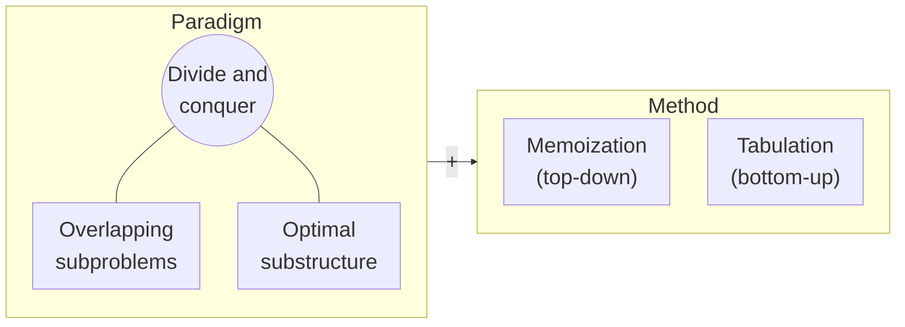

import Slide from 'stack-site-builder/components/Slide.astro';
import RecursionDemo from '@components/RecursionDemo.astro';
import FibMemoDemo from '@components/FibMemoDemo.astro';
import DpTableDemo from '@components/DpTableDemo.astro';
import DpGridDemo from '@components/DpGridDemo.astro';
import PathDpDemo from '@components/PathDpDemo.astro';
import FibCountDemo from '@components/FibCountDemo.astro';
import CoinMemoDemo from '@components/CoinMemoDemo.astro';
import CoinCompareDemo from '@components/CoinCompareDemo.astro';

{/* Slide rules follow the slide section of docs/writing-rules.md.
    Numbers match the practice code (topic-14-dynamic-programming) exactly. */}

<Slide class="cover">

# Dynamic Programming

Topic 14

*Advanced Algorithms*

</Slide>

<Slide>

## Topic 01's promise
::sub[Why was recursive Fibonacci slow?]

- The culprit was not recursion but **computing the same value over and over**.
- Just writing each answer down once turns exponential time into linear time.

<br/>

We apply that idea in turn to coin change, the longest increasing subsequence,  
grid paths, shortest paths, and the 0/1 knapsack.  
Then we walk the table backwards to recover **the choices that built the answer**.

</Slide>

<Slide class="center">

## Dynamic programming
::sub[Dynamic Programming]

</Slide>

<Slide>

#### Divide and conquer + storage
::sub[When the smaller problems overlap]



</Slide>

<Slide>

#### Two conditions and two methods
::sub[The "dynamic" in the name does not mean "changes at run time"]

- **Overlapping subproblems**
  - The same small problem shows up many times.
- **Optimal substructure**
  - The optimal solution to a large problem is built from optimal solutions to smaller ones.
- **There are two ways to store answers.**
  - Memoization: keep the recursion and write the answers down.
  - Tabulation: fill a table upward from the smallest problems.

</Slide>

<Slide class="center">

## Fibonacci, again
::sub[Fibonacci]

</Slide>

<Slide class="compact">

#### Recursive Fibonacci
::sub[Topic 01's code as is]

```plaintext
ALGORITHM FibRecursive(n)
    if n <= 1 then
        return n
    return FibRecursive(n-1) + FibRecursive(n-2)
```

- **Time** $$O(2^n)$$: grows exponentially.
- **Space** $$O(n)$$: the recursion stack
- **The problem**: it repeats the same computations.

</Slide>

<Slide class="compact">

#### Iterative Fibonacci
::sub[Carry just the two previous terms forward]

```plaintext
ALGORITHM FibIterative(n)
    if n <= 1 then return n
    prev <- 0, curr <- 1
    for i <- 2 to n do
        next <- prev + curr
        prev <- curr
        curr <- next
    return curr
```

- **Time** $$O(n)$$ · **Space** $$O(1)$$

</Slide>

<Slide>

### One step at a time: F(5)
::sub[A node that recomputes a value turns red]

<RecursionDemo n={5} slide />

</Slide>

<Slide>

#### How much Fibonacci computes
::sub[Calls C(n) = C(n-1) + C(n-2) + 1]

| Term | Calls | of which $$F(3)$$ | of which $$F(2)$$ |
| --- | --- | --- | --- |
| $$F(0)$$, $$F(1)$$ | 1 | | |
| $$F(2)$$ | 3 | | 1 |
| $$F(3)$$ | 5 | 1 | 1 |
| $$F(4)$$ | 9 | 1 | 2 |
| $$F(5)$$ | 15 | 2 | 3 |

15 calls for $$F(5)$$ alone, yet only 6 distinct values.  
$$C(n) = 2F(n+1) - 1$$, growing about 1.6 times per step.

</Slide>

<Slide class="center">

## Memoization
::sub[Memoization: take a memo]

</Slide>

<Slide class="compact">

#### Write the answer down
::sub[`01_fibonacci/fibonacci.c` · only two lines of if changed]

```c
long long fibMemo(int n) {
    if (n <= 1) {
        return n;                       // 1. the base definition
    }
    if (memo[n] != -1) {
        return memo[n];                 // 2. already written down: return at once
    }
    memo[n] = fibMemo(n - 1) + fibMemo(n - 2);  // 3. compute recursively
    return memo[n];                     // 4. write it down and return
}
```

- **Time** $$O(n)$$: each value is computed once.
- **Space** $$O(n)$$: memo array + recursion stack

</Slide>

<Slide>

### One step at a time: F(5) with a memo
::sub[Yellow is a call answered from the memo; dashed branches are never called at all]

<FibMemoDemo n={5} slide />

</Slide>

<Slide>

#### What changed
::sub[The way down is the same; the way back up differs]

- $$F(2) = 1$$ is computed and written into `memo[2]`.
- When $$F(4)$$ calls $$F(2)$$ again, it comes out of `memo[2]`.
  - **No more branching.**
- $$F(5)$$'s right child $$F(3)$$ also comes out of `memo[3]`.
  - The four calls below it vanish.

<br/>

Calls drop **from 15 to 9**, in general $$2n - 1$$.  
`memo[0]` and `memo[1]` stay -1 because the base case returns them directly.

</Slide>

<Slide class="center">

## Tabulation
::sub[Tabulation: fill the table from the smallest]

</Slide>

<Slide class="compact">

#### From the bottom up
::sub[One loop and one array]

```plaintext
ALGORITHM FibTabulation(n)
    if n <= 1 then
        return n
    dp[0] <- 0
    dp[1] <- 1
    for i <- 2 to n do
        dp[i] <- dp[i-1] + dp[i-2]    // the two cells before are already filled
    return dp[n]
```

- **Time** $$O(n)$$: once per cell
- **Space** $$O(n)$$: one table, and no stack is used.
- Keep only the last two cells and space is $$O(1)$$; that is Topic 01's loop.

</Slide>

<Slide>

### One step at a time: the dp table
::sub[Orange is the cell being filled; blue are the cells it refers to]

<DpTableDemo problem="fib" n={5} slide />

</Slide>

<Slide>

### Count it yourself: the work of the three methods
::sub[Move n. Click a bar below to see how many times recursion called that term]

<FibCountDemo n={5} slide />

</Slide>

<Slide class="compact">

#### The three side by side
::sub[The recursive call counts match Topic 01's table]

- Output

```console
F(5)
  recursive  = 5, calls = 15
  memo       = 5, calls = 9
  memo       = [-1, -1, 1, 2, 3, 5]
  tabulation = 5
  dp         = [0, 1, 1, 2, 3, 5]

 n  recursive calls  memo calls                 F(n)
 10              177          19                   55
 20            21891          39                 6765
 30          2692537          59               832040
 90                -         179  2880067194370816120
```

</Slide>

<Slide>

#### Memoization vs. tabulation
::sub[Same recurrence, opposite directions]

| | Memoization | Tabulation |
| --- | --- | --- |
| Computation | **lazy** (only what is needed) | **eager** (everything) |
| Starting point | top → bottom, big → small | bottom → top, small → big |
| Implementation | recursion + cache | loop + table |
| Intuitiveness | transcribe the recurrence | the fill order must be worked out |
| Robustness | risk of stack overflow | uses no stack |
| Space optimization | hard | easy |

</Slide>

<Slide>

#### The character of each
::sub[Top-down and bottom-up]

- **Memoization**
  - Stores results while recursing and so avoids recomputation.
  - Descends from the big problem, like $$F(4)$$, $$F(3)$$, computing **only what is needed**.
  - Recursive calls add overhead.
- **Tabulation**
  - Fills the table in order from the small problems.
  - Solves **every subproblem** from the smallest up, like $$F(2)$$, $$F(3)$$.
  - Uses only a loop, so it is efficient.

</Slide>

<Slide class="center">

## Lazy and eager
::sub[Do it when needed, or do it all in advance]

</Slide>

<Slide class="center">

#### What is lazy?
::sub["Idle"? No]

**"The smartness of working only when needed"**

</Slide>

<Slide>

#### Lazy in everyday life

| Example | Eager | Lazy |
| --- | --- | --- |
| Video streaming | download the whole movie, then play | buffer only the part about to play |
| Images on a web page | load all 100 images | only what is on screen, more as you scroll |
| Database query | posts, friends, photos all at once | basic info first, the rest when opened |

<br/>

Netflix and YouTube starting playback before everything arrives is lazy.

</Slide>

<Slide class="compact">

#### Python generators
::sub[A lazy list]

```python
def squares_eager(n):          # keep every value in memory
    result = []
    for i in range(n):
        result.append(i * i)
    return result

def squares_lazy(n):           # compute one at a time, only when needed
    for i in range(n):
        yield i * i

numbers = squares_eager(1000000)   # a list of a million elements is created
numbers = squares_lazy(1000000)    # nothing has been computed yet
```

</Slide>

<Slide class="compact">

#### Lazy evaluation in functional programming
::sub[Define an infinite Fibonacci sequence and take only what you need]

```python
def fibonacci_infinite():      # "define" infinitely many Fibonacci numbers
    a, b = 0, 1
    while True:
        yield a
        a, b = b, a + b

fib = fibonacci_infinite()
first_10 = [next(fib) for _ in range(10)]   # only 10 are actually computed
```

Languages such as Haskell do this at the language level.

</Slide>

<Slide>

#### When lazy is better
::sub[The memoization side]

- **When only part of the result is needed**
  - You just need $$F(50)$$
- **Conditional computation**
  - Some work is needed only under certain conditions
- **Saving memory**
  - Not every intermediate result needs to be stored
- **Quick prototyping**
  - You need working code first

</Slide>

<Slide>

#### When eager is better
::sub[The tabulation side]

- **When the whole result is needed**
  - You need every value from $$F(1)$$ to $$F(50)$$
- **When robustness matters**
  - You want to avoid the risk of stack overflow
- **When tuning performance**
  - You want to remove the overhead of recursive calls
- **When tuning space**
  - You want fine control over memory use

</Slide>

<Slide class="center">

## Example 1. Coin change
::sub[Coin Change: the minimum number of coins for an amount]

</Slide>

<Slide>

#### The last coin paid
::sub[The fewest coins of 2, 3, 5 won that make 6 won? 2 coins (3 + 3)]

- Greedy pays 5 won first and gets stuck, because the remaining 1 won cannot be made.
- Dynamic programming splits on **the last coin paid**, $$c$$.
  - The remaining $$a - c$$ won is the same problem again.

$$
C(a) = \begin{cases}
0 & a = 0 \\
\min\limits_{c \,\in\, \text{coins},\ c \le a} \bigl( C(a - c) + 1 \bigr) & a > 0
\end{cases}
$$

An amount that cannot be made is $$\infty$$ (`INF` in the code)

</Slide>

<Slide class="compact">

#### Memoization
::sub[`02_coin_change/` · the same four steps as Fibonacci]

```plaintext
ALGORITHM CoinChangeMemo(amount, coins, m, memo)
    if amount = 0 then return 0          // 1. base: 0 won takes 0 coins
    if amount < 0 then return INF        //    a negative amount cannot be made
    if memo[amount] != -1 then           // 2. already computed: return at once
        return memo[amount]
    best <- INF                          // 3. pay each coin once, recurse on the rest
    for i <- 0 to m-1 do
        r <- CoinChangeMemo(amount - coins[i], coins, m, memo)
        if r != INF and r + 1 < best then
            best <- r + 1
    memo[amount] <- best                 // 4. write it down and return
    return best
```

</Slide>

<Slide>

### One step at a time: the path the memo takes down
::sub[coinChangeMemo(6) · yellow is read from memo, dashed is a negative amount, bold edges gave the minimum]

<CoinMemoDemo coins={[2, 3, 5]} amount={6} slide />

</Slide>

<Slide class="compact">

#### 5 won was never solved
::sub[Lazy]

- Output

```console
coins = {2, 3, 5}, amount = 6
  solve 6
  solve 4
  solve 2
  solve 1
  solve 3
memo -> 2 coins, solved 5 amounts
  memo = [-1, INF, 1, 1, 2, -1, 2]
```

- `memo[5] = -1`: making 6 won never needed it.
- `memo[1] = INF`: computed once, read back twice.

</Slide>

<Slide>

### One step at a time: tabulation
::sub[Blue arrows above the table are references; once full, restoration arrows run backwards below it]

<DpTableDemo problem="coin" coins={[2, 3, 5]} amount={6} slide />

</Slide>

<Slide>

#### The moment the 6-won cell is filled
::sub[For each coin, look at the a - c won cell]

| Last coin | Cell referenced | Candidate |
| --- | --- | --- |
| 2 | `dp[4]` = 2 | 3 |
| 3 | `dp[3]` = 1 | **2** (minimum) |
| 5 | `dp[1]` = INF | impossible |

<br/>

- Whenever the minimum changes, write that coin into `choice[a]`.
- At the end, `choice[6] = 3` → the 3-won cell, `choice[3] = 3` → the 0-won cell
- **Walking the table backwards to recover the choices** is path restoration.

</Slide>

<Slide>

### Topic 06's 80 won
::sub[Greedy paid 4 coins (50 + 10 + 10 + 10). Only the 10-won cells are shown]

<DpTableDemo problem="coin" coins={[50, 40, 10]} amount={80} unit={10} slide />

</Slide>

<Slide class="compact">

#### Comparing both gives 2 coins
::sub[The 80-won cell: paying 50 won gives 4 coins, paying 40 won gives 2]

- Output

```console
tab  -> 2 coins: 3 + 3, filled 6 amounts
  dp   = [0, INF, 1, 1, 2, 1, 2]

coins = {50, 40, 10}, amount = 80
memo -> 2 coins, solved 8 amounts
tab  -> 2 coins: 40 + 40, filled 80 amounts
```

- Once greedy picked 50 won, it never looked at the 40-won option again.
- The memo solved only **8** amounts, all multiples of 10; the table filled all **80** cells.
- Time $$O(Am)$$ · space $$O(A)$$ (amount $$A$$, $$m$$ coins)

</Slide>

<Slide>

### Try it yourself: amounts where greedy differs
::sub[Pick a coin set or type one in, then click an amount to compare the two answers]

<CoinCompareDemo coins={[50, 40, 10]} amount={80} slide />

</Slide>

<Slide class="center">

## Example 2. Longest increasing subsequence
::sub[LIS: Longest Increasing Subsequence]

</Slide>

<Slide>

#### The length of the longest increasing subsequence
::sub[Pick some elements, keeping their order, so they strictly increase]

`[10, 9, 2, 5, 3, 7, 101, 18]` → **4**

<br/>

| Sequence picked | Length |
| --- | --- |
| 2 5 7 101 | 4 |
| 2 5 7 18 | 4 |
| 2 3 7 101 | 4 |
| 2 3 7 18 | 4 |

The answer need not be unique.

</Slide>

<Slide class="compact">

#### Memoization: take it or leave it
::sub[The remaining work is fixed by (the element i to look at, the last element taken prev)]

```plaintext
ALGORITHM LisHelper(arr, n, i, prev)
    if i = n then return 0                       // 1. base: no elements left
    if memo[i][prev+1] != -1 then                // 2. (i, prev) already solved
        return memo[i][prev+1]
    exclude <- LisHelper(arr, n, i+1, prev)      // 3. leave arr[i]
    include <- 0
    if prev = -1 or arr[i] > arr[prev] then      //    if arr[i] can be taken
        include <- 1 + LisHelper(arr, n, i+1, i) //    take it
    memo[i][prev+1] <- max(include, exclude)     // 4. write down the larger
    return memo[i][prev+1]
```

- $$O(2^n)$$ without a memo, $$O(n^2)$$ with one
- `prev + 1` puts `prev = -1` (nothing taken) into column 0

</Slide>

<Slide>

#### Different branches, same remaining work
::sub[The four branches after the first two elements of 2, 10, 5, 7, 3]

| 2 | 10 | Taken so far | Remaining work |
| --- | --- | --- | --- |
| take | take | `[2, 10]` | `i = 2, prev = 10` |
| take | leave | `[2]` | `i = 2, prev = 2` |
| leave | take | `[10]` | `i = 2, prev = 10` |
| leave | leave | `[]` | `i = 2`, nothing taken |

<br/>

The first and third rows are **the same subproblem**. It needs solving only once.

</Slide>

<Slide class="compact">

#### Putting the memo to use
::sub[Surprisingly, the memo table is not used all that much]

```console
plain recursion = 4, calls = 108
memo hits (i, prev + 1)
  hit memo[7][7] = 0
  hit memo[7][7] = 0
  hit memo[6][6] = 1
  hit memo[7][7] = 0
  hit memo[6][6] = 1
  hit memo[7][7] = 0
  hit memo[6][6] = 1
  hit memo[5][5] = 2
  hit memo[4][4] = 2
  hit memo[7][7] = 0
  hit memo[7][7] = 0
memo = 4, calls = 62, hits = 11, filled 36 of 72
```

With 8 elements, 11 hits. As the array grows, the gap between $$2^n$$ and $$n^2$$ widens.

</Slide>

<Slide>

#### Tabulation: the longest that ends here
::sub[One dp cell = the longest increasing subsequence ending at that element]

$$
dp[i] = 1 + \max \{\, dp[j] : j < i,\ arr[j] < arr[i] \,\}
$$

- If there is no such $$j$$, `dp[i] = 1`
- Filling one cell looks at **several** earlier cells.
- The answer is not `dp[n-1]` but **the maximum of `dp`**.
- Recording the chosen $$j$$ in `prev[i]` lets us restore the sequence.
- Time $$O(n^2)$$ · space $$O(n)$$

</Slide>

<Slide>

### One step at a time: LIS
::sub[Blue arrows are the smaller elements; the dark arrow is the one that gave the longest sequence]

<DpTableDemo problem="lis" arr={[10, 9, 2, 5, 3, 7, 101, 18]} slide />

</Slide>

<Slide class="compact">

#### Output and restoration
::sub[`03_lis/`]

```console
tab  = 4
  dp   = [1, 1, 1, 2, 2, 3, 4, 4]
  prev = [-1, -1, -1, 2, 2, 3, 5, 5]
  one LIS: 2 5 7 101
```

- The maximum 4 first appears at element 6 (101).
- Following `prev`: element 5 (7), 3 (5), 2 (2); reversed, `2 5 7 101`
- Choosing 18 instead gives `2 5 7 18`; tie handling decides which answer comes out.

</Slide>

<Slide class="center">

## Example 3. Grid paths
::sub[Avoiding obstacles in path search]

</Slide>

<Slide>

#### The number of paths from (0, 0) to (5, 5)
::sub[Each step is x+1 or y+1; obstacles at (2, 2) (3, 3) (4, 4)]

- A path into a cell can come from only two places.
  - From the cell **above**
  - From the cell to the **left**
- So a cell's value = above + left
- An obstacle cell is 0
- Memoization counts "from here to the end," tabulation "from the start to here."

</Slide>

<Slide>

### One step at a time: the grid
::sub[Filling row by row, the cells above and to the left are always filled first]

<DpGridDemo problem="grid" slide />

</Slide>

<Slide class="compact">

#### 48 paths
::sub[`04_grid_paths/` · time and space O(XY)]

```console
plain recursion = 48, calls = 439
memo            = 48, calls = 65, solved 32 cells
tab             = 48

  x\y    0    1    2    3    4    5
   0     1    1    1    1    1    1
   1     1    2    3    4    5    6
   2     1    3    #    4    9   15
   3     1    4    4    #    9   24
   4     1    5    9    9    #   24
   5     1    6   15   24   24   48
```

Without obstacles there are $$\binom{10}{5} = 252$$; the three diagonal obstacles block 204.

</Slide>

<Slide>

### Try it yourself: obstacles
::sub[Click a cell to place or remove an obstacle; the table is filled again from the start]

<DpGridDemo problem="grid" editable slide />

</Slide>

<Slide class="center">

## Example 4. Path finding
::sub[The shortest path using exactly k edges]

</Slide>

<Slide class="compact">

#### 0 → 3 with 3 edges
::sub[A directed graph with 9 edges, each with a cost]

- Only two paths use 3 edges.
  - **Path 1**: 0 → 2 → 4 → 3, 2 + 3 + 1 = **6**
  - **Path 2**: 0 → 2 → 1 → 3, 2 + 2 + 6 = 10
- Instead of counting directly, split by **the first step**.
  - After going from 0 to 1 or 2, what remains is "to 3 with 2 edges"

<br/>

```plaintext
0→1 (1)   0→2 (2)   1→3 (6)   2→1 (2)   2→3 (4)
2→4 (3)   3→5 (3)   4→3 (1)   4→5 (5)
```

</Slide>

<Slide>

#### Splitting by the first step
::sub[0 → 3 (3 edges)]

1. **From 0 there are 2 choices: 1 and 2**
   - 1 → 3 (2 edges), 2 → 3 (2 edges)
2. **From 1 there is 1 choice: 3**
   - 3 → 3 (1 edge): no such edge, so **impossible**
3. **From 2 there are 3 choices: 1, 3, 4**
   - 1 → 3 (1 edge) = 6, so 2 → 1 → 3 = 2 + 6 = 8
   - 3 → 3 (1 edge): impossible
   - 4 → 3 (1 edge) = 1, so 2 → 4 → 3 = 3 + 1 = **4**
4. **0 → 2 → 4 → 3 = 2 + (3 + 1) = 6**

</Slide>

<Slide>

#### The recurrence
::sub[S(u, v, k): the minimum cost from u to v using k edges]

$$
S(u, v, k) = \begin{cases}
0 & k = 0,\ u = v \\
\infty & k = 0,\ u \ne v \\
\min\limits_{u \to x} \bigl( w(u, x) + S(x, v, k-1) \bigr) & k > 0
\end{cases}
$$

<br/>

- **Implementation 1**: this, directly as a recursion
- **Implementation 2**: memoization with a `memo[k][u][v]` table
  - Along with each value, record **the cheapest first step** `next[k][u][v]`.

</Slide>

<Slide>

### One step at a time: the memo table and path restoration
::sub[Dashed blue is the edge being tried, dark blue the edge that gave the minimum, pink the restored path]

<PathDpDemo slide />

</Slide>

<Slide class="compact">

#### Implementation 2: memoization
::sub[`05_shortest_path/shortestPath.pseudo`]

```plaintext
ALGORITHM ShortestMemo(u, v, k, memo, next)
    if k = 0 then
        if u = v then return 0 else return INF
    if memo[k][u][v] != -1 then return memo[k][u][v]
    best <- INF
    for each edge u -> x do
        r <- ShortestMemo(x, v, k-1, memo, next)
        if r != INF and w(u, x) + r < best then
            best <- w(u, x) + r
            next[k][u][v] <- x        // record the cheapest first step
    memo[k][u][v] <- best
    return best
```

</Slide>

<Slide class="compact">

#### The cells written into the table
::sub[Only 6 of the 18 cells were computed]

```console
plain recursion = 6, calls = 12
  hit memo[1][3][3] = INF
memo            = 6, calls = 11
  k=1: 1->3 = 6, 3->3 = INF, 4->3 = 1
  k=2: 1->3 = INF, 2->3 = 4
  k=3: 0->3 = 6
path: 0 -> 2 -> 4 -> 3 (2 + 3 + 1 = 6)
```

- The table cells match the steps we split by hand, one for one.
- The graph is small, so the call counts are almost the same.
  - $$O(d^k)$$ without a memo, $$O(kVd)$$ with one

</Slide>

<Slide class="compact">

#### Path restoration
::sub[Record what you chose when settling a value, and follow it at the end]

```plaintext
ALGORITHM RestorePath(u, v, k, next)
    path <- [u]
    while k > 0 do
        u <- next[k][u][v]            // follow the recorded first step
        append u to path
        k <- k - 1
    return path
```

- Following it

```plaintext
next[3][0][3] = 2    0 → 2   (cost 2)
next[2][2][3] = 4    2 → 4   (cost 3)
next[1][4][3] = 3    4 → 3   (cost 1)
```

</Slide>

<Slide>

#### One extra line that records the choice
::sub[choice, prev, next]

- Coin change's `choice`, LIS's `prev`, and `next` here all do the same job.
- When asked not for "the minimum" but for **how to achieve the minimum**, this line comes along.
- This differs from Dijkstra in Topic 12.
  - With a limit on edges, 0 → 2 → 3 (2 edges) is not an answer.

</Slide>

<Slide class="center">

## Example 5. 0/1 knapsack
::sub[The problem Topic 06 deferred]

</Slide>

<Slide>

#### A knapsack that cannot be split
::sub[Capacity 50, items (10, 60) (20, 100) (30, 120)]

- Greedy (by value per unit weight) took items 1 and 2 and stopped at **160**.
- Taking items 2 and 3 gives **220**.

$$
dp[i][c] = \begin{cases}
dp[i-1][c] & w_i > c \\
\max\bigl(dp[i-1][c],\ dp[i-1][c - w_i] + v_i\bigr) & w_i \le c
\end{cases}
$$

- The cell above: leave item $$i$$
- The cell $$w_i$$ to the left in the row above + $$v_i$$: take item $$i$$

</Slide>

<Slide>

### One step at a time: the knapsack table
::sub[All weights are multiples of 10, so only every tenth column is shown. At the end it climbs back up to restore the items]

<DpGridDemo problem="knapsack" slide />

</Slide>

<Slide class="compact">

#### 220, items 2 and 3
::sub[`06_knapsack/` · time and space O(nW)]

```console
dp (columns every 10)
  i\c    0   10   20   30   40   50
  0      0    0    0    0    0    0
  1      0   60   60   60   60   60
  2      0   60  100  160  160  160
  3      0   60  100  160  180  220

best = 220
  take item 3 (w=30, v=120)
  take item 2 (w=20, v=100)
```

- 220 = max(the cell above, 160; `dp[2][20]` + 120)
- The "drop item 1, take 2 and 3" that greedy missed was already inside `dp[2][20] = 100`.

</Slide>

<Slide>

### Try it yourself: capacity and items
::sub[Lower the capacity to 40 or change a weight or value; the table, the restored items and the greedy answer change together]

<DpGridDemo problem="knapsack" editable slide />

</Slide>

<Slide class="center">

## Dynamic programming in summary
::sub[When and how]

</Slide>

<Slide>

#### When it applies
::sub[When small problems overlap and small optima build the large optimum]

- **When a problem is made of smaller (repeated) instances**
  - It is solved from the solutions to its subproblems.
- **Split like divide and conquer, but the subproblems overlap**
  - Solve the small ones first, store them, and reuse them later.
- **For optimization problems, like greedy**
  - There are many candidates, and we want the optimal value.
  - Greedy follows one candidate; dynamic programming compares **all** of them.

</Slide>

<Slide>

#### The principle of optimality
::sub[The principle of optimality]

- An optimal solution to an instance of the problem
  - always contains optimal solutions to all its subinstances.
- **Example: shortest paths**
  - If $$v_k$$ lies on an optimal path from $$v_i$$ to $$v_j$$,
  - the subpaths from $$v_i$$ to $$v_k$$ and from $$v_k$$ to $$v_j$$ are optimal too.
- **Counterexample: the longest simple path**
  - Making each subpath as long as possible can reuse vertices.

</Slide>

<Slide>

#### Divide and conquer vs. dynamic programming

| | Divide and conquer | Dynamic programming |
| --- | --- | --- |
| Direction | top-down: split going down | bottom-up by default (memo does the same top-down) |
| Subproblems | do not overlap | overlap |
| Efficiency | efficient when subproblems are independent | stores overlapping answers, no recomputation |
| Examples | merge sort, quicksort, recursive Fibonacci | iterative Fibonacci, coin change, LIS, knapsack |

<br/>

Recursive Fibonacci has the shape of divide and conquer, but its subproblems overlap, so it is inefficient.

</Slide>

<Slide>

#### Order of design
::sub[Start from what one cell of the table means]

1. **Define the subproblem.**
   - In one sentence, like "`dp[a]` is the fewest coins that make `a` won"
2. **Set up the recursive property (the recurrence).**
   - Usually split on one last choice.
3. **Fix the base cases.**
4. **Choose the direction of computation.**
   - For memoization, a table on the recursion; for tabulation, the fill order
5. **If needed, record the choices and restore them.**
   - `choice`, `prev`, `next`

</Slide>

<Slide>

#### Problems it can solve
::sub[Famous examples of dynamic programming]

| Problem | What one cell means |
| --- | --- |
| Fibonacci numbers, binomial coefficients | $$F(n)$$, $$\binom{n}{k}$$ |
| Coin change | fewest coins for amount $$a$$ |
| All-pairs shortest paths (Floyd) | $$i$$ → $$j$$ through vertices $$1..k$$ only |
| Chained matrix multiplication | fewest multiplications for $$A_i \cdots A_j$$ |
| Knapsack, traveling salesperson | items $$1..i$$ and capacity $$c$$; visited set and last vertex |
| Edit distance, sequence alignment | prefixes of $$i$$ and $$j$$ characters of two strings (DNA) |

The Smith-Waterman and Needleman-Wunsch algorithms do sequence alignment.

</Slide>

<Slide class="compact">

#### Try it now
::sub[Change one cell of the table and check]

[lec-algorithm/algorithm-code](https://github.com/lec-algorithm/algorithm-code/tree/main) · `src/topic-14-dynamic-programming/`  
Open a file and press the **▶ button** at the top right of the editor.

1. **Delete the two `if` lines in `fibMemo` that check the memo.**
   - The call count becomes identical to the plain recursion.
2. **Find more amounts where greedy and the table disagree with `{50, 40, 10}`.**
   - Run it side by side with Topic 06's greedy code.
3. **Change the shortest path's destination to 5 and `k` to 4.**
   - You get `0 -> 2 -> 4 -> 3 -> 5` (9).
4. **Change the knapsack capacity to 40.**
   - You get 180 (items 1 and 3).

</Slide>

<Slide>

## What to keep

1. **Dynamic programming solves each overlapping subproblem once.**
   - Optimal substructure is what lets small answers build a large one.
2. **Memoization is top-down (lazy); tabulation is bottom-up (eager).**
   - Fibonacci's 15 calls become 9, $$O(2^n)$$ becomes $$O(n)$$
3. **It finds the answers greedy missed.**
   - 80 won is 40 + 40; the 0/1 knapsack is 220
4. **Path restoration: record the choices and follow them back.**
   - `choice`, `prev`, `next`
5. **Design starts with defining what one cell of the table is.**

</Slide>
