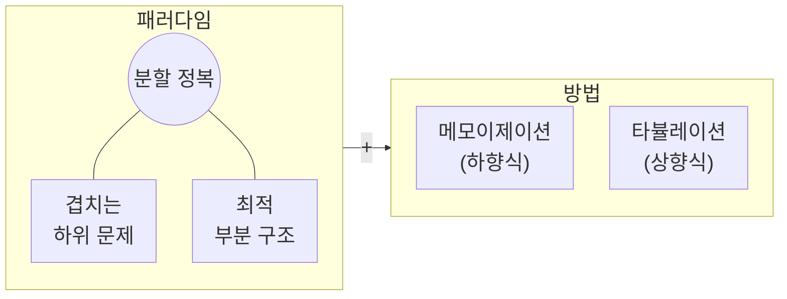

import Slide from 'stack-site-builder/components/Slide.astro';
import RecursionDemo from '@components/RecursionDemo.astro';
import FibMemoDemo from '@components/FibMemoDemo.astro';
import DpTableDemo from '@components/DpTableDemo.astro';
import DpGridDemo from '@components/DpGridDemo.astro';
import PathDpDemo from '@components/PathDpDemo.astro';

{/* 슬라이드 작성 규칙은 docs/writing-rules.md의 "슬라이드 규칙"을 따릅니다.
    수치는 실습 코드(topic-14-dynamic-programming)의 실행 결과와 같습니다. */}

<Slide class="cover">

# 동적 계획법

주제 14

*고급알고리즘*

</Slide>

<Slide>

## 주제 01의 약속
::sub[피보나치 재귀는 왜 느렸나]

- 원인은 재귀가 아니라 **같은 값을 몇 번이고 다시 구하는 것**이었습니다.
- 한 번 구한 답을 적어 두기만 하면 지수 시간이 선형 시간이 됩니다.

<br/>

그 생각을 거스름돈, 최장 증가 부분수열, 격자 경로, 최단 경로, 0/1 배낭에 차례로 적용합니다.  
그리고 표를 거꾸로 따라가 **답을 만든 선택**까지 되살립니다.

</Slide>

<Slide class="center">

## 동적 계획법
::sub[Dynamic Programming]

</Slide>

<Slide>

#### 분할 정복 + 저장
::sub[작은 문제들이 서로 겹칠 때]



</Slide>

<Slide>

#### 두 조건과 두 방법
::sub[이름의 dynamic은 "실행 중에 바뀐다"는 뜻이 아닙니다]

- **겹치는 하위 문제**(overlapping subproblems)
  - 같은 작은 문제가 여러 번 나옵니다.
- **최적 부분 구조**(optimal substructure)
  - 큰 문제의 최적해가 작은 문제의 최적해로 이루어집니다.
- **저장하는 방법은 둘입니다.**
  - 메모이제이션: 재귀는 그대로 두고 답을 적어 둔다.
  - 타뷸레이션: 작은 문제부터 표를 채워 올라간다.

</Slide>

<Slide class="center">

## 피보나치, 다시
::sub[Fibonacci]

</Slide>

<Slide class="compact">

#### 피보나치 재귀
::sub[주제 01의 코드 그대로]

```plaintext
ALGORITHM FibRecursive(n)
    if n <= 1 then
        return n
    return FibRecursive(n-1) + FibRecursive(n-2)
```

- **시간** $$O(2^n)$$: 지수적으로 늘어납니다.
- **공간** $$O(n)$$: 재귀 스택
- **문제점**: 같은 계산을 반복합니다.

</Slide>

<Slide class="compact">

#### 피보나치 반복
::sub[앞의 두 항만 들고 나아갑니다]

```plaintext
ALGORITHM FibIterative(n)
    if n <= 1 then return n
    prev <- 0, curr <- 1
    for i <- 2 to n do
        next <- prev + curr
        prev <- curr
        curr <- next
    return curr
```

- **시간** $$O(n)$$ · **공간** $$O(1)$$

</Slide>

<Slide>

### 한 걸음씩: F(5)
::sub[같은 값을 다시 구하는 노드가 빨강입니다]

<RecursionDemo n={5} slide />

</Slide>

<Slide>

#### 피보나치의 계산량
::sub[호출 수 C(n) = C(n-1) + C(n-2) + 1]

| 구하려는 항 | 호출 수 | 그중 $$F(3)$$ | 그중 $$F(2)$$ |
| --- | --- | --- | --- |
| $$F(0)$$, $$F(1)$$ | 1 | | |
| $$F(2)$$ | 3 | | 1 |
| $$F(3)$$ | 5 | 1 | 1 |
| $$F(4)$$ | 9 | 1 | 2 |
| $$F(5)$$ | 15 | 2 | 3 |

$$F(5)$$ 하나에 15번, 서로 다른 값은 6개뿐입니다.  
$$C(n) = 2F(n+1) - 1$$, 한 칸마다 약 1.6배씩 늘어납니다.

</Slide>

<Slide class="center">

## 메모이제이션
::sub[Memoization: 메모를 해 두자]

</Slide>

<Slide class="compact">

#### 답을 적어 둔다
::sub[`01_fibonacci/fibonacci.c` · 바뀐 것은 if 두 줄]

```c
long long fibMemo(int n) {
    if (n <= 1) {
        return n;                       // 1. 기본 정의
    }
    if (memo[n] != -1) {
        return memo[n];                 // 2. 이미 적어 둔 값이면 바로
    }
    memo[n] = fibMemo(n - 1) + fibMemo(n - 2);  // 3. 재귀로 구하고
    return memo[n];                     // 4. 적어 두고 돌려준다
}
```

- **시간** $$O(n)$$: 각 값을 한 번만 계산합니다.
- **공간** $$O(n)$$: 메모 배열 + 재귀 스택

</Slide>

<Slide>

### 한 걸음씩: 메모와 함께 F(5)
::sub[노랑은 메모에서 꺼낸 호출, 점선은 아예 불리지 않은 가지입니다]

<FibMemoDemo n={5} slide />

</Slide>

<Slide>

#### 무엇이 달라졌나
::sub[내려가는 길은 같고, 돌아오는 길이 다릅니다]

- $$F(2) = 1$$을 구해 `memo[2]`에 적습니다.
- $$F(4)$$가 다시 $$F(2)$$를 부르면 `memo[2]`에서 꺼냅니다.
  - **다시 갈라지지 않습니다.**
- $$F(5)$$의 오른쪽 $$F(3)$$도 `memo[3]`에서 꺼냅니다.
  - 그 아래 호출 4개가 사라집니다.

<br/>

호출 **15번 → 9번**, 일반적으로 $$2n - 1$$번입니다.  
`memo[0]`, `memo[1]`은 기저에서 바로 돌려주므로 -1로 남습니다.

</Slide>

<Slide class="center">

## 타뷸레이션
::sub[Tabulation: 작은 것부터 표를 채운다]

</Slide>

<Slide class="compact">

#### 아래에서 위로
::sub[반복문 하나와 배열 하나]

```plaintext
ALGORITHM FibTabulation(n)
    if n <= 1 then
        return n
    dp[0] <- 0
    dp[1] <- 1
    for i <- 2 to n do
        dp[i] <- dp[i-1] + dp[i-2]    // 앞의 두 칸은 이미 채워져 있다
    return dp[n]
```

- **시간** $$O(n)$$: 칸마다 한 번
- **공간** $$O(n)$$: 표 하나, 스택은 쓰지 않습니다.
- 앞 두 칸만 남기면 공간 $$O(1)$$, 그것이 주제 01의 반복입니다.

</Slide>

<Slide>

### 한 걸음씩: dp 표
::sub[주황이 지금 채우는 칸, 파랑이 참조하는 칸입니다]

<DpTableDemo problem="fib" n={5} slide />

</Slide>

<Slide class="compact">

#### 세 방식을 나란히
::sub[재귀 호출 수는 주제 01의 표와 같은 숫자입니다]

- 결과

```console
F(5)
  recursive  = 5, calls = 15
  memo       = 5, calls = 9
  memo       = [-1, -1, 1, 2, 3, 5]
  tabulation = 5
  dp         = [0, 1, 1, 2, 3, 5]

 n  recursive calls  memo calls                 F(n)
 10              177          19                   55
 20            21891          39                 6765
 30          2692537          59               832040
 90                -         179  2880067194370816120
```

</Slide>

<Slide>

#### 메모이제이션 vs. 타뷸레이션
::sub[같은 점화식, 다른 방향]

| | 메모이제이션 | 타뷸레이션 |
| --- | --- | --- |
| 계산 방식 | **lazy** (필요한 것만) | **eager** (전부) |
| 시작점 | 위 → 아래, 큰 문제 → 작은 문제 | 아래 → 위, 작은 문제 → 큰 문제 |
| 구현 | 재귀 + 캐시 | 반복문 + 표 |
| 직관성 | 점화식을 그대로 옮긴다 | 채우는 순서를 정해야 한다 |
| 안정성 | 스택 오버플로 위험 | 스택을 쓰지 않는다 |
| 공간 최적화 | 어렵다 | 쉽다 |

</Slide>

<Slide>

#### 두 방식의 성격
::sub[하향식(top-down)과 상향식(bottom-up)]

- **메모이제이션**
  - 재귀로 호출하면서 계산된 결과를 저장해 중복 계산을 피합니다.
  - $$F(4)$$, $$F(3)$$처럼 큰 문제에서 내려가며 **필요한 것만** 계산합니다.
  - 재귀 호출의 부담이 붙습니다.
- **타뷸레이션**
  - 작은 문제부터 순서대로 표를 채웁니다.
  - $$F(2)$$, $$F(3)$$처럼 작은 것부터 **모든 하위 문제**를 풉니다.
  - 반복문만 쓰므로 효율적입니다.

</Slide>

<Slide class="center">

## lazy와 eager
::sub[필요할 때 하느냐, 미리 다 해 두느냐]

</Slide>

<Slide class="center">

#### lazy가 무엇인가요?
::sub["게으름"? 아니요]

**"필요할 때만 일하는 똑똑함"**

</Slide>

<Slide>

#### 생활 속 lazy

| 예 | eager | lazy |
| --- | --- | --- |
| 동영상 스트리밍 | 영화 전체를 받은 뒤 재생 | 볼 부분만 버퍼링하며 재생 |
| 웹 페이지 이미지 | 이미지 100개를 모두 불러옴 | 화면에 보이는 것만, 스크롤하면 더 |
| 데이터베이스 조회 | 글·친구·사진을 한꺼번에 | 기본 정보만 먼저, 나머지는 열어 볼 때 |

<br/>

넷플릭스와 유튜브가 다 받기 전에 재생을 시작하는 것이 lazy입니다.

</Slide>

<Slide class="compact">

#### Python의 제너레이터
::sub[lazy한 리스트]

```python
def squares_eager(n):          # 모든 값을 메모리에 저장
    result = []
    for i in range(n):
        result.append(i * i)
    return result

def squares_lazy(n):           # 필요할 때만 하나씩 계산
    for i in range(n):
        yield i * i

numbers = squares_eager(1000000)   # 원소 100만 개짜리 리스트가 생긴다
numbers = squares_lazy(1000000)    # 아직 아무것도 계산하지 않았다
```

</Slide>

<Slide class="compact">

#### 함수형 프로그래밍의 lazy evaluation
::sub[무한 피보나치를 정의해 두고, 필요한 만큼만 꺼낸다]

```python
def fibonacci_infinite():      # 무한히 많은 피보나치 수를 "정의"한다
    a, b = 0, 1
    while True:
        yield a
        a, b = b, a + b

fib = fibonacci_infinite()
first_10 = [next(fib) for _ in range(10)]   # 실제로는 10개만 계산된다
```

Haskell 같은 언어는 이것을 언어 차원에서 합니다.

</Slide>

<Slide>

#### 언제 lazy가 나을까
::sub[메모이제이션 쪽]

- **부분 결과만 필요할 때**
  - $$F(50)$$ 하나만 알면 될 때
- **조건부 계산**
  - 특정 조건에서만 일부 계산이 필요할 때
- **메모리 절약**
  - 모든 중간 결과를 저장할 필요가 없을 때
- **빠른 프로토타이핑**
  - 일단 돌아가는 코드가 먼저 필요할 때

</Slide>

<Slide>

#### 언제 eager가 나을까
::sub[타뷸레이션 쪽]

- **전체 결과가 필요할 때**
  - $$F(1)$$부터 $$F(50)$$까지 모두 필요할 때
- **안정성이 중요할 때**
  - 스택 오버플로 위험을 피하고 싶을 때
- **성능을 다듬을 때**
  - 재귀 호출의 부담을 없애고 싶을 때
- **공간을 다듬을 때**
  - 메모리 사용량을 세밀하게 제어하고 싶을 때

</Slide>

<Slide class="center">

## 예제 1. 거스름돈
::sub[Coin Change: 특정 금액을 만드는 최소 동전 개수]

</Slide>

<Slide>

#### 마지막에 낸 동전
::sub[동전 2, 3, 5원으로 6원을 만드는 최소 개수는? 2개 (3 + 3)]

- 그리디는 5원을 먼저 내고, 남은 1원을 만들 수 없어 막힙니다.
- 동적 계획법은 **마지막에 낸 동전** $$c$$로 쪼갭니다.
  - 나머지 $$a - c$$원은 다시 같은 문제입니다.

$$
C(a) = \begin{cases}
0 & a = 0 \\
\min\limits_{c \,\in\, \text{coins},\ c \le a} \bigl( C(a - c) + 1 \bigr) & a > 0
\end{cases}
$$

만들 수 없는 금액은 $$\infty$$(코드에서는 `INF`)

</Slide>

<Slide class="compact">

#### 메모이제이션
::sub[`02_coin_change/` · 피보나치와 같은 네 단계]

```plaintext
ALGORITHM CoinChangeMemo(amount, coins, m, memo)
    if amount = 0 then return 0          // 1. 기저: 0원은 동전 0개
    if amount < 0 then return INF        //    음수 금액은 만들 수 없다
    if memo[amount] != -1 then           // 2. 이미 구한 금액이면 바로 돌려준다
        return memo[amount]
    best <- INF                          // 3. 동전마다 하나씩 내 보고 나머지를 재귀로
    for i <- 0 to m-1 do
        r <- CoinChangeMemo(amount - coins[i], coins, m, memo)
        if r != INF and r + 1 < best then
            best <- r + 1
    memo[amount] <- best                 // 4. 적어 두고 돌려준다
    return best
```

</Slide>

<Slide class="compact">

#### 메모가 내려가는 길
::sub[coinChangeMemo(6)]

```plaintext
solve 6
├─ 동전 2: 6-2 = 4 → solve 4
│  ├─ 동전 2: 4-2 = 2 → solve 2
│  │  ├─ 동전 2: 2-2 = 0 → 0개
│  │  ├─ 동전 3, 5: 음수 → 불가
│  │  └─ 결과: 1개 (2)
│  ├─ 동전 3: 4-3 = 1 → solve 1
│  │  └─ 결과: 불가 (INF)
│  ├─ 동전 5: 음수 → 불가
│  └─ 결과: 2개 (2 + 2)
├─ 동전 3: 6-3 = 3 → solve 3
│  ├─ 동전 2: 3-2 = 1 → memo[1] = INF 꺼냄
│  ├─ 동전 3: 3-3 = 0 → 0개
│  └─ 결과: 1개 (3)
├─ 동전 5: 6-5 = 1 → memo[1] = INF 꺼냄
└─ 최종: min(2+1, 1+1) = 2개 (3 + 3)
```

</Slide>

<Slide class="compact">

#### 5원은 끝내 풀지 않았다
::sub[lazy]

- 결과

```console
coins = {2, 3, 5}, amount = 6
  solve 6
  solve 4
  solve 2
  solve 1
  solve 3
memo -> 2 coins, solved 5 amounts
  memo = [-1, INF, 1, 1, 2, -1, 2]
```

- `memo[5] = -1`: 6원을 만드는 데 필요하지 않았습니다.
- `memo[1] = INF`: 한 번 구하고 두 번 꺼냈습니다.

</Slide>

<Slide>

### 한 걸음씩: 타뷸레이션
::sub[표 위 파랑 화살표가 참조, 다 채우면 표 아래로 경로 복원 화살표가 거꾸로 이어집니다]

<DpTableDemo problem="coin" coins={[2, 3, 5]} amount={6} slide />

</Slide>

<Slide>

#### 6원 칸을 채우는 순간
::sub[동전마다 a - c원 칸을 봅니다]

| 마지막 동전 | 참조하는 칸 | 후보 |
| --- | --- | --- |
| 2 | `dp[4]` = 2 | 3 |
| 3 | `dp[3]` = 1 | **2** (최소) |
| 5 | `dp[1]` = INF | 불가 |

<br/>

- 최솟값이 바뀔 때 `choice[a]`에 그 동전을 적어 둡니다.
- 끝에서 `choice[6] = 3` → 3원 칸, `choice[3] = 3` → 0원 칸
- **표를 거꾸로 따라가 선택을 되살리는 것**이 경로 복원입니다.

</Slide>

<Slide>

### 주제 06의 80원
::sub[그리디는 4개(50 + 10 + 10 + 10)였습니다. 10원 단위 칸만 보입니다]

<DpTableDemo problem="coin" coins={[50, 40, 10]} amount={80} unit={10} slide />

</Slide>

<Slide class="compact">

#### 모두 견주므로 2개
::sub[80원 칸: 50원을 내면 4개, 40원을 내면 2개]

- 결과

```console
tab  -> 2 coins: 3 + 3, filled 6 amounts
  dp   = [0, INF, 1, 1, 2, 1, 2]

coins = {50, 40, 10}, amount = 80
memo -> 2 coins, solved 8 amounts
tab  -> 2 coins: 40 + 40, filled 80 amounts
```

- 그리디는 50원을 고른 순간 40원 쪽을 다시 보지 않았습니다.
- 메모는 10원 단위 금액 **8개**만, 표는 **80칸** 전부를 채웠습니다.
- 시간 $$O(Am)$$ · 공간 $$O(A)$$ (금액 $$A$$, 동전 $$m$$개)

</Slide>

<Slide class="center">

## 예제 2. 최장 증가 부분수열
::sub[LIS: Longest Increasing Subsequence]

</Slide>

<Slide>

#### 가장 긴 증가 부분수열의 길이
::sub[순서를 지킨 채 몇 개를 골라 순증가하게]

`[10, 9, 2, 5, 3, 7, 101, 18]` → **4**

<br/>

| 고른 수열 | 길이 |
| --- | --- |
| 2 5 7 101 | 4 |
| 2 5 7 18 | 4 |
| 2 3 7 101 | 4 |
| 2 3 7 18 | 4 |

답은 하나가 아닐 수 있습니다.

</Slide>

<Slide class="compact">

#### 메모이제이션: 고른다, 안 고른다
::sub[남은 일은 (지금 볼 원소 i, 마지막으로 고른 원소 prev)로 정해진다]

```plaintext
ALGORITHM LisHelper(arr, n, i, prev)
    if i = n then return 0                       // 1. 기저: 더 볼 원소가 없다
    if memo[i][prev+1] != -1 then                // 2. 이미 구한 (i, prev)면 바로
        return memo[i][prev+1]
    exclude <- LisHelper(arr, n, i+1, prev)      // 3. arr[i]를 고르지 않는 경우
    include <- 0
    if prev = -1 or arr[i] > arr[prev] then      //    arr[i]를 고를 수 있으면
        include <- 1 + LisHelper(arr, n, i+1, i) //    고르는 경우
    memo[i][prev+1] <- max(include, exclude)     // 4. 둘 중 큰 것을 적어 둔다
    return memo[i][prev+1]
```

- 메모 없이 $$O(2^n)$$, 메모로 $$O(n^2)$$
- `prev = -1`(고른 것 없음)을 0번 열에 담으려고 `prev + 1`

</Slide>

<Slide>

#### 갈래가 달라도 남은 일이 같다
::sub[2, 10, 5, 7, 3의 앞 두 원소에서 갈라진 네 갈래]

| 2 | 10 | 고른 수열 | 남은 일 |
| --- | --- | --- | --- |
| 고름 | 고름 | `[2, 10]` | `i = 2, prev = 10` |
| 고름 | 안 고름 | `[2]` | `i = 2, prev = 2` |
| 안 고름 | 고름 | `[10]` | `i = 2, prev = 10` |
| 안 고름 | 안 고름 | `[]` | `i = 2`, 고른 것 없음 |

<br/>

첫 줄과 셋째 줄은 **같은 부분 문제**입니다. 한 번만 풀면 됩니다.

</Slide>

<Slide class="compact">

#### 메모이제이션 활용
::sub[의외로 메모 표가 그렇게 많이 쓰이지는 않네요]

```console
plain recursion = 4, calls = 108
memo hits (i, prev + 1)
  hit memo[7][7] = 0
  hit memo[7][7] = 0
  hit memo[6][6] = 1
  hit memo[7][7] = 0
  hit memo[6][6] = 1
  hit memo[7][7] = 0
  hit memo[6][6] = 1
  hit memo[5][5] = 2
  hit memo[4][4] = 2
  hit memo[7][7] = 0
  hit memo[7][7] = 0
memo = 4, calls = 62, hits = 11, filled 36 of 72
```

원소 8개에서는 11번입니다. 길어질수록 $$2^n$$과 $$n^2$$의 차이가 벌어집니다.

</Slide>

<Slide>

#### 타뷸레이션: 여기서 끝나는 가장 긴 길이
::sub[dp 한 칸 = 그 원소로 끝나는 가장 긴 증가 부분수열의 길이]

$$
dp[i] = 1 + \max \{\, dp[j] : j < i,\ arr[j] < arr[i] \,\}
$$

- 그런 $$j$$가 없으면 `dp[i] = 1`
- 칸 하나를 채울 때 앞의 칸을 **여러 개** 봅니다.
- 답은 `dp[n-1]`이 아니라 **`dp`의 최댓값**입니다.
- 고른 $$j$$를 `prev[i]`에 적어 두면 수열을 복원할 수 있습니다.
- 시간 $$O(n^2)$$ · 공간 $$O(n)$$

</Slide>

<Slide>

### 한 걸음씩: LIS
::sub[파랑 화살표가 자기보다 작은 원소, 진한 화살표가 가장 긴 수열을 준 원소입니다]

<DpTableDemo problem="lis" arr={[10, 9, 2, 5, 3, 7, 101, 18]} slide />

</Slide>

<Slide class="compact">

#### 결과와 복원
::sub[`03_lis/`]

```console
tab  = 4
  dp   = [1, 1, 1, 2, 2, 3, 4, 4]
  prev = [-1, -1, -1, 2, 2, 3, 5, 5]
  one LIS: 2 5 7 101
```

- 최댓값 4는 6번(101)에서 처음 나옵니다.
- `prev`를 따라가면 5번(7), 3번(5), 2번(2), 뒤집으면 `2 5 7 101`
- 18 쪽을 고르면 `2 5 7 18`, 동점 처리가 어느 답을 낼지 정합니다.

</Slide>

<Slide class="center">

## 예제 3. 격자 경로
::sub[경로 탐색에서 장애물 회피]

</Slide>

<Slide>

#### (0, 0)에서 (5, 5)까지 가는 경로의 수
::sub[한 번에 x+1 또는 y+1, 장애물 (2, 2) (3, 3) (4, 4)]

- 어떤 칸에 오는 길은 둘뿐입니다.
  - **위 칸**에서 오는 길
  - **왼쪽 칸**에서 오는 길
- 그러니 칸의 값 = 위 칸 + 왼쪽 칸
- 장애물 칸은 0
- 메모이제이션은 "여기서 끝까지", 타뷸레이션은 "처음부터 여기까지"를 셉니다.

</Slide>

<Slide>

### 한 걸음씩: 격자
::sub[행 순서로 채우면 위 칸과 왼쪽 칸은 언제나 먼저 채워져 있습니다]

<DpGridDemo problem="grid" slide />

</Slide>

<Slide class="compact">

#### 48가지
::sub[`04_grid_paths/` · 시간과 공간 O(XY)]

```console
plain recursion = 48, calls = 439
memo            = 48, calls = 65, solved 32 cells
tab             = 48

  x\y    0    1    2    3    4    5
   0     1    1    1    1    1    1
   1     1    2    3    4    5    6
   2     1    3    #    4    9   15
   3     1    4    4    #    9   24
   4     1    5    9    9    #   24
   5     1    6   15   24   24   48
```

장애물이 없으면 $$\binom{10}{5} = 252$$, 대각선 장애물 셋이 204개를 막았습니다.

</Slide>

<Slide class="center">

## 예제 4. 길찾기
::sub[간선을 정확히 k개 써서 가는 최단 경로]

</Slide>

<Slide class="compact">

#### 0 → 3, 간선 3개로
::sub[간선 9개짜리 방향 그래프, 간선마다 비용]

- 간선 3개짜리 길은 둘뿐입니다.
  - **길 1**: 0 → 2 → 4 → 3, 2 + 3 + 1 = **6**
  - **길 2**: 0 → 2 → 1 → 3, 2 + 2 + 6 = 10
- 직접 세지 않고 **첫 걸음**으로 쪼갭니다.
  - 0에서 1이나 2로 간 뒤, 남은 일은 "3까지 간선 2개로"

<br/>

```plaintext
0→1 (1)   0→2 (2)   1→3 (6)   2→1 (2)   2→3 (4)
2→4 (3)   3→5 (3)   4→3 (1)   4→5 (5)
```

</Slide>

<Slide>

#### 첫 걸음으로 쪼개기
::sub[0 → 3 (간선 3개)]

1. **0에서의 선택지는 1, 2로 총 2개**
   - 1 → 3 (간선 2개), 2 → 3 (간선 2개)
2. **1에서의 선택지는 3으로 총 1개**
   - 3 → 3 (간선 1개): 그런 간선이 없어 **불가**
3. **2에서의 선택지는 1, 3, 4로 총 3개**
   - 1 → 3 (간선 1개) = 6이므로 2 → 1 → 3 = 2 + 6 = 8
   - 3 → 3 (간선 1개): 불가
   - 4 → 3 (간선 1개) = 1이므로 2 → 4 → 3 = 3 + 1 = **4**
4. **0 → 2 → 4 → 3 = 2 + (3 + 1) = 6**

</Slide>

<Slide>

#### 점화식
::sub[S(u, v, k): u에서 v로 간선 k개를 써서 가는 최소 비용]

$$
S(u, v, k) = \begin{cases}
0 & k = 0,\ u = v \\
\infty & k = 0,\ u \ne v \\
\min\limits_{u \to x} \bigl( w(u, x) + S(x, v, k-1) \bigr) & k > 0
\end{cases}
$$

<br/>

- **구현 1**: 이것을 그대로 재귀로
- **구현 2**: `memo[k][u][v]` 표를 붙인 메모이제이션
  - 값과 함께 **가장 싼 첫 걸음** `next[k][u][v]`를 적어 둡니다.

</Slide>

<Slide>

### 한 걸음씩: 메모 표와 경로 복원
::sub[파랑 점선은 시도하는 간선, 진한 파랑은 최솟값을 준 간선, 분홍은 복원한 길입니다]

<PathDpDemo slide />

</Slide>

<Slide class="compact">

#### 구현 2: 메모이제이션
::sub[`05_shortest_path/shortestPath.pseudo`]

```plaintext
ALGORITHM ShortestMemo(u, v, k, memo, next)
    if k = 0 then
        if u = v then return 0 else return INF
    if memo[k][u][v] != -1 then return memo[k][u][v]
    best <- INF
    for each edge u -> x do
        r <- ShortestMemo(x, v, k-1, memo, next)
        if r != INF and w(u, x) + r < best then
            best <- w(u, x) + r
            next[k][u][v] <- x        // 가장 싼 첫 걸음을 적어 둔다
    memo[k][u][v] <- best
    return best
```

</Slide>

<Slide class="compact">

#### 표에 적힌 칸
::sub[18칸 중 6칸만 구했습니다]

```console
plain recursion = 6, calls = 12
  hit memo[1][3][3] = INF
memo            = 6, calls = 11
  k=1: 1->3 = 6, 3->3 = INF, 4->3 = 1
  k=2: 1->3 = INF, 2->3 = 4
  k=3: 0->3 = 6
path: 0 -> 2 -> 4 -> 3 (2 + 3 + 1 = 6)
```

- 손으로 쪼갠 단계와 표의 칸이 하나씩 맞습니다.
- 그래프가 작아 호출 수는 거의 같습니다.
  - 메모 없이는 $$O(d^k)$$, 메모로는 $$O(kVd)$$

</Slide>

<Slide class="compact">

#### 경로 복원
::sub[값을 정할 때 고른 것을 함께 적어 두고, 끝에서 따라간다]

```plaintext
ALGORITHM RestorePath(u, v, k, next)
    path <- [u]
    while k > 0 do
        u <- next[k][u][v]            // 적어 둔 첫 걸음을 따라간다
        append u to path
        k <- k - 1
    return path
```

- 따라가면

```plaintext
next[3][0][3] = 2    0 → 2   (비용 2)
next[2][2][3] = 4    2 → 4   (비용 3)
next[1][4][3] = 3    4 → 3   (비용 1)
```

</Slide>

<Slide>

#### 고른 것을 적어 두는 한 줄
::sub[choice, prev, next]

- 거스름돈의 `choice`, LIS의 `prev`, 여기의 `next`는 같은 일을 합니다.
- "최솟값"이 아니라 **최소가 되는 방법**을 물으면 이 한 줄이 붙습니다.
- 주제 12의 다익스트라와 다릅니다.
  - 간선 수 제한이 있으면 0 → 2 → 3(간선 2개)은 답이 아닙니다.

</Slide>

<Slide class="center">

## 예제 5. 0/1 배낭
::sub[주제 06에서 미뤄 둔 문제]

</Slide>

<Slide>

#### 쪼갤 수 없는 배낭
::sub[용량 50, 물건 (10, 60) (20, 100) (30, 120)]

- 그리디(단위 무게당 가치 순)는 물건 1, 2를 담고 **160**에서 멈췄습니다.
- 물건 2, 3을 담으면 **220**입니다.

$$
dp[i][c] = \begin{cases}
dp[i-1][c] & w_i > c \\
\max\bigl(dp[i-1][c],\ dp[i-1][c - w_i] + v_i\bigr) & w_i \le c
\end{cases}
$$

- 위 칸: 물건 $$i$$를 담지 않음
- 위 줄에서 $$w_i$$만큼 왼쪽 칸 + $$v_i$$: 물건 $$i$$를 담음

</Slide>

<Slide>

### 한 걸음씩: 배낭 표
::sub[무게가 모두 10의 배수라 10 단위 열만 보입니다. 끝에서 위로 거슬러 올라가며 복원합니다]

<DpGridDemo problem="knapsack" slide />

</Slide>

<Slide class="compact">

#### 220, 물건 2와 3
::sub[`06_knapsack/` · 시간과 공간 O(nW)]

```console
dp (columns every 10)
  i\c    0   10   20   30   40   50
  0      0    0    0    0    0    0
  1      0   60   60   60   60   60
  2      0   60  100  160  160  160
  3      0   60  100  160  180  220

best = 220
  take item 3 (w=30, v=120)
  take item 2 (w=20, v=100)
```

- 220 = max(위 칸 160, `dp[2][20]` + 120)
- 그리디가 놓친 "물건 1을 버리고 2, 3"이 `dp[2][20] = 100`에 들어 있었습니다.

</Slide>

<Slide class="center">

## 동적 계획법 정리
::sub[언제, 어떻게]

</Slide>

<Slide>

#### 언제 쓸 수 있나
::sub[작은 문제가 겹치고, 작은 최적이 큰 최적을 만들 때]

- **문제가 작은(반복되는) 인스턴스로 이루어질 때**
  - 하위 문제의 해결책을 바탕으로 문제를 풉니다.
- **분할 정복처럼 쪼개되, 하위 문제가 서로 겹칠 때**
  - 작은 것을 먼저 풀어 저장하고, 나중에 꺼내 씁니다.
- **그리디처럼 최적화 문제에**
  - 후보 해가 여럿이고, 그중 최적의 값을 찾습니다.
  - 그리디는 후보 하나를 따라가고, 동적 계획법은 **모두** 견줍니다.

</Slide>

<Slide>

#### 최적성의 원리
::sub[The principle of optimality]

- 문제의 한 인스턴스에 대한 최적해는
  - 언제나 모든 하위 인스턴스에 대한 최적해를 포함합니다.
- **예: 최단 경로**
  - $$v_k$$가 $$v_i$$에서 $$v_j$$로 가는 최적 경로 위에 있다면
  - $$v_i$$에서 $$v_k$$, $$v_k$$에서 $$v_j$$로 가는 부분 경로도 최적입니다.
- **반례: 가장 긴 단순 경로**
  - 부분 경로를 각각 가장 길게 늘리면 정점이 겹칠 수 있습니다.

</Slide>

<Slide>

#### 분할 정복 vs. 동적 계획법

| | 분할 정복 | 동적 계획법 |
| --- | --- | --- |
| 방향 | 하향식: 쪼개 내려간다 | 상향식이 기본 (메모는 하향식으로 같은 일) |
| 하위 문제 | 서로 겹치지 않는다 | 서로 겹친다 |
| 효율 | 하위 문제가 독립이면 효율적 | 겹치는 답을 저장해 재계산을 없앤다 |
| 예 | 머지 정렬, 퀵 정렬, 피보나치 재귀 | 피보나치 반복, 거스름돈, LIS, 배낭 |

<br/>

피보나치 재귀는 분할 정복의 모양이지만 하위 문제가 겹쳐 비효율적입니다.

</Slide>

<Slide>

#### 설계하는 순서
::sub[표의 한 칸이 무엇인지부터]

1. **부분 문제를 정한다.**
   - "`dp[a]`는 `a`원을 만드는 최소 동전 수"처럼 한 문장으로
2. **재귀 속성(점화식)을 세운다.**
   - 대개 마지막 선택 하나로 쪼갭니다.
3. **기저를 정한다.**
4. **계산 방향을 정한다.**
   - 메모이제이션이면 재귀에 표를, 타뷸레이션이면 채우는 순서를
5. **필요하면 선택을 기록해 복원한다.**
   - `choice`, `prev`, `next`

</Slide>

<Slide>

#### 해결할 수 있는 문제
::sub[동적 계획법의 유명한 예]

| 문제 | 한 칸의 뜻 |
| --- | --- |
| 피보나치 수열, 이항 계수 | $$F(n)$$, $$\binom{n}{k}$$ |
| 거스름돈 | 금액 $$a$$의 최소 동전 수 |
| 모든 쌍 최단 경로 (플로이드) | 정점 $$1..k$$만 거쳐 $$i$$ → $$j$$ |
| 연쇄 행렬 곱셈 | $$A_i \cdots A_j$$의 최소 곱셈 수 |
| 배낭, 외판원 문제 | 물건 $$1..i$$와 용량 $$c$$, 방문 집합과 마지막 정점 |
| 편집 거리, 서열 정렬 | 두 문자열(DNA) 앞부분 $$i$$, $$j$$글자 |

Smith-Waterman, Needleman-Wunsch 알고리즘이 서열 정렬입니다.

</Slide>

<Slide class="compact">

#### 지금 해 볼 것
::sub[표의 한 칸을 바꿔 보며 확인하기]

[lec-algorithm/algorithm-code](https://github.com/lec-algorithm/algorithm-code/tree/main) · `src/topic-14-dynamic-programming/`  
파일을 열고 편집기 오른쪽 위 **▶ 버튼**을 누르면 실행됩니다.

1. **`fibMemo`에서 메모를 확인하는 `if` 두 줄을 지워 봅니다.**
   - 호출 수가 재귀와 똑같아집니다.
2. **`{50, 40, 10}`으로 그리디와 답이 갈리는 금액을 더 찾아봅니다.**
   - 주제 06의 그리디 코드와 나란히 돌려 봅니다.
3. **최단 경로의 도착점을 5로, `k`를 4로 바꿔 봅니다.**
   - `0 -> 2 -> 4 -> 3 -> 5`(9)가 나옵니다.
4. **배낭의 용량을 40으로 바꿔 봅니다.**
   - 180(물건 1, 3)이 나옵니다.

</Slide>

<Slide>

## 남길 것

1. **동적 계획법은 겹치는 부분 문제를 한 번만 풉니다.**
   - 최적 부분 구조가 있어야 작은 답으로 큰 답을 만듭니다.
2. **메모이제이션은 하향식(lazy), 타뷸레이션은 상향식(eager)입니다.**
   - 피보나치 15번이 9번, $$O(2^n)$$이 $$O(n)$$
3. **그리디가 놓친 답을 찾습니다.**
   - 80원은 40 + 40, 0/1 배낭은 220
4. **경로 복원: 고른 것을 적어 두고 거꾸로 따라갑니다.**
   - `choice`, `prev`, `next`
5. **설계는 표의 한 칸이 무엇인지 정하는 데서 시작합니다.**

</Slide>
