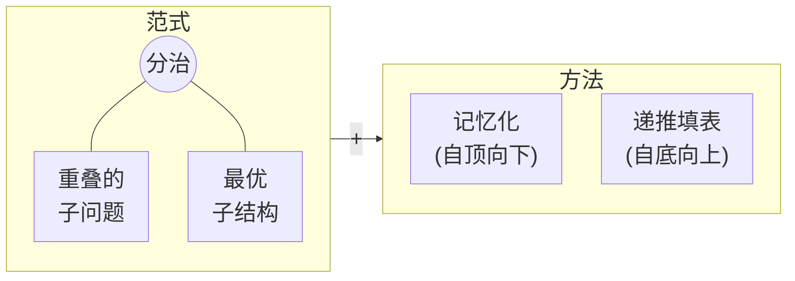

import Slide from 'stack-site-builder/components/Slide.astro';
import RecursionDemo from '@components/RecursionDemo.astro';
import FibMemoDemo from '@components/FibMemoDemo.astro';
import DpTableDemo from '@components/DpTableDemo.astro';
import DpGridDemo from '@components/DpGridDemo.astro';
import PathDpDemo from '@components/PathDpDemo.astro';

{/* 幻灯片规则见 docs/writing-rules.md 的幻灯片规则一节。
    数字与实践代码（topic-14-dynamic-programming）的运行结果一致。 */}

<Slide class="cover">

# 动态规划

主题 14

*高级算法*

</Slide>

<Slide>

## 主题 01 的承诺
::sub[斐波那契递归为什么慢]

- 原因不在递归，而在于**把同一个值一遍又一遍地重新计算**。
- 只要把算过的答案记下来，指数时间就变成线性时间。

<br/>

把这个想法依次用到找零钱、最长递增子序列、网格路径、最短路径、0/1 背包上。  
再沿着表格倒着走，把**得出答案的选择**也还原出来。

</Slide>

<Slide class="center">

## 动态规划
::sub[Dynamic Programming]

</Slide>

<Slide>

#### 分治 + 存储
::sub[当小问题彼此重叠时]



</Slide>

<Slide>

#### 两个条件与两种方法
::sub[名字里的 dynamic 并不是"运行时会变"的意思]

- **重叠子问题**（overlapping subproblems）
  - 同一个小问题出现多次。
- **最优子结构**（optimal substructure）
  - 大问题的最优解由小问题的最优解构成。
- **存答案的方法有两种。**
  - 记忆化：保留递归，把答案记下来。
  - 递推填表：从小问题开始往上填表。

</Slide>

<Slide class="center">

## 再看斐波那契
::sub[Fibonacci]

</Slide>

<Slide class="compact">

#### 斐波那契递归
::sub[主题 01 的代码原样照搬]

```plaintext
ALGORITHM FibRecursive(n)
    if n <= 1 then
        return n
    return FibRecursive(n-1) + FibRecursive(n-2)
```

- **时间** $$O(2^n)$$：指数级增长。
- **空间** $$O(n)$$：递归栈
- **问题**：重复同样的计算。

</Slide>

<Slide class="compact">

#### 斐波那契迭代
::sub[只带着前两项往前走]

```plaintext
ALGORITHM FibIterative(n)
    if n <= 1 then return n
    prev <- 0, curr <- 1
    for i <- 2 to n do
        next <- prev + curr
        prev <- curr
        curr <- next
    return curr
```

- **时间** $$O(n)$$ · **空间** $$O(1)$$

</Slide>

<Slide>

### 单步：F(5)
::sub[重新计算同一个值的节点是红色]

<RecursionDemo n={5} slide />

</Slide>

<Slide>

#### 斐波那契的计算量
::sub[调用次数 C(n) = C(n-1) + C(n-2) + 1]

| 要求的项 | 调用次数 | 其中 $$F(3)$$ | 其中 $$F(2)$$ |
| --- | --- | --- | --- |
| $$F(0)$$, $$F(1)$$ | 1 | | |
| $$F(2)$$ | 3 | | 1 |
| $$F(3)$$ | 5 | 1 | 1 |
| $$F(4)$$ | 9 | 1 | 2 |
| $$F(5)$$ | 15 | 2 | 3 |

一个 $$F(5)$$ 要调用 15 次，不同的值只有 6 个。  
$$C(n) = 2F(n+1) - 1$$，每多一项大约变成 1.6 倍。

</Slide>

<Slide class="center">

## 记忆化
::sub[Memoization：做个笔记]

</Slide>

<Slide class="compact">

#### 把答案记下来
::sub[`01_fibonacci/fibonacci.c` · 只改了两行 if]

```c
long long fibMemo(int n) {
    if (n <= 1) {
        return n;                       // 1. 基本定义
    }
    if (memo[n] != -1) {
        return memo[n];                 // 2. 已经记下的值直接返回
    }
    memo[n] = fibMemo(n - 1) + fibMemo(n - 2);  // 3. 递归求出
    return memo[n];                     // 4. 记下再返回
}
```

- **时间** $$O(n)$$：每个值只算一次。
- **空间** $$O(n)$$：memo 数组 + 递归栈

</Slide>

<Slide>

### 单步：带记忆地求 F(5)
::sub[黄色是从 memo 取出的调用，虚线是根本没有被调用的分支]

<FibMemoDemo n={5} slide />

</Slide>

<Slide>

#### 哪里不一样了
::sub[下去的路相同，回来的路不同]

- 求出 $$F(2) = 1$$，写进 `memo[2]`。
- $$F(4)$$ 再次调用 $$F(2)$$ 时，从 `memo[2]` 取出。
  - **不再分叉。**
- $$F(5)$$ 右边的 $$F(3)$$ 也从 `memo[3]` 取出。
  - 它下面的 4 次调用消失了。

<br/>

调用 **15 次 → 9 次**，一般是 $$2n - 1$$ 次。  
`memo[0]`、`memo[1]` 在基本情况里直接返回，所以保持 -1。

</Slide>

<Slide class="center">

## 递推填表
::sub[Tabulation：从小到大填表]

</Slide>

<Slide class="compact">

#### 从下往上
::sub[一个循环加一个数组]

```plaintext
ALGORITHM FibTabulation(n)
    if n <= 1 then
        return n
    dp[0] <- 0
    dp[1] <- 1
    for i <- 2 to n do
        dp[i] <- dp[i-1] + dp[i-2]    // 前两格已经填好
    return dp[n]
```

- **时间** $$O(n)$$：每格一次
- **空间** $$O(n)$$：一张表，不用栈。
- 只留前两格，空间就是 $$O(1)$$，这正是主题 01 的迭代。

</Slide>

<Slide>

### 单步：dp 表
::sub[橙色是正在填的格子，蓝色是引用的格子]

<DpTableDemo problem="fib" n={5} slide />

</Slide>

<Slide class="compact">

#### 三种方式并排
::sub[递归调用次数与主题 01 的表格数字相同]

- 结果

```console
F(5)
  recursive  = 5, calls = 15
  memo       = 5, calls = 9
  memo       = [-1, -1, 1, 2, 3, 5]
  tabulation = 5
  dp         = [0, 1, 1, 2, 3, 5]

 n  recursive calls  memo calls                 F(n)
 10              177          19                   55
 20            21891          39                 6765
 30          2692537          59               832040
 90                -         179  2880067194370816120
```

</Slide>

<Slide>

#### 记忆化 vs. 递推填表
::sub[同一个递推式，不同的方向]

| | 记忆化 | 递推填表 |
| --- | --- | --- |
| 计算方式 | **lazy**（只算需要的） | **eager**（全部算） |
| 起点 | 上 → 下，大问题 → 小问题 | 下 → 上，小问题 → 大问题 |
| 实现 | 递归 + 缓存 | 循环 + 表 |
| 直观性 | 照搬递推式 | 要确定填表顺序 |
| 稳定性 | 有栈溢出风险 | 不用栈 |
| 空间优化 | 困难 | 容易 |

</Slide>

<Slide>

#### 两种方式的性格
::sub[自顶向下（top-down）与自底向上（bottom-up）]

- **记忆化**
  - 在递归调用中保存算好的结果，避免重复计算。
  - 像 $$F(4)$$、$$F(3)$$ 这样从大问题往下走，**只算需要的**。
  - 带有递归调用的开销。
- **递推填表**
  - 从小问题开始按顺序填表。
  - 像 $$F(2)$$、$$F(3)$$ 这样从小的开始解**所有子问题**。
  - 只用循环，所以高效。

</Slide>

<Slide class="center">

## lazy 与 eager
::sub[需要时才做，还是事先全做好]

</Slide>

<Slide class="center">

#### lazy 是什么？
::sub["偷懒"？不是]

**"只在需要时才干活的聪明"**

</Slide>

<Slide>

#### 生活中的 lazy

| 例子 | eager | lazy |
| --- | --- | --- |
| 视频流媒体 | 下载完整部电影再播放 | 只缓冲要看的部分，边下边播 |
| 网页图片 | 加载全部 100 张图片 | 只加载看得见的，滚动时再加载 |
| 数据库查询 | 帖子·好友·照片一次全取 | 先取基本信息，其余打开时再取 |

<br/>

Netflix 和 YouTube 不等全部下载完就开始播放，这就是 lazy。

</Slide>

<Slide class="compact">

#### Python 的生成器
::sub[lazy 的列表]

```python
def squares_eager(n):          # 把所有值存进内存
    result = []
    for i in range(n):
        result.append(i * i)
    return result

def squares_lazy(n):           # 需要时才算一个
    for i in range(n):
        yield i * i

numbers = squares_eager(1000000)   # 生成一个 100 万个元素的列表
numbers = squares_lazy(1000000)    # 还什么都没算
```

</Slide>

<Slide class="compact">

#### 函数式编程的 lazy evaluation
::sub[先定义无限的斐波那契，再按需取用]

```python
def fibonacci_infinite():      # "定义"无限多个斐波那契数
    a, b = 0, 1
    while True:
        yield a
        a, b = b, a + b

fib = fibonacci_infinite()
first_10 = [next(fib) for _ in range(10)]   # 实际只算了 10 个
```

Haskell 这样的语言在语言层面就这样做。

</Slide>

<Slide>

#### 什么时候 lazy 更好
::sub[记忆化这一边]

- **只需要部分结果时**
  - 只要知道 $$F(50)$$ 一个值
- **条件计算**
  - 只有在特定条件下才需要部分计算
- **节省内存**
  - 不必保存所有中间结果
- **快速原型**
  - 先要一份能跑的代码

</Slide>

<Slide>

#### 什么时候 eager 更好
::sub[递推填表这一边]

- **需要全部结果时**
  - $$F(1)$$ 到 $$F(50)$$ 都要
- **重视稳定性时**
  - 想避开栈溢出的风险
- **打磨性能时**
  - 想去掉递归调用的开销
- **打磨空间时**
  - 想精细地控制内存用量

</Slide>

<Slide class="center">

## 例 1. 找零钱
::sub[Coin Change：凑出某个金额的最少硬币数]

</Slide>

<Slide>

#### 最后付出的那枚硬币
::sub[用 2、3、5 韩元硬币凑 6 韩元最少几枚？2 枚（3 + 3）]

- 贪心先付 5 韩元，剩下的 1 韩元凑不出，就卡住了。
- 动态规划按**最后付出的硬币** $$c$$ 拆开。
  - 剩下的 $$a - c$$ 韩元又是同一个问题。

$$
C(a) = \begin{cases}
0 & a = 0 \\
\min\limits_{c \,\in\, \text{coins},\ c \le a} \bigl( C(a - c) + 1 \bigr) & a > 0
\end{cases}
$$

凑不出的金额记为 $$\infty$$（代码里是 `INF`）

</Slide>

<Slide class="compact">

#### 记忆化
::sub[`02_coin_change/` · 和斐波那契一样的四步]

```plaintext
ALGORITHM CoinChangeMemo(amount, coins, m, memo)
    if amount = 0 then return 0          // 1. 基本情况：0 元需要 0 枚
    if amount < 0 then return INF        //    负数金额凑不出
    if memo[amount] != -1 then           // 2. 已经求过的金额直接返回
        return memo[amount]
    best <- INF                          // 3. 每种硬币各付一枚，剩下的递归
    for i <- 0 to m-1 do
        r <- CoinChangeMemo(amount - coins[i], coins, m, memo)
        if r != INF and r + 1 < best then
            best <- r + 1
    memo[amount] <- best                 // 4. 记下再返回
    return best
```

</Slide>

<Slide class="compact">

#### 记忆化往下走的路
::sub[coinChangeMemo(6)]

```plaintext
solve 6
├─ 硬币 2: 6-2 = 4 → solve 4
│  ├─ 硬币 2: 4-2 = 2 → solve 2
│  │  ├─ 硬币 2: 2-2 = 0 → 0 枚
│  │  ├─ 硬币 3, 5: 负数 → 不行
│  │  └─ 结果: 1 枚 (2)
│  ├─ 硬币 3: 4-3 = 1 → solve 1
│  │  └─ 结果: 不行 (INF)
│  ├─ 硬币 5: 负数 → 不行
│  └─ 结果: 2 枚 (2 + 2)
├─ 硬币 3: 6-3 = 3 → solve 3
│  ├─ 硬币 2: 3-2 = 1 → 取出 memo[1] = INF
│  ├─ 硬币 3: 3-3 = 0 → 0 枚
│  └─ 结果: 1 枚 (3)
├─ 硬币 5: 6-5 = 1 → 取出 memo[1] = INF
└─ 最终: min(2+1, 1+1) = 2 枚 (3 + 3)
```

</Slide>

<Slide class="compact">

#### 始终没有去求 5 韩元
::sub[lazy]

- 结果

```console
coins = {2, 3, 5}, amount = 6
  solve 6
  solve 4
  solve 2
  solve 1
  solve 3
memo -> 2 coins, solved 5 amounts
  memo = [-1, INF, 1, 1, 2, -1, 2]
```

- `memo[5] = -1`：凑 6 韩元时用不到它。
- `memo[1] = INF`：求了一次，取出了两次。

</Slide>

<Slide>

### 单步：递推填表
::sub[表上方的蓝色箭头是引用，填完后表下方有路径还原箭头倒着连起来]

<DpTableDemo problem="coin" coins={[2, 3, 5]} amount={6} slide />

</Slide>

<Slide>

#### 填 6 韩元这一格的那一刻
::sub[对每种硬币看 a - c 韩元那一格]

| 最后一枚硬币 | 引用的格子 | 候选 |
| --- | --- | --- |
| 2 | `dp[4]` = 2 | 3 |
| 3 | `dp[3]` = 1 | **2**（最小） |
| 5 | `dp[1]` = INF | 不行 |

<br/>

- 最小值更新时，把那枚硬币记进 `choice[a]`。
- 最后 `choice[6] = 3` → 3 韩元那格，`choice[3] = 3` → 0 韩元那格
- **沿表倒着走、还原所做的选择**，就是路径还原。

</Slide>

<Slide>

### 主题 06 的 80 韩元
::sub[贪心付了 4 枚（50 + 10 + 10 + 10）。只显示 10 韩元为单位的格子]

<DpTableDemo problem="coin" coins={[50, 40, 10]} amount={80} unit={10} slide />

</Slide>

<Slide class="compact">

#### 全部比较，所以是 2 枚
::sub[80 韩元那格：最后付 50 韩元是 4 枚，付 40 韩元是 2 枚]

- 结果

```console
tab  -> 2 coins: 3 + 3, filled 6 amounts
  dp   = [0, INF, 1, 1, 2, 1, 2]

coins = {50, 40, 10}, amount = 80
memo -> 2 coins, solved 8 amounts
tab  -> 2 coins: 40 + 40, filled 80 amounts
```

- 贪心在拿起 50 韩元的那一刻，就再也没看 40 韩元那条路。
- 记忆化只解了 10 韩元为单位的 **8 个**金额，表格填满了 **80 格**。
- 时间 $$O(Am)$$ · 空间 $$O(A)$$（金额 $$A$$，硬币 $$m$$ 种）

</Slide>

<Slide class="center">

## 例 2. 最长递增子序列
::sub[LIS：Longest Increasing Subsequence]

</Slide>

<Slide>

#### 最长递增子序列的长度
::sub[保持顺序挑出若干个，使其严格递增]

`[10, 9, 2, 5, 3, 7, 101, 18]` → **4**

<br/>

| 挑出的序列 | 长度 |
| --- | --- |
| 2 5 7 101 | 4 |
| 2 5 7 18 | 4 |
| 2 3 7 101 | 4 |
| 2 3 7 18 | 4 |

答案可能不止一个。

</Slide>

<Slide class="compact">

#### 记忆化：选，还是不选
::sub[剩下的事由（现在要看的元素 i，最后选的元素 prev）决定]

```plaintext
ALGORITHM LisHelper(arr, n, i, prev)
    if i = n then return 0                       // 1. 基本情况：没有元素可看了
    if memo[i][prev+1] != -1 then                // 2. 已求过的 (i, prev) 直接返回
        return memo[i][prev+1]
    exclude <- LisHelper(arr, n, i+1, prev)      // 3. 不选 arr[i] 的情况
    include <- 0
    if prev = -1 or arr[i] > arr[prev] then      //    如果可以选 arr[i]
        include <- 1 + LisHelper(arr, n, i+1, i) //    选的情况
    memo[i][prev+1] <- max(include, exclude)     // 4. 记下两者中较大的
    return memo[i][prev+1]
```

- 不加记忆 $$O(2^n)$$，加记忆 $$O(n^2)$$
- 为了把 `prev = -1`（还没选）放进第 0 列，用 `prev + 1`

</Slide>

<Slide>

#### 路不同，剩下的事却相同
::sub[2、10、5、7、3 的前两个元素分出的四条路]

| 2 | 10 | 已选序列 | 剩下的事 |
| --- | --- | --- | --- |
| 选 | 选 | `[2, 10]` | `i = 2, prev = 10` |
| 选 | 不选 | `[2]` | `i = 2, prev = 2` |
| 不选 | 选 | `[10]` | `i = 2, prev = 10` |
| 不选 | 不选 | `[]` | `i = 2`，还没选 |

<br/>

第一行和第三行是**同一个子问题**。只需解一次。

</Slide>

<Slide class="compact">

#### 记忆化的使用情况
::sub[出乎意料，memo 表并没有被用那么多次]

```console
plain recursion = 4, calls = 108
memo hits (i, prev + 1)
  hit memo[7][7] = 0
  hit memo[7][7] = 0
  hit memo[6][6] = 1
  hit memo[7][7] = 0
  hit memo[6][6] = 1
  hit memo[7][7] = 0
  hit memo[6][6] = 1
  hit memo[5][5] = 2
  hit memo[4][4] = 2
  hit memo[7][7] = 0
  hit memo[7][7] = 0
memo = 4, calls = 62, hits = 11, filled 36 of 72
```

8 个元素时只有 11 次。越长，$$2^n$$ 与 $$n^2$$ 的差距越大。

</Slide>

<Slide>

#### 递推填表：以这里结尾的最长长度
::sub[dp 的一格 = 以该元素结尾的最长递增子序列的长度]

$$
dp[i] = 1 + \max \{\, dp[j] : j < i,\ arr[j] < arr[i] \,\}
$$

- 没有这样的 $$j$$ 时 `dp[i] = 1`
- 填一格时要看前面**好几格**。
- 答案不是 `dp[n-1]`，而是 **`dp` 的最大值**。
- 把选中的 $$j$$ 记进 `prev[i]`，就能还原序列。
- 时间 $$O(n^2)$$ · 空间 $$O(n)$$

</Slide>

<Slide>

### 单步：LIS
::sub[蓝色箭头是比自己小的元素，深色箭头是给出最长序列的元素]

<DpTableDemo problem="lis" arr={[10, 9, 2, 5, 3, 7, 101, 18]} slide />

</Slide>

<Slide class="compact">

#### 结果与还原
::sub[`03_lis/`]

```console
tab  = 4
  dp   = [1, 1, 1, 2, 2, 3, 4, 4]
  prev = [-1, -1, -1, 2, 2, 3, 5, 5]
  one LIS: 2 5 7 101
```

- 最大值 4 第一次出现在第 6 个（101）。
- 沿 `prev` 走是第 5 个（7）、第 3 个（5）、第 2 个（2），反过来是 `2 5 7 101`
- 选 18 那边就是 `2 5 7 18`，平局的处理方式决定出哪个答案。

</Slide>

<Slide class="center">

## 例 3. 网格路径
::sub[路径搜索中绕开障碍]

</Slide>

<Slide>

#### 从 (0, 0) 到 (5, 5) 的路径数
::sub[每次 x+1 或 y+1，障碍 (2, 2) (3, 3) (4, 4)]

- 走到某一格的路只有两种。
  - 从**上面一格**来的路
  - 从**左边一格**来的路
- 所以一格的值 = 上面一格 + 左边一格
- 障碍格为 0
- 记忆化数"从这里到终点"，递推填表数"从起点到这里"。

</Slide>

<Slide>

### 单步：网格
::sub[按行的顺序填，上面一格和左边一格总是先填好]

<DpGridDemo problem="grid" slide />

</Slide>

<Slide class="compact">

#### 48 条
::sub[`04_grid_paths/` · 时间和空间 O(XY)]

```console
plain recursion = 48, calls = 439
memo            = 48, calls = 65, solved 32 cells
tab             = 48

  x\y    0    1    2    3    4    5
   0     1    1    1    1    1    1
   1     1    2    3    4    5    6
   2     1    3    #    4    9   15
   3     1    4    4    #    9   24
   4     1    5    9    9    #   24
   5     1    6   15   24   24   48
```

没有障碍时是 $$\binom{10}{5} = 252$$，对角线上的三个障碍挡住了 204 条。

</Slide>

<Slide class="center">

## 例 4. 寻路
::sub[恰好用 k 条边的最短路径]

</Slide>

<Slide class="compact">

#### 0 → 3，用 3 条边
::sub[9 条边的有向图，每条边带代价]

- 用 3 条边的路只有两条。
  - **路 1**：0 → 2 → 4 → 3，2 + 3 + 1 = **6**
  - **路 2**：0 → 2 → 1 → 3，2 + 2 + 6 = 10
- 不直接数，而是按**第一步**拆开。
  - 从 0 走到 1 或 2 之后，剩下的是"用 2 条边到 3"

<br/>

```plaintext
0→1 (1)   0→2 (2)   1→3 (6)   2→1 (2)   2→3 (4)
2→4 (3)   3→5 (3)   4→3 (1)   4→5 (5)
```

</Slide>

<Slide>

#### 按第一步拆开
::sub[0 → 3（3 条边）]

1. **0 的选择有 1、2，共 2 个**
   - 1 → 3（2 条边），2 → 3（2 条边）
2. **1 的选择只有 3，共 1 个**
   - 3 → 3（1 条边）：没有这样的边，**不行**
3. **2 的选择有 1、3、4，共 3 个**
   - 1 → 3（1 条边）= 6，所以 2 → 1 → 3 = 2 + 6 = 8
   - 3 → 3（1 条边）：不行
   - 4 → 3（1 条边）= 1，所以 2 → 4 → 3 = 3 + 1 = **4**
4. **0 → 2 → 4 → 3 = 2 + (3 + 1) = 6**

</Slide>

<Slide>

#### 递推式
::sub[S(u, v, k)：从 u 用 k 条边到 v 的最小代价]

$$
S(u, v, k) = \begin{cases}
0 & k = 0,\ u = v \\
\infty & k = 0,\ u \ne v \\
\min\limits_{u \to x} \bigl( w(u, x) + S(x, v, k-1) \bigr) & k > 0
\end{cases}
$$

<br/>

- **实现 1**：原样写成递归
- **实现 2**：加上 `memo[k][u][v]` 表的记忆化
  - 除了值，还记下**最便宜的第一步** `next[k][u][v]`。

</Slide>

<Slide>

### 单步：memo 表与路径还原
::sub[蓝色虚线是正在尝试的边，深蓝是给出最小值的边，粉色是还原出的路]

<PathDpDemo slide />

</Slide>

<Slide class="compact">

#### 实现 2：记忆化
::sub[`05_shortest_path/shortestPath.pseudo`]

```plaintext
ALGORITHM ShortestMemo(u, v, k, memo, next)
    if k = 0 then
        if u = v then return 0 else return INF
    if memo[k][u][v] != -1 then return memo[k][u][v]
    best <- INF
    for each edge u -> x do
        r <- ShortestMemo(x, v, k-1, memo, next)
        if r != INF and w(u, x) + r < best then
            best <- w(u, x) + r
            next[k][u][v] <- x        // 记下最便宜的第一步
    memo[k][u][v] <- best
    return best
```

</Slide>

<Slide class="compact">

#### 表里写下的格子
::sub[18 格中只求了 6 格]

```console
plain recursion = 6, calls = 12
  hit memo[1][3][3] = INF
memo            = 6, calls = 11
  k=1: 1->3 = 6, 3->3 = INF, 4->3 = 1
  k=2: 1->3 = INF, 2->3 = 4
  k=3: 0->3 = 6
path: 0 -> 2 -> 4 -> 3 (2 + 3 + 1 = 6)
```

- 手工拆分的步骤与表里的格子一一对应。
- 图很小，调用次数几乎一样。
  - 不加记忆是 $$O(d^k)$$，加记忆是 $$O(kVd)$$

</Slide>

<Slide class="compact">

#### 路径还原
::sub[决定值时把所选的一起记下，最后沿着走]

```plaintext
ALGORITHM RestorePath(u, v, k, next)
    path <- [u]
    while k > 0 do
        u <- next[k][u][v]            // 沿记下的第一步走
        append u to path
        k <- k - 1
    return path
```

- 沿着走

```plaintext
next[3][0][3] = 2    0 → 2   (代价 2)
next[2][2][3] = 4    2 → 4   (代价 3)
next[1][4][3] = 3    4 → 3   (代价 1)
```

</Slide>

<Slide>

#### 记下所选的那一行
::sub[choice, prev, next]

- 找零钱的 `choice`、LIS 的 `prev`、这里的 `next` 做的是同一件事。
- 问的不是"最小值"而是**怎样才能最小**时，就会多出这一行。
- 这与主题 12 的 Dijkstra 不同。
  - 有边数限制时，0 → 2 → 3（2 条边）不是答案。

</Slide>

<Slide class="center">

## 例 5. 0/1 背包
::sub[主题 06 留下的问题]

</Slide>

<Slide>

#### 不能分割的背包
::sub[容量 50，物品 (10, 60) (20, 100) (30, 120)]

- 贪心（按单位重量价值）装了物品 1、2，停在 **160**。
- 装物品 2、3 是 **220**。

$$
dp[i][c] = \begin{cases}
dp[i-1][c] & w_i > c \\
\max\bigl(dp[i-1][c],\ dp[i-1][c - w_i] + v_i\bigr) & w_i \le c
\end{cases}
$$

- 上面一格：不装物品 $$i$$
- 上一行往左 $$w_i$$ 格 + $$v_i$$：装物品 $$i$$

</Slide>

<Slide>

### 单步：背包表
::sub[重量都是 10 的倍数，只显示以 10 为单位的列。最后从下往上回溯还原]

<DpGridDemo problem="knapsack" slide />

</Slide>

<Slide class="compact">

#### 220，物品 2 和 3
::sub[`06_knapsack/` · 时间和空间 O(nW)]

```console
dp (columns every 10)
  i\c    0   10   20   30   40   50
  0      0    0    0    0    0    0
  1      0   60   60   60   60   60
  2      0   60  100  160  160  160
  3      0   60  100  160  180  220

best = 220
  take item 3 (w=30, v=120)
  take item 2 (w=20, v=100)
```

- 220 = max(上面一格 160, `dp[2][20]` + 120)
- 贪心错过的"丢掉物品 1、装 2 和 3"就藏在 `dp[2][20] = 100` 里。

</Slide>

<Slide class="center">

## 动态规划小结
::sub[何时用，怎么用]

</Slide>

<Slide>

#### 什么时候能用
::sub[小问题重叠，小的最优能组成大的最优]

- **问题由更小的（重复出现的）实例构成时**
  - 以子问题的解为基础求解。
- **像分治一样拆开，但子问题彼此重叠时**
  - 先解小的存起来，之后取出来用。
- **像贪心一样用于最优化问题**
  - 候选解有多个，从中找出最优的值。
  - 贪心跟着一个候选走，动态规划把候选**全部**比较。

</Slide>

<Slide>

#### 最优性原理
::sub[The principle of optimality]

- 一个问题实例的最优解
  - 总是包含它所有子实例的最优解。
- **例：最短路径**
  - 若 $$v_k$$ 在从 $$v_i$$ 到 $$v_j$$ 的最优路径上
  - 则从 $$v_i$$ 到 $$v_k$$、从 $$v_k$$ 到 $$v_j$$ 的部分路径也是最优的。
- **反例：最长简单路径**
  - 把部分路径分别拉到最长，顶点可能重复。

</Slide>

<Slide>

#### 分治 vs. 动态规划

| | 分治 | 动态规划 |
| --- | --- | --- |
| 方向 | 自顶向下：拆开往下走 | 以自底向上为主（记忆化用自顶向下做同样的事） |
| 子问题 | 彼此不重叠 | 彼此重叠 |
| 效率 | 子问题独立时高效 | 存下重叠的答案，消除重复计算 |
| 例子 | 归并排序、快速排序、斐波那契递归 | 斐波那契迭代、找零钱、LIS、背包 |

<br/>

斐波那契递归是分治的形状，但子问题重叠，所以低效。

</Slide>

<Slide>

#### 设计的顺序
::sub[先确定表的一格是什么]

1. **确定子问题。**
   - 像"`dp[a]` 是凑出 `a` 韩元的最少硬币数"这样用一句话写出
2. **建立递归性质（递推式）。**
   - 通常按最后一次选择拆开。
3. **确定基本情况。**
4. **确定计算方向。**
   - 记忆化就在递归上加表，递推填表就安排填表顺序
5. **需要时记录选择并还原。**
   - `choice`、`prev`、`next`

</Slide>

<Slide>

#### 能解决的问题
::sub[动态规划的著名例子]

| 问题 | 一格的含义 |
| --- | --- |
| 斐波那契数列、二项式系数 | $$F(n)$$, $$\binom{n}{k}$$ |
| 找零钱 | 金额 $$a$$ 的最少硬币数 |
| 全源最短路径（Floyd） | 只经过顶点 $$1..k$$ 从 $$i$$ 到 $$j$$ |
| 矩阵链乘法 | $$A_i \cdots A_j$$ 的最少乘法次数 |
| 背包、旅行商问题 | 物品 $$1..i$$ 与容量 $$c$$，已访问集合与最后顶点 |
| 编辑距离、序列比对 | 两个字符串（DNA）的前 $$i$$、$$j$$ 个字符 |

Smith-Waterman、Needleman-Wunsch 算法就是序列比对。

</Slide>

<Slide class="compact">

#### 现在就试试
::sub[改一改表的某一格来确认]

[lec-algorithm/algorithm-code](https://github.com/lec-algorithm/algorithm-code/tree/main) · `src/topic-14-dynamic-programming/`  
打开文件，按编辑器右上角的 **▶ 按钮**即可运行。

1. **删掉 `fibMemo` 里检查 memo 的两行 `if`。**
   - 调用次数会和递归一模一样。
2. **用 `{50, 40, 10}` 再找几个贪心答案不同的金额。**
   - 和主题 06 的贪心代码并排运行。
3. **把最短路径的终点改成 5、`k` 改成 4。**
   - 会得到 `0 -> 2 -> 4 -> 3 -> 5`（9）。
4. **把背包容量改成 40。**
   - 会得到 180（物品 1、3）。

</Slide>

<Slide>

## 要记住的

1. **动态规划只解一次重叠的子问题。**
   - 要有最优子结构，才能用小答案组成大答案。
2. **记忆化是自顶向下（lazy），递推填表是自底向上（eager）。**
   - 斐波那契 15 次变 9 次，$$O(2^n)$$ 变 $$O(n)$$
3. **找到贪心错过的答案。**
   - 80 韩元是 40 + 40，0/1 背包是 220
4. **路径还原：把所选的记下，倒着走回去。**
   - `choice`、`prev`、`next`
5. **设计从确定表的一格是什么开始。**

</Slide>
